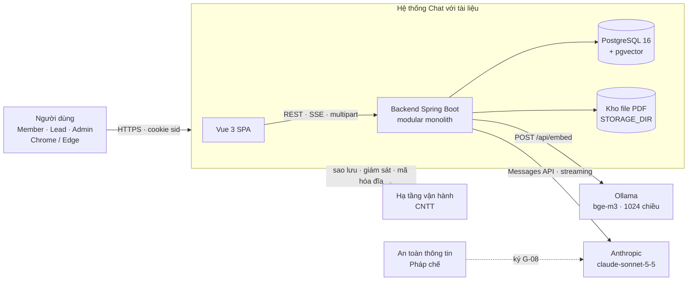
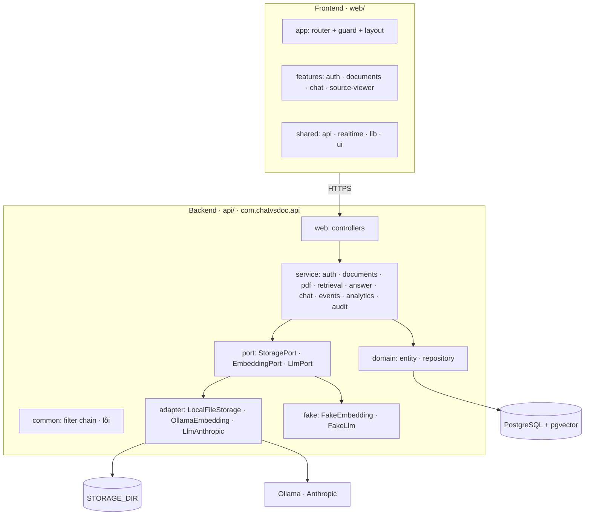
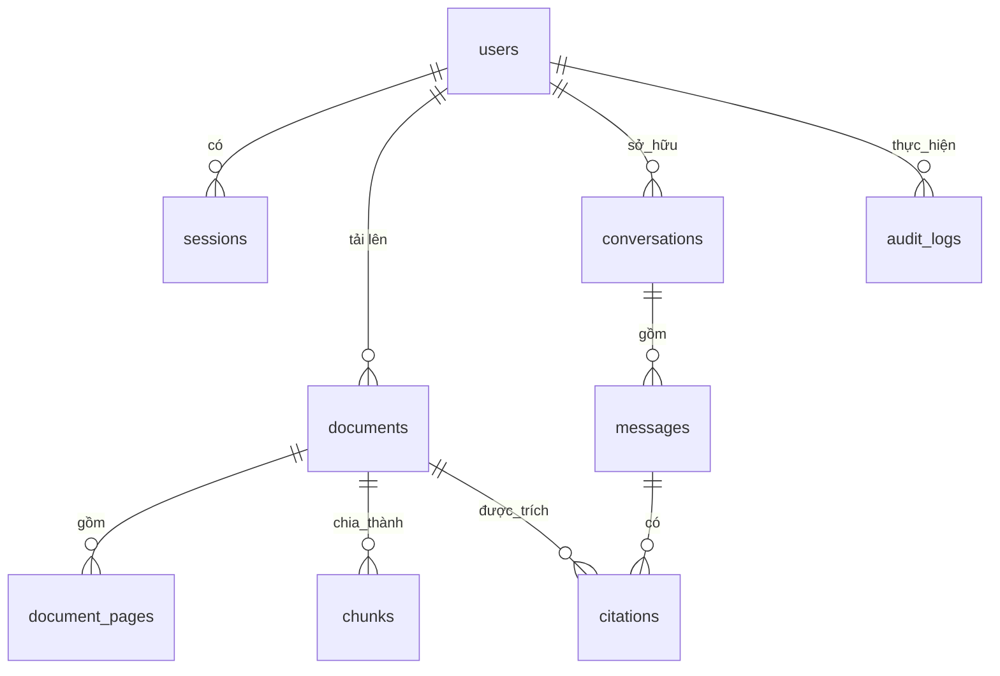
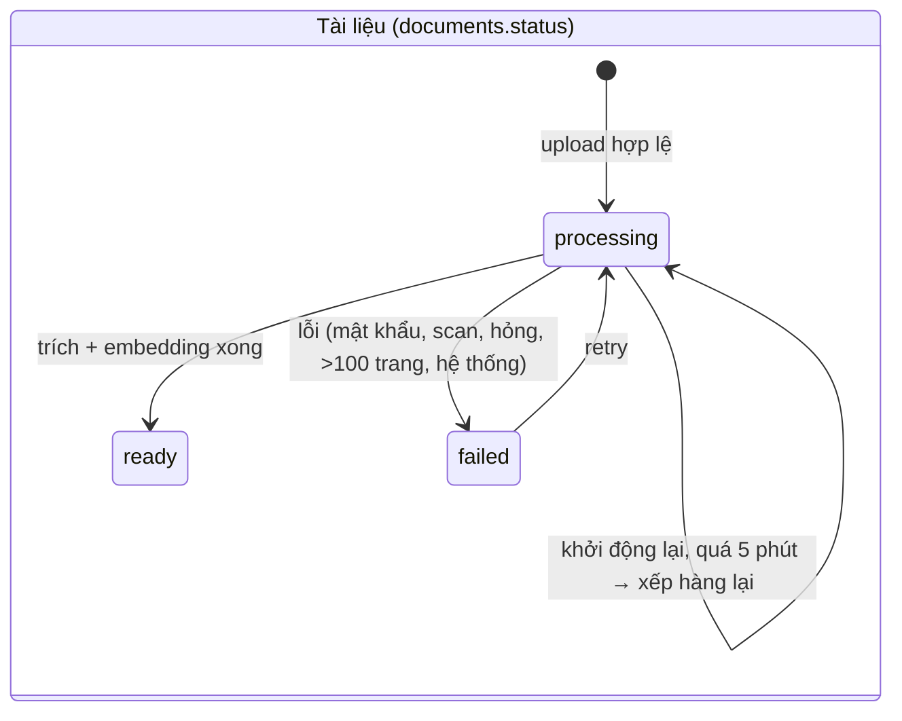
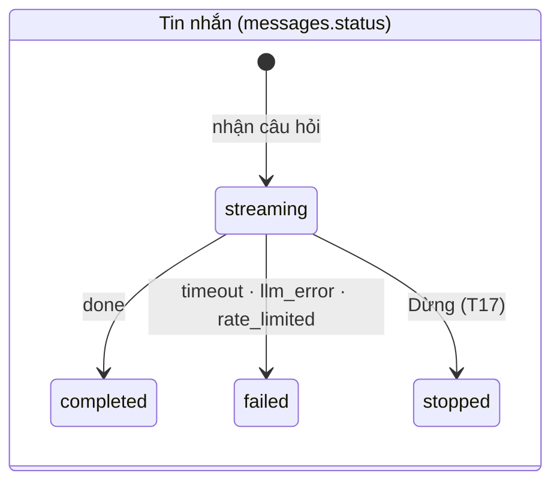
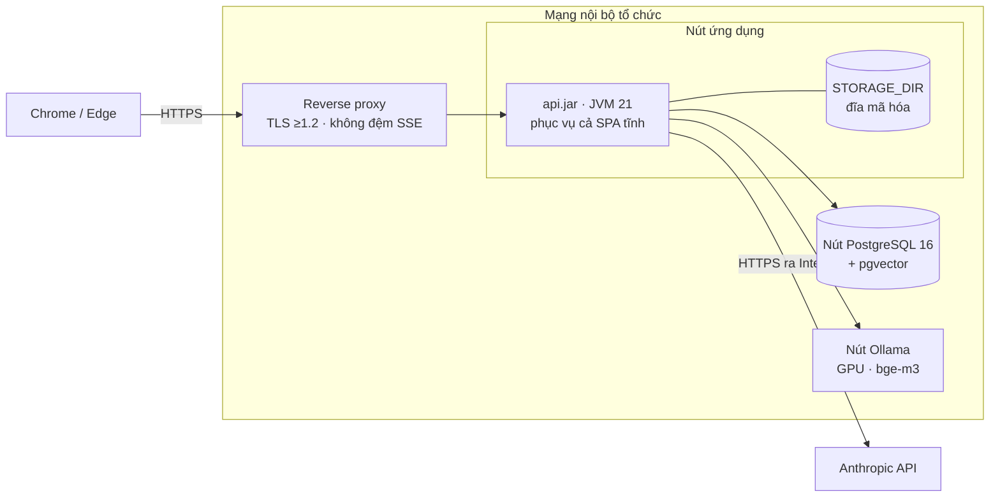

# Tài liệu Kiến trúc Phần mềm (SAD) — "Chat với tài liệu" (MVP)

> **Chuẩn áp dụng:** IEEE 1016-2009 — Software Design Descriptions (góc nhìn kiến trúc)
> **Mã tài liệu / Phiên bản:** SAD-CVD-001 / v0.1 (Draft) · **Ngày:** 2026-11-02
> **Prompt nguồn:** [SAD_Prompt_IEEE_standard.md](SAD_Prompt_IEEE_standard.md) · **Checklist:** [SAD_IEEE_1016_Checklist.xlsx](SAD_IEEE_1016_Checklist.xlsx)
> **Thượng nguồn:** [BRD](../requirements/BRD.md) · [PRD](../requirements/PRD.md) · [Implement Plan](../implement/implement_plan.md) · [Danh sách task](../implement/README.md)
> **Liên quan:** [SDD UI/UX](SDD_UIUX_Blueprint.md) (thiết kế client và hợp đồng giao tiếp; SAD này bổ sung phần **backend và hệ thống**) · [Test Plan](../test/Test_Plan.md) · [api/README](../../api/README.md)
> **Quy ước:** `[Đề xuất]` = lựa chọn của tác giả, cần Tech Lead xác nhận; `[TBD]` = chưa có thông tin; `[Đã triển khai]` = đã có trong mã (T01–T16, tính tới 2026-10-28); `[Kế hoạch]` = thuộc task chưa làm (T17–T23). ID `BR/US/AC/TH/NFR/EV/D/OQ/G/T` lấy từ BRD, PRD và danh sách task; `AD-xx` là quyết định kiến trúc ở mục 6.

---

## 0. Tóm tắt ràng buộc kỹ thuật và bối cảnh hệ thống

### 0.1 Nền tảng hệ thống

| Thuộc tính | Giá trị | Nguồn |
|---|---|---|
| Tên hệ thống | Chat với tài liệu (MVP) | BRD |
| Chức năng nghiệp vụ lõi | Người dùng đã đăng nhập tải PDF lên **một workspace chung**, hỏi bằng tiếng Việt/Anh, nhận câu trả lời streaming **có trích dẫn tên tài liệu + số trang**; không có căn cứ thì từ chối, không bịa | BR-001…BR-009, BR-012 |
| Quy mô / tải mục tiêu | Tối đa **20 tài liệu** (mỗi file ≤ 10 MB, ≤ 100 trang) ⇒ ≤ 2.000 trang; **≥ 10 người dùng đồng thời** [Đề xuất, chờ OQ-003]; ≤ 20 câu trả lời đồng thời toàn hệ thống | D-002, NFR-C01, `CHAT_MAX_CONCURRENT` |
| Mục tiêu hiệu năng | Token đầu p90 ≤ 3 s · hoàn chỉnh p90 ≤ 15 s · xử lý 100 trang p90 ≤ 60 s · LCP p75 ≤ 2 s | TH-01/02/03/08 [Đề xuất] |
| Ngăn xếp đã chốt | Java 21 + Spring Boot 3.3 + Maven; PostgreSQL 16 + pgvector; Vue 3 + TypeScript + Vite; embedding `bge-m3` (Ollama, 1024 chiều); LLM Anthropic `claude-sonnet-5-5` | Implement Plan §3, task README §3 |
| Ràng buộc bắt buộc | Ứng dụng web (CON-002) · chỉ PDF có lớp văn bản, không OCR (D-008) · chỉ gọi LLM bên ngoài khi An toàn thông tin/Pháp chế ký (D-006, G-08) · đăng nhập do Admin cấp (D-007) · Chrome/Edge ≥ 1280 px · ngân sách và thời hạn còn mở (OQ-011) | BRD §6, PRD §1.3 |

### 0.2 Tóm tắt ràng buộc kỹ thuật (điều kiện biên của thiết kế)

1. **Dữ liệu nhạy cảm ra ngoài chỉ qua một cổng.** Chỉ backend được gọi LLM/embedding; nội dung nghiệp vụ không vào log, analytics, công cụ báo lỗi (NFR-S02, S06; G-08).
2. **Kết quả LLM không xác định**, nên đúng/sai của câu trả lời được kiểm soát bằng thiết kế (chỉ đưa nguồn truy hồi vào ngữ cảnh, buộc trích dẫn, buộc từ chối) và đo bằng bộ câu hỏi chuẩn DEP-002, không chỉ bằng test đơn vị.
3. **Quy mô rất nhỏ** (20 tài liệu, một đội) ⇒ ưu tiên đơn giản vận hành hơn khả năng co giãn ngang; mọi chỗ giả định **một instance** phải được ghi rõ.
4. **Hạ tầng phụ thuộc người:** staging/production, GPU cho embedding, proxy nội bộ có đệm SSE hay không, chính sách sao lưu đều **chưa chốt** (OQ-UX-02, OQ-022, TR-02). Thiết kế phải chạy được khi các điều này thay đổi.
5. **Embedding CPU trên PC dev chậm ≈ 4 lần ngưỡng TH-03**, nên kiến trúc tách embedding sau `EmbeddingPort` để đổi máy chủ/mô hình mà không đổi nghiệp vụ.

### 0.3 Phạm vi và ranh giới kiến trúc (Context View)

**Trong ranh giới (hệ thống đang thiết kế):** SPA Vue, backend Spring Boot, CSDL PostgreSQL + pgvector, kho file PDF cục bộ, hàng đợi xử lý và bus sự kiện chạy trong tiến trình backend.
**Ngoài ranh giới (thực thể bên ngoài):** người dùng (Member, Lead, Admin), dịch vụ embedding Ollama, dịch vụ LLM Anthropic, hạ tầng mã hóa đĩa (BitLocker/LUKS), hệ thống giám sát và sao lưu, proxy/CNTT nội bộ.
**Ngoài phạm vi sản phẩm MVP:** OCR, định dạng khác PDF, đồng bộ kho tài liệu, ứng dụng di động (BR-023/024, CON-002/003).



| Dịch vụ hệ thống **cung cấp** | Dịch vụ hệ thống **cần** từ môi trường |
|---|---|
| Đăng nhập/phiên; tải lên và xử lý PDF; danh sách tài liệu theo thời gian thực; hỏi đáp streaming có trích dẫn; xem đoạn gốc `[Kế hoạch: T17/T18]`; dừng/tạo lại `[Kế hoạch: T17/T19]`; analytics và nhật ký kiểm toán | CSDL PostgreSQL 16 có pgvector và citext · thư mục lưu file bền, mã hóa đĩa · dịch vụ embedding · dịch vụ LLM đã được phê duyệt · TLS ở rìa · sao lưu · giám sát |

---

## 1. Mục tiêu kiến trúc và nguyên tắc thiết kế

### 1.1 Các động lực kiến trúc hàng đầu

| # | Động lực | Vì sao | Thiết kế ưu tiên nó như thế nào | Chỉ tiêu |
|---|---|---|---|---|
| **KD-1** | **Đáng tin cậy của câu trả lời** (có căn cứ, kiểm chứng được) | Niềm tin là trụ cột sản phẩm; bịa đặt nguy hiểm hơn không trả lời (P-3, RSK-001) | Ngữ cảnh LLM **chỉ** gồm đoạn truy hồi từ tài liệu `ready`; prompt buộc `[n]`, `NOT_FOUND`, `MISSING`; trích dẫn lưu thành bản ghi `citations` có trang + offset; câu trả lời phân loại `answered/partial/not_found`; mọi thay đổi prompt/tham số kèm đo DEP-002 | TH-04 ≥ 90%, TH-06 ≥ 90%, TH-07 ≤ 5% |
| **KD-2** | **Bảo mật và bảo vệ dữ liệu** | Tài liệu kinh doanh nhạy cảm; LLM ở ngoài (RSK-002) | LLM/embedding chỉ gọi từ backend qua port; phiên cookie HttpOnly lưu băm SHA-256 phía máy chủ; RBAC ở API; CSRF bằng header tùy biến; log không có nội dung; `audit_logs` chỉ thêm; mã hóa đĩa bởi hạ tầng | G-06, G-07, G-08, NFR-S01…S06 |
| **KD-3** | **Phản hồi nhanh khi hỏi** | Thời gian chờ là thành phần của MET-001 | Streaming SSE trên luồng ảo (virtual threads); truy hồi một truy vấn vector có chỉ mục HNSW; gộp delta ở client; giới hạn đồng thời có hàng đợi ngắn | TH-01 p90 ≤ 3 s, TH-02 p90 ≤ 15 s |
| KD-4 (phụ) | **Dễ kiểm thử và thay thế nhà cung cấp** | Nhà cung cấp AI chưa chốt chắc chắn; kết quả LLM không xác định | Port + bản giả (`FakeLlm`, `FakeEmbedding`); hợp đồng API-first (OpenAPI) có `ContractTest`; luật ranh giới FE R-1…R-6 (ESLint) | Độ phủ BE ≥ 70% (G-09) |

Khi các động lực xung đột, thứ tự ưu tiên là **KD-1 > KD-2 > KD-3 > KD-4**; không hạ ngưỡng KD-1/KD-2 để đạt KD-3 (Test Plan nguyên tắc 4).

### 1.2 Mẫu kiến trúc vĩ mô

**Chọn: monolith mô-đun (modular monolith) phân tầng, ranh giới ngoài theo Ports & Adapters, giao tiếp thời gian thực bằng SSE.**

- **Một bản triển khai backend duy nhất** (`api.jar`), chia gói theo tầng và theo năng lực: `web` (controller) → `service/*` (nghiệp vụ) → `port` (giao diện ra ngoài) → `adapter`/`fake`; `domain` (entity + repository) dùng chung. Chỉ `service` truy cập `domain`; không `service` nào gọi `adapter` cụ thể (nối ở cấu hình).
- **Ports & Adapters** cho mọi thứ ngoài tiến trình có thể đổi: `StoragePort`, `EmbeddingPort`, `LlmPort`. Mỗi adapter mới phải qua bộ test hợp đồng `*PortContract`.
- **Bất đồng bộ trong tiến trình:** `InProcessJobQueue` cho xử lý PDF, `InProcessEventBus` cho sự kiện workspace, luồng ảo cho mỗi luồng trả lời.
- **Hợp đồng API-first:** `contracts/openapi.yaml` là nguồn sự thật; FE sinh kiểu từ đó và dùng MSW trong khi BE chưa xong.

**Biện minh:**

| Lý do | Giải thích |
|---|---|
| Quy mô | ≤ 20 tài liệu, một đội, ≥ 10 người dùng đồng thời: một tiến trình dư sức; tách dịch vụ chỉ thêm chi phí vận hành và độ trễ mạng |
| Nguồn lực | 1 FE + 1 BE toàn thời gian + 1 QA bán thời gian; nhiều dịch vụ vượt khả năng vận hành |
| Giao dịch | Ghi trang + đoạn + trạng thái tài liệu trong **một giao dịch** (PdfPipeline); giữ chỗ 20 tài liệu nguyên tử bằng khóa tư vấn Postgres: dễ với một CSDL, khó với nhiều dịch vụ |
| Đường lui | Ranh giới port và `EventBus`/`JobQueue` là giao diện: khi cần nhiều instance chỉ đổi adapter (LISTEN/NOTIFY, hàng đợi trong CSDL), không đổi nghiệp vụ |
| Đổi lại | **Giả định một instance** (xem AD-02, rủi ro ở mục 6.3); không co giãn ngang; hàng đợi mất khi tiến trình dừng (được bù bằng quét lại `processing` quá 5 phút khi khởi động) |

---

## 2. Phân rã thành phần hệ thống (Composition View)



### 2.1 Lớp Frontend / Client

Thiết kế UI chi tiết (màn hình, thành phần, máy trạng thái, thuật toán ALG-01/02/03) nằm ở [SDD UI/UX](SDD_UIUX_Blueprint.md). Tóm tắt kiến trúc:

| Khía cạnh | Quyết định |
|---|---|
| Phân phối | **SPA** build tĩnh bằng Vite; **cùng origin với API** (cookie `SameSite=Strict`; dev dùng proxy Vite, production qua reverse proxy hoặc do backend phục vụ **[Đề xuất, chưa dựng]**); không SSR/CDN trong MVP; ngân sách bundle JS khởi tạo ≤ 200 KB gzip, CSS ≤ 40 KB gzip |
| Cấu trúc | `app/` (router, guard, bố cục 3 cột) · `features/<tên>/` (auth, documents, chat, source-viewer) · `shared/{api,realtime,lib,ui}` |
| Trạng thái | Pinia (trạng thái giao diện, phiên) + TanStack Query (dữ liệu máy chủ); bản nháp câu hỏi chỉ ở `sessionStorage`; **không** lưu token ở `localStorage` |
| Giao thức | REST/JSON cho lệnh và truy vấn; **`fetch` + `ReadableStream`** cho luồng trả lời (SSE qua POST); **`EventSource`** cho kênh sự kiện workspace; **XHR** cho tải lên (có tiến trình); polling dự phòng khi SSE bị proxy đệm (`VITE_POLL_FALLBACK`) |
| Hiển thị an toàn | Nội dung LLM/PDF chỉ qua `shared/lib/markdown` (markdown-it + DOMPurify); cấm `v-html`/`innerHTML` nơi khác (R-4); `pdfjs-dist` nạp lười `[Kế hoạch: T18]` (R-5) |
| Ranh giới mô-đun | R-1…R-6 do ESLint ép, có ca vi phạm kiểm thử trong `web/src/__lint_fixtures__/` |

### 2.2 Lớp Ứng dụng / Logic nghiệp vụ

| Mô-đun (`service/…`) | Trách nhiệm | Phụ thuộc chính | Trạng thái |
|---|---|---|---|
| `auth` (`AuthService`, `SessionService`, `PasswordHasher`, `PasswordPolicy`, `TokenGenerator`, `UserAdminService`) | Đăng nhập/đăng xuất, phiên cookie `sid`, khóa tạm 5 lần/15 phút, ép đổi mật khẩu tạm, tạo/vô hiệu hóa tài khoản (CLI) | domain, `audit`, `events` | Đã triển khai (T04) |
| `documents` (`DocumentService`, `LimitedCopy`, `InProcessJobQueue`, `DocumentProcessor`) | Nhận upload theo luồng, kiểm tra ràng buộc, **giữ chỗ nguyên tử ≤ 20**, xếp hàng xử lý | `StoragePort`, `JobQueue`, `events`, `audit` | Đã triển khai (T07) |
| `pdf` (`PdfPipeline`, `TextNormalizer`, `Chunker`) | Phân loại lỗi (mật khẩu, scan, hỏng, > 100 trang), trích văn bản từng trang (PDFBox), chuẩn hóa NFC, chia đoạn 800/1.000 ký tự chồng 100, embedding theo lô 32, ghi một giao dịch | `EmbeddingPort`, domain | Đã triển khai (T08) |
| `retrieval` (`Retriever`, `ChunkSearchRepository`) | Embedding câu hỏi, top-k đa tài liệu theo cosine, lọc ngưỡng, đánh số `[n]` | `EmbeddingPort`, pgvector | Đã triển khai (T12) |
| `answer` (`AnswerService`, `Prompts`, `StreamParser`, `LangDetector`) | Dựng prompt "chỉ dùng nguồn", gọi LLM streaming, tách `<<NOT_FOUND>>`/`<<MISSING>>`, ghép trích dẫn, phát hiện ngôn ngữ | `LlmPort`, `retrieval` | Đã triển khai (T13) |
| `chat` (`ChatStreamService`, `ConversationService`, `ChatViews`) | Hội thoại, điều phối một lượt hỏi-đáp, giới hạn đồng thời, hủy luồng, lưu tin nhắn + trích dẫn | `answer`, `retrieval`, `analytics` | Đã triển khai (T14); Dừng/Tạo lại `[Kế hoạch: T17]` |
| `events` (`EventService`, `InProcessEventBus`) | Sự kiện workspace qua SSE, phát lại theo `Last-Event-ID` (vòng đệm 500 sự kiện/10 phút), tối đa 3 kết nối/người | domain | Đã triển khai (T09) |
| `analytics` (`AnalyticsService`, `AnalyticsSchema`) | Ghi sự kiện EV-xxx, danh sách trắng tên/thuộc tính, không ghi nội dung | domain | Đã triển khai (T09) |
| `audit` (`AuditService`) | Ghi nhật ký kiểm toán chỉ thêm | domain | Đã triển khai |

**Tác vụ bất đồng bộ và worker:**

- **Xử lý PDF:** `InProcessJobQueue` với `PROCESSING_WORKERS` (mặc định 2), hết hạn 120 s/job, lỗi embedding thử lại 3 lần (1 s/2 s/4 s). Khi khởi động, tài liệu `processing` cũ hơn 5 phút được xếp hàng lại (`orphan-minutes`).
- **Trả lời:** mỗi lượt hỏi chạy trên luồng ảo; điều khiển bằng `Semaphore` toàn hệ thống (`CHAT_MAX_CONCURRENT`=20, công bằng), ≤ 3 luồng/người, một luồng/hội thoại (`409 ANSWER_IN_PROGRESS`); chờ hàng đợi tối đa 10 s rồi phát `error rate_limited`.
- **Chưa có:** tác vụ nền định kỳ xóa hội thoại sau 90 ngày (D-008, `[Kế hoạch]`), tóm tắt tài liệu, xóa tài liệu (US-013/014, ngoài lát cắt).

### 2.3 Lớp Hạ tầng dữ liệu

| Thành phần | Quyết định | Ghi chú |
|---|---|---|
| CSDL chính | **PostgreSQL 16** + `pgvector` (vector, HNSW cosine) + `citext` (email); một CSDL cho dữ liệu thường và vector | Đủ cho ≤ 2.000 trang (~ vài nghìn đoạn); tránh thêm kho vector riêng (AD-03) |
| Migration | Flyway, `V<n>__mo_ta.sql`, `ddl-auto: validate`; không downgrade | Hiện có V1 (khởi tạo), V2 (khóa tài khoản) |
| Kho file | `STORAGE_DIR` qua `StoragePort` (`LocalFileStorage`); khóa lưu do hệ thống sinh, chống thoát đường dẫn | Mã hóa khi lưu **do hạ tầng** (BitLocker/LUKS/đĩa cloud), để còn phục vụ `Range` (AC-060.1) |
| Bộ nhớ đệm | **Không có tầng cache** trong MVP | Truy vấn vector đã đủ nhanh ở quy mô này; thêm khi đo thấy cần |
| Message broker | **Không có**; `InProcessJobQueue` và `InProcessEventBus` trong tiến trình | Hệ quả: một instance (AD-02) |
| Lưu giữ | Phiên: hết hạn khi rảnh `SESSION_IDLE_HOURS`=8 · tài liệu: đến khi bị xóa (xóa mềm `deleted_at`; xóa vật lý trong 24 giờ theo AC-060.3 `[Kế hoạch]`) · hội thoại: 90 ngày không hoạt động `[Kế hoạch]` · `audit_logs`: ≥ 1 năm [Đề xuất] · sao lưu: hằng ngày, giữ ≥ 7 ngày [Đề xuất, OQ-022] |

### 2.4 Lớp Backend / API

**Chuỗi filter** (thứ tự cố định): `RequestIdFilter` → `SecurityHeadersFilter` → `AccessLogFilter` → `CsrfHeaderFilter` → Spring Security (xác thực phiên, `PasswordChangeRequiredFilter`, `@PreAuthorize`). Spring Security chạy **stateless**; phiên là cookie `sid` tra cứu trong bảng `sessions`.

**Quy ước chung:** tiền tố `/api`; JSON UTF-8 `snake_case`; ID UUID v4; thời gian ISO 8601 UTC; trường lạ bị từ chối (422); lỗi luôn `{"error":{"code","message_key","details"}}`; `POST/PUT/PATCH/DELETE` bắt buộc `X-Requested-With: fetch`.

| Nhóm | Endpoint | Đầu vào → Đầu ra | Lỗi chính | Task |
|---|---|---|---|---|
| Xác thực | `POST /api/auth/login`, `POST /api/auth/logout`, `GET /api/me`, `POST /api/auth/change-password` | email + mật khẩu → `CurrentUser` + cookie `sid` | `INVALID_CREDENTIALS` 401, `ACCOUNT_LOCKED` 423 (+`retry_after_s`), `ACCOUNT_DISABLED` 403, `PASSWORD_CHANGE_REQUIRED` 403 | T04 |
| Tài liệu | `GET /api/documents` · `POST /api/documents` (multipart, 1 file/yêu cầu) · `POST /api/documents/{id}/retry` | danh sách + `count`/`limit` · file → bản ghi `processing` (201); retry → 202 | `DOCUMENT_LIMIT_REACHED` 409, `FILE_TOO_LARGE` 413, `NOT_PDF` 400, `NOT_RETRYABLE` 409 | T07, T09 |
| Sự kiện | `GET /api/events` (SSE) | `Last-Event-ID` → `document.created`, `document.status_changed`, `document.deleted`, `session.revoked`, `resync`, `heartbeat` 20 s, `: ping` 10 s | — | T09 |
| Hội thoại | `GET/POST /api/conversations` · `GET /api/conversations/{id}` | → danh sách/chi tiết, **chỉ của chính người gọi** | `NOT_FOUND` 404 | T14 |
| Hỏi đáp | `POST /api/conversations/{id}/messages` (SSE) | `{question}` (1–2.000 ký tự) → luồng `meta`, `status`, `delta`, `citation`, `done`, `error` | `QUESTION_INVALID` 422, `NO_READY_DOCUMENTS` 409, `ANSWER_IN_PROGRESS` 409; trong luồng: `rate_limited`, `timeout`, `llm_error` | T14 |
| Kiểm chứng `[Kế hoạch]` | `GET /api/citations/{message_id}/{index}` · `GET /api/documents/{id}/file` (hỗ trợ `Range`) · `POST /api/messages/{id}/stop` · `POST /api/messages/{id}/regenerate` | → `{documentId, page, pageCount, highlight}`; byte-range PDF | `DOCUMENT_DELETED` 410 | T17 |
| Analytics | `POST /api/analytics/events` (lô) | chỉ EV-021/022/025/030/050 phía client | `VALIDATION_ERROR` 422 | T09 |
| Sức khỏe | `GET /healthz` (sống) `[Đã triển khai]`; `GET /readyz` (CSDL, kho file, cấu hình LLM) `[Kế hoạch: T23]` — đường dẫn đã được phép trong `SecurityConfig` nhưng chưa có controller | — | — | T03, T23 |

Hợp đồng đầy đủ: [contracts/openapi.yaml](../../contracts/openapi.yaml). Giao diện quản trị (`/api/admin/*`, báo cáo) và các endpoint xóa/tóm tắt tài liệu, phản hồi 👍/👎 thuộc ngoài lát cắt hiện tại (SDD IF-09, IF-03 mở rộng).

---

## 3. Kiến trúc dữ liệu và luồng tích hợp

### 3.1 Chiến lược mô hình dữ liệu cốt lõi

**Quan hệ, một lược đồ dùng chung** (không database-per-service vì chỉ có một dịch vụ). Dữ liệu và vector cùng CSDL để truy hồi và lọc theo trạng thái tài liệu trong **một truy vấn**.



| Bảng | Nội dung chính | Chỉ mục / ràng buộc |
|---|---|---|
| `users` | email (`citext`, duy nhất), băm Argon2id, `role` ∈ {member, lead, admin}, `status`, cờ `must_change_password`, bộ đếm sai/khóa | — |
| `sessions` | băm SHA-256 của token 256 bit, `last_seen_at` (ghi ≤ 1 lần/phút) | `sessions_user_id_idx` |
| `documents` | tên, kích thước, số trang, `status` ∈ {processing, ready, failed}, mã lỗi, `unreadable_pages`, `uploaded_by`, `deleted_at` | `documents_active_idx` (một phần, `deleted_at IS NULL`) |
| `document_pages` | văn bản từng trang | — |
| `chunks` | `document_id`, `page`, `char_start/char_end`, `text`, `embedding vector(1024)` | **HNSW** `vector_cosine_ops`; `chunks_document_id_idx` |
| `conversations` | `user_id`, `last_activity_at` | `(user_id, last_activity_at DESC)` |
| `messages` | câu hỏi, câu trả lời, `answer_type` ∈ {answered, partial, not_found}, `status` ∈ {streaming, completed, stopped, failed}, token vào/ra | `(conversation_id, created_at)` |
| `citations` | `message_id`, chỉ số `[n]`, `document_id`, `page`, vị trí đoạn | `citations_document_id_idx` |
| `audit_logs` | thời điểm, người thực hiện, loại, đối tượng, kết quả | **chỉ thêm**: trigger chặn UPDATE/DELETE/TRUNCATE, quyền UPDATE/DELETE bị thu hồi |
| `events` | tên + thuộc tính sự kiện analytics (không nội dung) | `(ts)`, `(name, ts)` |

**Nguyên tắc dữ liệu:** (1) cô lập hội thoại theo `user_id` ở mọi truy vấn; (2) tài liệu thuộc workspace, không thuộc cá nhân (D-001); (3) enum PostgreSQL ánh xạ `@Enumerated(STRING)`; (4) `EMBEDDING_DIM` cố định từ V1, đổi phải tạo lại cột và tính lại toàn bộ vector; (5) tìm email phải ép `CAST(:email AS citext)`.

### 3.2 Luồng dữ liệu và tương tác (Interaction View)

#### 3.2.1 Luồng A — Tải lên và xử lý tài liệu

```mermaid
sequenceDiagram
  autonumber
  participant B as Trình duyệt (SPA)
  participant A as API (DocumentService)
  participant FS as StoragePort
  participant DB as PostgreSQL
  participant Q as JobQueue (2 worker)
  participant P as PdfPipeline
  participant E as EmbeddingPort (Ollama)
  participant EV as EventBus
  B->>B: ALG-02: đuôi + %PDF- + ≤10MB + còn chỗ
  B->>A: POST /api/documents (multipart, X-Requested-With)
  A->>A: đọc theo luồng, dừng khi vượt MAX_FILE_MB
  A->>DB: BEGIN; pg_advisory_xact_lock; đếm; INSERT documents(processing); COMMIT
  A->>FS: lưu file (khóa do hệ thống sinh)
  A->>Q: enqueue(documentId)
  A-->>B: 202 + bản ghi processing
  A->>EV: document.created
  Q->>P: xử lý (timeout 120 s)
  P->>FS: đọc file
  P->>P: đếm trang; phát hiện mật khẩu/scan/hỏng/>100 trang; trích từng trang; chuẩn hóa NFC; chia đoạn
  P->>E: embedding theo lô 32 (thử lại 1/2/4 s)
  P->>DB: một giao dịch: pages + chunks + status=ready|failed
  P->>EV: document.status_changed
  EV-->>B: SSE /api/events (≤ 5 s tới mọi phiên)
```

Điểm thiết kế: kiểm tra giới hạn 20 tài liệu **ở máy chủ, nguyên tử** (hai người cùng tải khi còn một chỗ: một người thắng); lỗi từng loại ánh xạ mã `TOO_MANY_PAGES`, `PASSWORD_PROTECTED`, `SCANNED_PDF`, `CORRUPTED`, `SYSTEM_ERROR`; một phần trang scan → `ready` kèm `unreadable_pages`.

#### 3.2.2 Luồng B — Hỏi đáp có trích dẫn (luồng quan trọng nhất)

```mermaid
sequenceDiagram
  autonumber
  participant B as Trình duyệt
  participant C as ChatStreamService
  participant R as Retriever
  participant E as EmbeddingPort
  participant DB as PostgreSQL
  participant An as AnswerService
  participant L as LlmPort (Anthropic)
  B->>C: POST /api/conversations/{id}/messages {question}
  C->>C: xác thực; 1 luồng/hội thoại; ≤3/người; Semaphore toàn hệ thống (chờ ≤10 s)
  C-->>B: SSE meta {message_id}
  C-->>B: SSE status "Đang tìm trong tài liệu…"
  C->>R: tìm top-k
  R->>E: embedding(câu hỏi)
  R->>DB: SELECT … ORDER BY embedding <=> q LIMIT 8 (chỉ tài liệu ready, chưa xóa)
  R->>R: lọc score ≥ 0.30; đánh số n=1..k
  alt không đoạn nào đạt ngưỡng
    C-->>B: done {answer_type: not_found}
  else có ngữ cảnh
    C->>An: prompt (system "chỉ dùng <source>", ngôn ngữ theo câu hỏi)
    An->>L: Messages API streaming (không gửi temperature/top_p/top_k)
    L-->>An: token
    An->>An: StreamParser: tách [n], <<NOT_FOUND>>, <<MISSING>>
    An-->>B: SSE delta* (+ citation khi [n] hợp lệ)
    An->>DB: INSERT messages, citations (answer_type, token)
    C-->>B: done {answer_type, citations}
  end
```

Xử lý ngoại lệ: không có token đầu sau `LLM_FIRST_TOKEN_TIMEOUT_S` (30 s) hoặc im lặng quá `STREAM_STALL_SECONDS` → `error timeout`; LLM lỗi/hết hạn mức → `error llm_error`; client ngắt → hủy luồng LLM (`ClientGone`); mọi luồng kết thúc đúng một `done` hoặc `error`.

#### 3.2.3 Luồng C — Đồng bộ thời gian thực

Mỗi phiên trình duyệt giữ một kết nối `GET /api/events` (tối đa 3/người). Sự kiện có ID tăng dần; khi nối lại với `Last-Event-ID`, máy chủ phát lại từ vòng đệm 500 sự kiện/10 phút, nếu không đủ thì phát `resync` để client tải lại danh sách. `session.revoked` được phát khi Admin vô hiệu hóa tài khoản để đăng xuất ≤ 60 s (AC-003.1).

### 3.3 Máy trạng thái toàn cục (State Dynamics View)

Trạng thái giao diện (ST-01…ST-04) ở [SDD §3.7](SDD_UIUX_Blueprint.md). Trạng thái **phía máy chủ**:





Kết quả nội dung của tin nhắn hoàn tất là `answer_type` ∈ {`answered`, `partial`, `not_found`}. **Phiên/tài khoản:** `active` → (5 lần sai/15 phút) khóa 15 phút → `active`; `active` → `disabled` (xóa mọi phiên, phát `session.revoked`); `must_change_password` chặn mọi `/api/**` trừ `/api/me`, đăng xuất, đổi mật khẩu.

---

## 4. Các mối quan tâm xuyên suốt và hạ tầng

### 4.1 Bảo mật và tuân thủ

| Vùng | Cơ chế | Tham chiếu |
|---|---|---|
| Xác thực | Email + mật khẩu do Admin cấp (không tự đăng ký); băm **Argon2id**; chống dò email bằng băm giả khi sai email; chính sách mật khẩu ≥ 10 ký tự có chữ và số; khóa 15 phút sau 5 lần sai (đếm nguyên tử bằng SQL) | D-007, AC-001.x, NFR-S03 |
| Phiên | Cookie `sid` `HttpOnly; Secure; SameSite=Strict; Path=/`, token 256 bit, CSDL chỉ lưu SHA-256; hết hạn khi rảnh 8 giờ; thu hồi phía máy chủ | AD-05, AC-003.1 |
| Phân quyền | RBAC `ROLE_MEMBER/LEAD/ADMIN` bằng `@PreAuthorize` ở API (không chỉ UI); mọi truy vấn hội thoại lọc theo `user_id`; Admin **không** có đường đọc hội thoại người khác | NFR-S04, BR-016, G-07 |
| CSRF / XSS | Header `X-Requested-With: fetch` bắt buộc cho phương thức ghi (thiếu → 403); `SameSite=Strict`; `SecurityHeadersFilter`; nội dung LLM/PDF coi là không tin cậy, render qua markdown + DOMPurify | NFR-S05, R-4 |
| Prompt injection | Văn bản nguồn được thoát (`& < > "`) và đặt trong thẻ `<source>`; quy tắc 6 của prompt: nội dung nguồn là dữ liệu, không phải chỉ thị; kiểm thử ≥ 10 ca + nhóm `injection` của DEP-002 | NFR-S05 |
| Mã hóa khi truyền | TLS ≥ 1.2 **kết thúc ở rìa** (reverse proxy/CNTT); cờ `Secure` của cookie bật mặc định; backend → Ollama/Anthropic qua HTTPS (Ollama cùng mạng nội bộ) | AC-060.1, `SESSION_COOKIE_SECURE` |
| Mã hóa khi lưu | PDF gốc: mã hóa đĩa do hạ tầng; CSDL: mã hóa đĩa/volume của máy chủ CSDL `[TBD: hạ tầng]`; mật khẩu băm có salt | AC-060.1 |
| Dữ liệu ra ngoài | Chỉ đoạn truy hồi (không cả tài liệu) và câu hỏi gửi tới LLM; nhà cung cấp phải cam kết không lưu giữ/không huấn luyện; **không gửi PDF thật** trước khi ATTT/Pháp chế ký (G-08) | D-006, CON-005 |
| Bí mật | Biến môi trường (`LLM_API_KEY`, `DB_PASSWORD`); `.env` không commit; khóa API riêng cho kiểm thử có hạn mức ngày; chưa có kho bí mật chuyên dụng `[TBD: OQ vận hành]` | AD-09 |
| Nhật ký kiểm toán | `audit_logs` chỉ thêm (trigger + thu hồi quyền): đăng nhập, tạo/vô hiệu hóa tài khoản, tải lên/xóa tài liệu | US-061, AC-061.x |
| Chuỗi cung ứng | `npm audit` và OWASP dependency-check trong CI (cảnh báo); quét gitleaks trong T22 | G-06 |

### 4.2 Độ tin cậy và chịu lỗi

| Rủi ro | Chiến lược | Chỗ thực hiện |
|---|---|---|
| LLM chậm/treo | Hạn chót token đầu 30 s; phát hiện im lặng; kết thúc bằng `error timeout` có nút Thử lại | `LLM_FIRST_TOKEN_TIMEOUT_S`, `STREAM_STALL_SECONDS` |
| LLM lỗi/hết hạn mức | Phân loại `llm_error`; thông điệp không lộ chi tiết kỹ thuật; ghi EV-024; ngưỡng rollback: lỗi trả lời > 10%/giờ | PRD §5.2, §6.1 |
| Quá tải | Giới hạn đồng thời: 20 toàn hệ thống (Semaphore công bằng), 3/người, 1/hội thoại; chờ tối đa 10 s rồi `rate_limited` (không thêm mã HTTP mới) | `ChatStreamService` |
| Embedding lỗi | Thử lại 3 lần, giãn cách 1/2/4 s theo lô; hết lần → `failed` (`SYSTEM_ERROR`) có nút Thử lại | `PdfPipeline` |
| Mất tiến trình khi đang xử lý | Ghi trang + đoạn + trạng thái **một giao dịch** (không để trạng thái nửa vời); quét lại `processing` > 5 phút khi khởi động | `InProcessJobQueue` |
| Tranh chấp tài nguyên | Khóa tư vấn `pg_advisory_xact_lock` cho giới hạn 20; kiểm thử chạy đua 20 vòng × 5 yêu cầu | `DocumentService` |
| SSE bị ngắt/đệm | `Last-Event-ID` + vòng đệm; heartbeat 20 s + ping 10 s; `resync`; polling dự phòng ở client | `EventService`, T11 |
| Upload lớn / lạm dụng | Đọc theo luồng, dừng ở `MAX_FILE_MB`; Tomcat nuốt phần dư ≤ 12 MB để client nhận 413 | `server.tomcat.max-swallow-size` |
| Khả dụng | Mục tiêu ≥ 99%/tháng giờ làm việc (NFR-A01); **một instance, không HA** (chấp nhận trong MVP); đường lui: sao lưu hằng ngày + rollback có diễn tập `[Kế hoạch: T23]`; RTO/RPO `[TBD: OQ-022]` | AD-02 |
| Không có circuit breaker riêng | Giới hạn đồng thời + hạn chót đóng vai trò bảo vệ; thêm circuit breaker khi nhiều instance hoặc khi đo thấy cần `[Đề xuất]` | — |

### 4.3 Khả năng quan sát

| Trụ cột | Thiết kế | Ràng buộc |
|---|---|---|
| Log | JSON (logstash-logback-encoder), mỗi dòng có `request_id`; log truy cập chỉ gồm method, **route (không query string)**, status, `duration_ms` | **Không bao giờ** log body hay nội dung nghiệp vụ (S-10) |
| Metrics | Sự kiện analytics EV-020…EV-024 đo `ttft_ms`, `total_ms`, `answer_type`, token vào/ra (chi phí LLM, RSK-007); báo cáo tuần tính từ bảng `events` `[Kế hoạch: US-050]` | Danh sách trắng `AnalyticsSchema`, không chứa nội dung |
| Sức khỏe | `/healthz` (sống); `/readyz` (CSDL + kho file + cấu hình LLM) `[Kế hoạch: T23]`; Actuator chỉ mở `health` | — |
| Cảnh báo | Tỷ lệ lỗi trả lời > 10%/giờ · TTFT p90 > 3 s kéo dài 15 phút · hàng đợi kẹt > 10 phút · 5xx > 2% · đĩa/CSDL gần đầy · tài liệu `processing` > 5 phút · chi phí LLM vượt ngày `[Kế hoạch: T23]` | NFR-O01, G-13 |
| Truy vết phân tán | **Không cần** (một tiến trình); `request_id` xuyên log, header phản hồi; SDK ngoài (Ollama/Anthropic) ghi thời gian gọi | — |
| Giám sát lỗi FE | Công cụ báo lỗi FE `[TBD]`; phải kiểm chứng không chứa nội dung | G-13 |

---

## 5. Khung nhìn phụ thuộc, tài nguyên và triển khai

### 5.1 Khung nhìn phụ thuộc (Dependency View)

| Phần tử | Phụ thuộc vào | Loại | Ghi chú |
|---|---|---|---|
| `web` (controller) | `service`, `common` | Nội bộ | Không truy cập `domain` trực tiếp |
| `service/chat` | `answer`, `retrieval`, `analytics`, `events` | Nội bộ | Điều phối một lượt hỏi-đáp |
| `service/answer` | `LlmPort` | Port | Không biết nhà cung cấp |
| `service/retrieval`, `service/pdf` | `EmbeddingPort`, pgvector | Port + CSDL | |
| `service/documents` | `StoragePort`, `JobQueue`, `events` | Port | |
| `port/adapter/*` | HTTP client tới Ollama/Anthropic; hệ thống file | Ngoài | Chọn bằng `EMBEDDING_PROVIDER`/`LLM_PROVIDER` |
| `domain` | Hibernate/JPA, JDBC, PGvector, Flyway | Thư viện | |
| Bản dựng BE | Spring Boot 3.3, PDFBox, commons-fileupload2, Argon2 (BouncyCastle), logstash-logback-encoder, springdoc; test: JUnit 5, Testcontainers ≥ 1.21.4 | Thư viện | Danh sách đầy đủ ở `api/pom.xml` |
| `web/` | Vue 3, Pinia, Vue Router, TanStack Query, Reka UI, Tailwind, `pdfjs-dist`, `markdown-it`, DOMPurify, vue-i18n; test: Vitest, MSW, Playwright, axe-core | Thư viện | `web/package.json` |
| Môi trường chạy | JDK 21; PostgreSQL 16 + pgvector (+ citext); Ollama chạy `bge-m3`; truy cập Internet tới Anthropic | Hạ tầng | |

**Quy tắc phụ thuộc** (FE do ESLint R-1…R-6 ép; **BE hiện chưa có công cụ ép tự động**: Test Plan §3.1 dự kiến ArchUnit nhưng chưa có trong `pom.xml`, nên đây là việc cần làm): không vòng; `service` không phụ thuộc `adapter`; chỉ `shared/api` gọi `fetch`; `shared/*` không import `features/*`.

### 5.2 Khung nhìn tài nguyên (Resource View)

| Thành phần | Tài nguyên | Cơ sở / [Đề xuất] |
|---|---|---|
| Backend (1 tiến trình JVM 21) | 2 vCPU · 2–4 GB RAM · luồng ảo cho I/O; 2 worker xử lý PDF | Tải nhẹ: ≤ 20 luồng trả lời đồng thời chủ yếu chờ I/O; PDFBox trong bộ nhớ theo từng file ≤ 10 MB |
| PostgreSQL + pgvector | 2 vCPU · 4 GB RAM · ≈ 1–5 GB đĩa | ≤ 2.000 trang ≈ vài nghìn đoạn × vector 1024 chiều (4 KB/vector) + chỉ mục HNSW: dưới vài trăm MB; dư địa lớn |
| Kho file PDF | ≥ 20 × 10 MB = 200 MB (+ dự phòng) | Trên ổ mã hóa; sao lưu hằng ngày |
| Embedding `bge-m3` (Ollama) | **GPU hoặc cấu hình tương đương cho staging/production**; CPU PC dev chậm ≈ 4 lần ngưỡng TH-03 | TR-02, Test Plan §5.1; **chưa chốt** (Phụ lục B-3 Test Plan) |
| LLM Anthropic | Phụ thuộc hạn mức và độ trễ nhà cung cấp; ngân sách token theo ngày | NFR-O01, RSK-007 |
| Mạng | SSE giữ kết nối lâu mỗi phiên (≥ 10 phiên × (1 kênh sự kiện + 1 luồng trả lời)); upload ≤ 10 MB/file | Proxy phải không đệm SSE (OQ-UX-02) |
| Trình duyệt | Bundle khởi tạo ≤ 200 KB JS gzip; `pdfjs-dist` nạp lười | TH-08 |

### 5.3 Ánh xạ vật lý / thực thi (Physical/Execution Mapping)

| Môi trường | Nút và thành phần | Cấu hình LLM / Embedding | Trạng thái |
|---|---|---|---|
| **Dev (PC của đội)** | Vite dev server (`:5173`, proxy `/api`) · `api` chạy `spring-boot:run` (`:8080`) · Docker: `pgvector/pgvector:pg16` (`ops/docker-compose.yml`, DB `chatdoc`) · Ollama cục bộ (tùy chọn) | Mặc định `LLM_PROVIDER=fake`; `EMBEDDING_PROVIDER=ollama` hoặc `fake` | Đã có |
| **CI (GitHub Actions, Ubuntu)** | job `web` (lint, typecheck, test, build, size, `gen:api` không đổi), `api` (`./mvnw verify` + Testcontainers), `contract` (Redocly lint), `dependency-check` (cảnh báo) | Fake | Đã có |
| **E2E xác định** | `ops/docker-compose.e2e.yml`: PostgreSQL + API (profile `e2e`) + web build; hiện E2E chạy với `dev:mock` | Fake, `STREAM_STALL_SECONDS=3` | Một phần `[Kế hoạch: T21]` |
| **Staging** | **Giống production**: 1 nút ứng dụng (JVM) + 1 PostgreSQL + thư mục file mã hóa + Ollama (GPU) + reverse proxy TLS | `bge-m3` thật + `claude-sonnet-5-5` thật | `[Kế hoạch]` `[TBD: OQ-011, CNTT]` |
| **Production** | Như staging; HA/DR ngoài MVP | Như staging | `[Kế hoạch]` `[TBD]` |



Ghi chú: sơ đồ triển khai staging/production là **thiết kế mục tiêu [Đề xuất]**; chưa có runbook/IaC (`ops/runbook.md` thuộc T23). Cho tới khi chốt, chỉ Dev và CI là môi trường đã tồn tại.

---

## 6. Lý do thiết kế (Design Rationale)

### 6.1 Quyết định kiến trúc

| ID | Quyết định | Lý do | Động lực / yêu cầu |
|---|---|---|---|
| **AD-01** | Monolith mô-đun + Ports & Adapters | Quy mô nhỏ, giao dịch đơn giản, đội nhỏ; ranh giới port giữ đường lui | KD-4, CON-001, NFR-C01 |
| **AD-02** | Hàng đợi xử lý PDF và event bus **trong tiến trình**, một instance | Không thêm broker; đủ cho 20 tài liệu; đổi sang LISTEN/NOTIFY sau giao diện khi cần | KD-3, CON-001 |
| **AD-03** | PostgreSQL 16 + **pgvector** (HNSW, cosine) trong cùng CSDL, không kho vector riêng | Một dịch vụ để vận hành; truy hồi và lọc `status='ready'` trong một truy vấn; thừa sức cho vài nghìn đoạn | KD-1, KD-3, TH-01 |
| **AD-04** | **SSE** (không WebSocket) cho trả lời và sự kiện workspace; trả lời bằng `fetch` + `ReadableStream` qua POST | Luồng một chiều server → client, chạy trên HTTP thường, tự nối lại; POST mang được thân câu hỏi | KD-3 (SDD DD-01) |
| **AD-05** | **Phiên cookie HttpOnly** lưu băm phía máy chủ, không JWT | Thu hồi tức thì khi vô hiệu hóa (≤ 60 s); chống đánh cắp token qua XSS | KD-2, AC-003.1 (SDD DD-03) |
| **AD-06** | Nhà cung cấp AI sau port: embedding `bge-m3` (Ollama) + LLM `claude-sonnet-5-5`; bản giả cho dev/test | Đa ngôn ngữ Việt/Anh 1024 chiều; chạy nội bộ không gửi tài liệu ra ngoài ở bước embedding; LLM chốt 2026-10-26; test lặp lại được | KD-1, KD-2, KD-4, D-005, D-006 |
| **AD-07** | **Truy hồi trước, sinh sau (RAG)**, prompt buộc `[n]`/`NOT_FOUND`/`MISSING`, ngưỡng `RETRIEVAL_MIN_SCORE`=0.30, `TOP_K`=8 | Ép câu trả lời có căn cứ; tham số điều chỉnh bằng đo DEP-002 | KD-1, TH-04/06/07 |
| **AD-08** | Văn bản trích **từng trang**, lưu trang + offset ký tự trong `chunks`; không OCR | Cần số trang để trích dẫn và vị trí để nổi bật; D-008 | BR-008, BR-022, D-008 |
| **AD-09** | Mã hóa khi lưu **do hạ tầng** (BitLocker/LUKS), không mã hóa tầng ứng dụng | Còn phục vụ `Range` cho xem PDF; tránh tự quản lý khóa | KD-2, AC-060.1 |
| **AD-10** | **Hợp đồng API-first** (`openapi.yaml`) + MSW cho FE + `ContractTest` | FE không chờ BE; hợp đồng là test | KD-4 |
| **AD-11** | Spring Boot 3.3 trên **luồng ảo** (Java 21), `SseEmitter` | Nhiều luồng chờ I/O dài (SSE, LLM) mà không cần mô hình reactive | KD-3 |
| **AD-12** | Giới hạn đồng thời trả lời bằng `Semaphore` + hàng đợi chờ ≤ 10 s, không thêm mã HTTP | Bảo vệ chi phí và độ trễ LLM; giữ hợp đồng lỗi đơn giản | KD-3, RSK-007 |
| **AD-13** | Flyway, `ddl-auto: validate`, không downgrade; `EMBEDDING_DIM` cố định từ V1 | Lược đồ có kiểm soát; tránh trôi lược đồ | KD-4 |

### 6.2 Các phương án đã cân nhắc và bị loại

| Quyết định liên quan | Phương án bị loại | Lý do kỹ thuật |
|---|---|---|
| AD-01 | **Microservices** (dịch vụ tải lên/xử lý, hỏi đáp, xác thực riêng) | Chi phí vận hành, độ trễ mạng, mất giao dịch đơn (giữ chỗ 20, ghi trang + đoạn); vượt khả năng 1 FE + 1 BE |
| AD-01 | **Serverless/hàm** cho xử lý PDF | Giữ kết nối SSE dài, PDFBox nặng bộ nhớ, tách trạng thái; không cần co giãn ở quy mô này |
| AD-02 | **Message broker** (RabbitMQ/Kafka/Redis) | Thêm dịch vụ cần vận hành; thông lượng 20 tài liệu không cần; có đường lui qua LISTEN/NOTIFY |
| AD-03 | **Kho vector riêng** (Qdrant/Milvus/Elastic) | Thêm dịch vụ và đồng bộ hai nơi; không tận dụng được lọc quan hệ trong một truy vấn; không cần ở vài nghìn đoạn |
| AD-03 | **Tìm kiếm từ khóa/BM25 thuần** | Không bắt được diễn đạt khác từ (nỗi đau P-1) và hỏi chéo ngôn ngữ (AC-024.2) |
| AD-04 | **WebSocket** | Cần hai chiều không có ở đây; khó qua một số proxy; phức tạp hơn; (SSE tự nối lại, `Last-Event-ID`) |
| AD-04 | **Polling** làm cơ chế chính | Độ trễ và tải; chỉ giữ làm dự phòng khi proxy đệm SSE |
| AD-05 | **JWT trong `localStorage`** | Dễ bị đánh cắp qua XSS; thu hồi chậm; tăng bề mặt tấn công |
| AD-05 | **SSO/OAuth2/OIDC** | Chưa có IdP được chốt, ngoài MVP (D-007: email + mật khẩu do Admin cấp); phiên cookie đủ |
| AD-06 | **Embedding qua dịch vụ đám mây** (OpenAI, v.v.) | Gửi nội dung tài liệu ra ngoài ở cả bước nhúng, nặng thêm G-08; `bge-m3` cục bộ tránh việc đó |
| AD-06 | **LLM tự lưu trữ nội bộ** làm mặc định | Chi phí hạ tầng và chất lượng tiếng Việt chưa đảm bảo; giữ làm phương án dự phòng nếu G-08 không được ký (TR-04) |
| AD-08 | **OCR** cho PDF scan | Ngoài phạm vi (D-008); đánh giá lại theo tỷ lệ từ chối `scanned_pdf` (ASM-001, > 20%) |
| AD-09 | **Mã hóa tầng ứng dụng** | Làm hỏng `Range` cho xem PDF, thêm quản lý khóa |
| AD-11 | **Spring WebFlux (reactive)** | Độ phức tạp cao, khó kiểm thử; luồng ảo cho cùng lợi ích |
| Nhiều | **Cache tầng (Redis)** | Không có nút thắt đã đo; thêm dịch vụ |

### 6.3 Rủi ro kiến trúc còn lại

| Rủi ro | Hệ quả | Giảm thiểu |
|---|---|---|
| Một instance, hàng đợi trong tiến trình | Dừng tiến trình = mất job đang chờ; không HA | Quét lại `processing` > 5 phút; sao lưu + rollback (T23); thiết kế giao diện sẵn để đổi |
| Embedding CPU quá chậm | Không đạt TH-03 | Staging có GPU (TR-02); không kết luận từ PC dev |
| Proxy đệm SSE | Streaming giật, TTFT sai | Kiểm sớm trên staging (OQ-UX-02); heartbeat; polling dự phòng |
| LLM không xác định | Đo AI dao động | Chạy lặp ≥ 3 lần; cố định phiên bản prompt/`TOP_K`/`MIN_SCORE` (TR-03) |
| Vị trí đoạn trích (OQ-UX-01) | AC-030.1 "nổi bật" hạ xuống tìm chuỗi phía client | `chunks` đã lưu `char_start/char_end`; chốt khi làm T17/T18 |

### 6.4 Truy vết quyết định ← yêu cầu / động lực

| Quyết định | Động lực | Yêu cầu (BRD/PRD) | Kiểm chứng |
|---|---|---|---|
| AD-01, AD-02, AD-11, AD-12 | KD-3, KD-4 | NFR-C01, TH-01/02/03, CON-001 | Thử tải L-1…L-5 (G-05) |
| AD-03, AD-07, AD-08 | KD-1 | BR-007, BR-008, BR-009, TH-04/05/06/07 | DEP-002 (G-04); `RetrieverIT` |
| AD-05, AD-09 | KD-2 | BR-015, BR-016, BR-017, NFR-S01…S04, AC-003.1, AC-060.1 | S-01…S-13, OWASP (G-06/G-07); `AuthControllerIT` |
| AD-06 | KD-1, KD-2, KD-4 | D-005, D-006, NFR-S06 | `*PortContract`; ký G-08 |
| AD-04 | KD-3 | AC-011.2, AC-020.1, AC-003.1 | `EventsControllerIT`; E2E hai phiên |
| AD-10, AD-13 | KD-4 | G-09 | `ContractTest`, `MigrationTest`, CI |
| Prompt chống injection | KD-1, KD-2 | NFR-S05 | `AnswerServiceTest`; ca `injection` DEP-002 |

---

## 7. Câu hỏi mở và việc cần làm

| ID | Nội dung | Chặn | Chủ sở hữu |
|---|---|---|---|
| OQ-UX-01 | Backend có trả vị trí đoạn trích không (đã lưu offset; cần xác nhận cách trả ở `GET /citations`) | T17, T18, AC-030.1 | Tech Lead |
| OQ-UX-02 | Proxy nội bộ có đệm SSE không | Streaming, TH-01 | CNTT |
| OQ-016 | Xác nhận AI **không** dùng kiến thức ngoài tài liệu (SAD đang giả định "không") | AC-023.2 | Quản lý |
| OQ-011 | Ngân sách, thời hạn, chi phí LLM | Kích thước staging/production | Quản lý |
| OQ-022 | Chính sách sao lưu, RTO/RPO | Mục 4.2, 5.3 | ATTT |
| — | Cấu hình staging/production (GPU, nút, proxy, bí mật) và kho bí mật | Mục 5.2, 5.3, G-05, G-13 | Tech Lead, CNTT |
| — | Xóa tài liệu vật lý trong 24 giờ, xóa hội thoại sau 90 ngày, báo cáo tuần, giao diện Admin (US-002/003, US-050, US-061: P0 ngoài lát cắt) | Launch | Tech Lead, PO |
| — | Giám sát lỗi FE và công cụ cảnh báo | G-13 | Tech Lead |

**Điều kiện baseline SAD v1.0:** Tech Lead rà soát và xác nhận các mục `[Đề xuất]` (mục 5.2, 5.3, 4.2 phần khả dụng); chốt các câu hỏi mở chặn T17/T18; cập nhật mục 5 khi staging/production đã dựng.

## Lịch sử phiên bản

| Phiên bản | Ngày | Tác giả | Tóm tắt |
|---|---|---|---|
| 0.1 | 2026-11-02 | nguoidinguocgio (soạn với Claude) | Bản nháp đầu: bổ sung kiến trúc backend và hệ thống theo IEEE 1016, đối chiếu mã nguồn T01–T16 |
