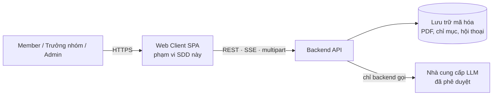
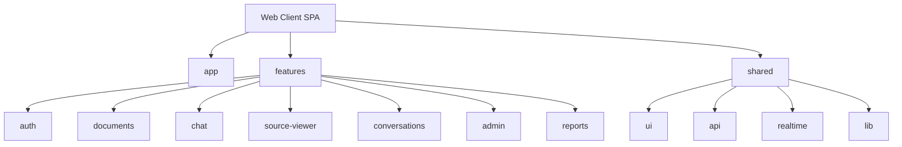
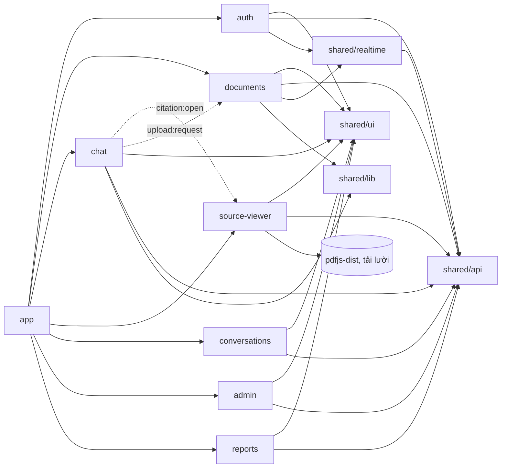
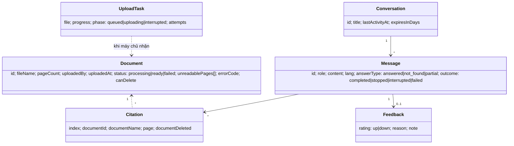
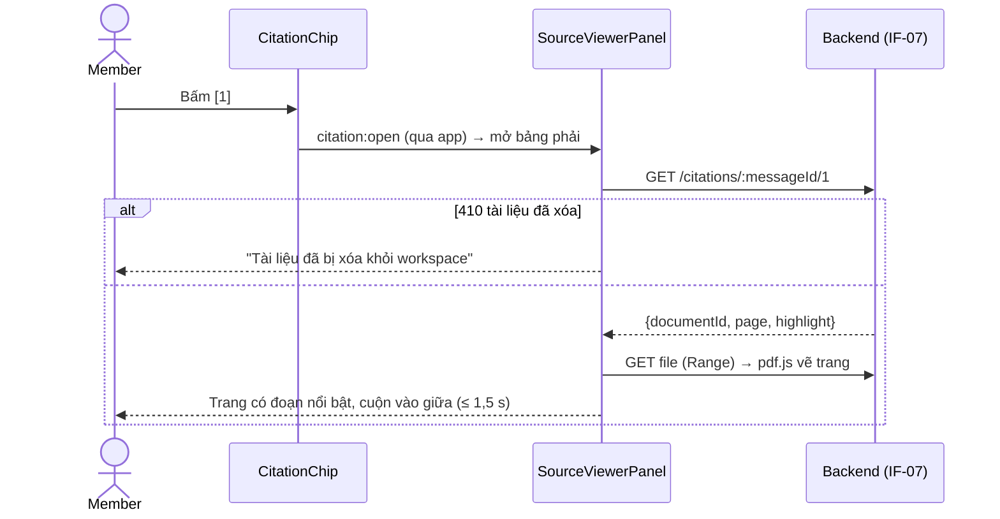
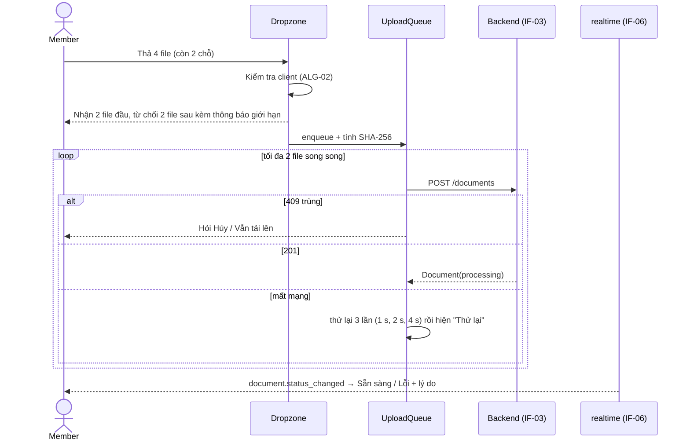
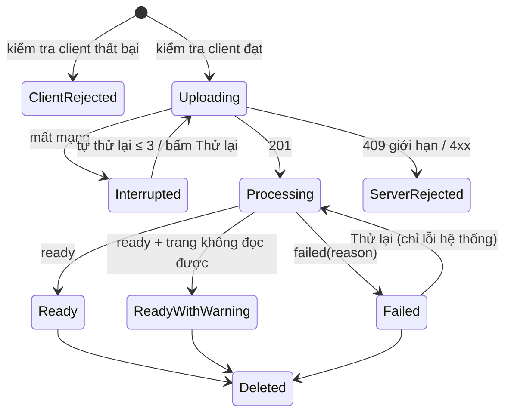
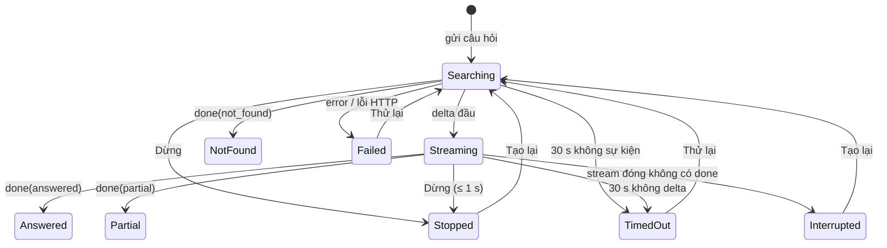

# Tài liệu Thiết kế Phần mềm (SDD) — Blueprint UI/UX — Công cụ "Chat với tài liệu" (MVP)

> **Chuẩn áp dụng:** IEEE 1016-2009 — Software Design Descriptions
> **Thượng nguồn:** [PRD-CVD-001 v0.1](../requirements/PRD.md), [BRD-CVD-001 v0.1](../requirements/BRD.md)
> **Checklist đối chiếu:** [BluePrint_Design_IEEE_1016_2009_Checklist.xlsx](../BluePrint_Design_IEEE_1016_2009_Checklist.xlsx) — kết quả ở mục 6.2
> **Phạm vi:** thiết kế web client và hợp đồng giao tiếp client ↔ backend. Thiết kế nội bộ backend (trích xuất PDF, truy hồi, gọi LLM) thuộc SDD Backend riêng.

| Thuộc tính | Giá trị |
|---|---|
| Mã tài liệu / Phiên bản | SDD-CVD-UX-001 / v0.2 (Draft) |
| Ngày | 2026-10-23 |
| Chủ sở hữu | nguoidinguocgio (PM/BA), phối hợp Design Lead, Tech Lead FE [TBD] |
| Lịch sử | v0.1 (2026-10-23) bản đầy đủ đầu tiên · v0.2 (2026-10-23) rút gọn theo checklist IEEE 1016, thêm Algorithm View |

**Quy ước:** `CN` mối quan tâm · `SCR` màn hình · `CMP` thành phần UI · `ST` máy trạng thái · `IF` giao diện/API · `DD` quyết định thiết kế · `ALG` thuật toán. ID `US/AC/TH/NFR/EV/D/OQ` lấy từ PRD/BRD. **[Đề xuất]** = lựa chọn của tác giả, cần Tech Lead/Design Lead xác nhận.

---

## 1. Bối cảnh và đối tượng thiết kế

### 1.1 Phạm vi và ranh giới

| Hạng mục | Mô tả |
|---|---|
| **Mục đích** | Web app cho đội phát triển kinh doanh tải tối đa 20 PDF vào một workspace chung và hỏi đáp (Việt/Anh), nhận câu trả lời tổng hợp **có trích dẫn tài liệu + trang kiểm chứng được**; từ chối khi tài liệu không có căn cứ. Mục tiêu: giảm ≥ 50% thời gian tra cứu (KR1.1) mà vẫn đáng tin (O2). |
| **Người dùng** | Member (PER-01), Trưởng nhóm (xem báo cáo — PER-02), Admin (PER-03) |
| **Hệ thống ngoài** | Backend API của sản phẩm; nhà cung cấp LLM đã phê duyệt (D-006) — **chỉ backend gọi, UI không bao giờ gọi trực tiếp**; trình duyệt Chrome/Edge |
| **Giao diện ngoài** | REST/JSON qua HTTPS; Server-Sent Events (SSE); multipart upload; PDF theo byte-range |
| **Ranh giới tin cậy** | TB-1: trình duyệt ↔ backend (TLS ≥ 1.2, cookie HttpOnly). TB-2: nội dung do LLM sinh và trích từ PDF là **dữ liệu không tin cậy** — UI chỉ render dạng văn bản đã khử độc (NFR-S05). |
| **Triển khai** | SPA phục vụ cùng origin với API (tránh CORS, cho phép cookie `SameSite=Strict`). Hạ tầng: [TBD — SDD Backend] |



### 1.2 Giả định và ràng buộc

| Loại | Nội dung |
|---|---|
| **Kỹ thuật** | Web (CON-002), chỉ PDF (CON-003), Chrome/Edge 2 bản mới nhất, tối ưu ≥ 1280 px (NFR-U01), giao diện tiếng Việt (NFR-U02), WCAG 2.1 AA (NFR-U03). Quyền do backend thực thi; UI chỉ ẩn/hiện (NFR-S04). |
| **Ngăn xếp FE [Đề xuất]** | React 18 + TypeScript + Vite; TanStack Query; Radix UI + Tailwind (token CSS); `pdfjs-dist`; `react-markdown` + `rehype-sanitize`; Vitest, Playwright, axe-core. |
| **Nghiệp vụ** | MVP: chỉ P0 được bảo đảm, P1 nếu kịp, P2 không thiết kế (lọc tài liệu, sao chép, OCR). Một workspace chung, hội thoại riêng tư (D-001). Ngân sách/thời hạn: [TBD: OQ-011]. |
| **Môi trường** | Mạng văn phòng ổn định, độ trễ < 100 ms; proxy nội bộ không đệm SSE [cần CNTT xác nhận — OQ-UX-02]. |
| **Dữ liệu** | ≤ 20 tài liệu (≤ 10 MB, ≤ 100 trang), câu hỏi 1–2.000 ký tự, hội thoại giữ 90 ngày, ≥ 10 người đồng thời (NFR-C01). Danh sách tài liệu không cần phân trang. |

---

## 2. Bên liên quan và mối quan tâm

### 2.1 Bên liên quan

| Bên liên quan | Mối quan tâm chính |
|---|---|
| Chuyên viên PTKD (người dùng chính) | Nhanh, đáng tin, kiểm chứng nguồn dễ, không mất nội dung đang soạn |
| Trưởng nhóm / Quản lý (nhà tài trợ) | Báo cáo tuần rõ ràng, bằng chứng giá trị MVP |
| Admin | Quản trị tài khoản đơn giản, an toàn, có nhật ký |
| Đội phát triển FE + QA | Cấu trúc rõ, dễ kiểm thử, hợp đồng API ổn định |
| An toàn thông tin / Pháp chế (có quyền chặn launch) | Client không làm lộ dữ liệu, chống XSS, phân quyền đúng, luôn nhắc kiểm chứng AI |
| Product Owner | Đo được phễu activation và OKR |

### 2.2 Mối quan tâm và tiêu chí chấp nhận

| ID | Mối quan tâm | Ưu tiên | Tiêu chí (định lượng) | Nguồn |
|---|---|---|---|---|
| CN-01 | Phản hồi nhanh khi hỏi | Cao | Chỉ báo "đang tìm" ≤ 300 ms; token đầu p90 ≤ 3 s; hoàn chỉnh p90 ≤ 15 s | AC-020.1, TH-01/02 |
| CN-02 | Kiểm chứng nguồn không cần mở file | Cao | Bấm `[n]` → trang PDF có đoạn nổi bật ≤ 1,5 s | AC-030.1 |
| CN-03 | Phân biệt rõ: có căn cứ / không tìm thấy / một phần / dở dang / lỗi | Cao | Không trạng thái lỗi/dở dang nào trông như "hoàn chỉnh" | US-023, PRD §5.2 |
| CN-04 | Biết tài liệu nào dùng được, vì sao file bị loại | Cao | Danh sách đủ cột, trạng thái đồng bộ ≤ 5 s, thông báo đúng AC-012.x | US-011, US-012 |
| CN-05 | Không mất nội dung đang soạn (hết phiên, mất mạng) | Cao | Khôi phục 100% bản nháp | AC-001.5 |
| CN-06 | Dễ học, dùng được lần đầu | Cao | ≥ 4/5 người UAT hoàn thành "tải lên – hỏi – kiểm chứng" không cần hỗ trợ | G-12 |
| CN-07 | Bảo mật phía client | Cao | 0 lỗi High/Critical OWASP; 0 ca XSS qua nội dung LLM/PDF trong ≥ 10 ca kiểm thử; phân quyền đúng; bị vô hiệu hóa → đăng xuất ≤ 60 s | G-06, NFR-S05, AC-003.1 |
| CN-08 | Báo cáo/quản trị dễ dùng, không lộ nội dung | Trung bình | Báo cáo đủ chỉ số AC-050.1/2, không chứa nội dung; mật khẩu tạm hiển thị 1 lần | US-050, AC-002.1 |
| CN-09 | Tiếp cận được | Trung bình | WCAG 2.1 AA; axe-core 0 lỗi serious/critical; thao tác P0 dùng được bằng bàn phím | NFR-U03 |
| CN-10 | Dễ bảo trì, kiểm thử, mở rộng sang P2 | Trung bình | Độ phủ logic FE ≥ 70%; E2E mọi luồng P0; thêm tính năng P2 chỉ sửa ≤ 2 module | G-09 |
| CN-11 | Đo lường được | Cao | 100% sự kiện client trong PRD §6.2 ghi đúng trên staging | G-10 |
| CN-12 | Luôn nhắc kiểm chứng AI | Cao | Tuyên bố trách nhiệm hiển thị mọi trạng thái | PRD §5.1, RSK-001 |

### 2.3 Ràng buộc UX/UI

| Hạng mục | Yêu cầu | Chuẩn | Kiểm chứng |
|---|---|---|---|
| Tương phản & màu | Chữ ≥ 4.5:1; thành phần UI ≥ 3:1; không truyền thông tin chỉ bằng màu (trạng thái luôn có icon + chữ) | WCAG 2.1 AA | axe-core + rà soát token |
| Chữ | Nội dung chat 16 px/26 px; UI 14 px; tối thiểu 12 px; dùng `rem`, zoom 200% không vỡ | WCAG 1.4.4 | Zoom 200% |
| Vùng bấm | ≥ 32 px (chuột), ≥ 44 px khi `pointer: coarse` | WCAG 2.5.8 | Test UI |
| Trạng thái tải | Skeleton nếu > 300 ms; phản hồi thao tác ≤ 100 ms | UX | E2E mạng chậm |
| Thông báo lỗi | Rõ, có hành động tiếp, không thuật ngữ kỹ thuật; dùng đúng câu chữ ở 3.5.3 | UX writing | Rà soát nội dung |
| Trạng thái trống | Mọi trạng thái trống có lời giải thích + hành động tiếp theo (PRD §5.2) | UX | Kiểm kê UI |
| Hiển thị an toàn | Markdown hạn chế qua sanitize; không HTML thô, không ảnh, link ngoài không tự kích hoạt | OWASP XSS | Kiểm thử injection |
| Chuyển động | ≤ 200 ms; tôn trọng `prefers-reduced-motion` | WCAG 2.3.3 | Thủ công |
| i18n / thiết bị | Mọi chuỗi qua khóa i18n (vi), ngày giờ `vi-VN`; < 1024 px hiển thị được, không cuộn ngang, không tối ưu | NFR-U01/U02 | Thủ công |

---

## 3. Các view thiết kế

| View | Mối quan tâm chính |
|---|---|
| 3.1 Composition | CN-10 |
| 3.2 Logical | CN-03, CN-04, CN-10 |
| 3.3 Dependency | CN-07, CN-10 |
| 3.4 Information | CN-05, CN-07, CN-11 |
| 3.5 Interface | CN-01, CN-02, CN-04, CN-06, CN-09 |
| 3.6 Interaction | CN-01, CN-02, CN-04, CN-07 |
| 3.7 State Dynamics | CN-03, CN-04, CN-05 |
| 3.8 Algorithm | CN-01, CN-03, CN-04, CN-07 |

### 3.1 Composition View

Client được phân rã theo **feature** (mỗi epic của PRD một module) trên một tầng dùng chung.

| Phần tử | Trách nhiệm | Phụ thuộc | Truy vết |
|---|---|---|---|
| `app` | Khởi tạo, routing + guard, bố cục 3 cột, banner kết nối, toast, Error Boundary theo vùng | features, shared | — |
| `features/auth` | Đăng nhập, đổi mật khẩu, quản lý phiên | shared | US-001, US-005 |
| `features/documents` | Bảng Tài liệu, kéo-thả, kiểm tra file, hàng đợi tải lên, trạng thái thời gian thực, xóa, tóm tắt | shared | US-010 – US-015 |
| `features/chat` | Ô nhập, luồng câu trả lời (SSE), render Markdown + trích dẫn, Dừng/Tạo lại, 👍/👎 | shared | US-020 – US-026, US-051 |
| `features/source-viewer` | Bảng Xem nguồn: vẽ trang PDF, làm nổi bật đoạn trích | shared, pdf.js | US-030 |
| `features/conversations` | Danh sách hội thoại, tạo/xóa | shared | US-040, US-041 |
| `features/admin` | Quản lý người dùng, nhật ký kiểm toán | shared | US-002 – US-004, US-061 |
| `features/reports` | Báo cáo tuần | shared | US-050 |
| `shared/ui` | Design system: token + component cơ sở | Radix, Tailwind | — |
| `shared/api` | HTTP client, ánh xạ mã lỗi → thông điệp, xử lý 401/403 | — | IF-01…IF-10 |
| `shared/realtime` | Kênh SSE workspace, tự kết nối lại | api | AC-011.2, AC-003.1 |
| `shared/lib` | `markdown`, `citations`, `draft`, `format`, `analytics`, `i18n` | — | — |



### 3.2 Logical View

**Màn hình**

| ID | Màn hình | Route | Quyền | Story |
|---|---|---|---|---|
| SCR-01 | Đăng nhập | `/login` | Mọi người | US-001 |
| SCR-02 | Bắt buộc đổi mật khẩu | `/change-password` | Đã xác thực, mật khẩu tạm | AC-001.4 |
| SCR-03 | **Workspace — Chat** (màn hình chính) | `/c`, `/c/:id` | Đã đăng nhập | US-010 – US-051 |
| SCR-04 | Quản trị: Người dùng, Nhật ký | `/admin/users`, `/admin/audit` | Admin | US-002 – US-004, US-061 |
| SCR-05 | Báo cáo tuần | `/reports` | Admin, Trưởng nhóm | US-050 |
| SCR-06 | Lỗi 403/404 | `*` | Mọi người | AC-002.3, AC-050.3 |

Guard phía client chỉ phục vụ trải nghiệm; chưa đăng nhập → `/login` (AC-001.6); sai vai trò → SCR-06; quyền thực sự do backend thực thi.

**Thành phần chính của SCR-03**

| ID | Component | Trách nhiệm |
|---|---|---|
| CMP-01 | `TopBar` + `AccountMenu` | Logo, bộ đếm "x/20" (cảnh báo ≥ 18), menu: đổi mật khẩu, hướng dẫn, Quản trị/Báo cáo theo vai trò, đăng xuất |
| CMP-02 | `ConnectionBanner` | Banner "Mất kết nối" cố định đầu trang |
| CMP-03 | `ConversationSidebar` | Hội thoại mới; nhóm Hôm nay/7 ngày/30 ngày/Cũ hơn; xóa; nhãn "Sẽ bị xóa sau {d} ngày" |
| CMP-04 | `MessageList` | Danh sách lượt hỏi đáp; tự cuộn trừ khi người dùng đã cuộn lên; ảo hóa khi > 50 lượt |
| CMP-05 | `AnswerCard` | Trình bày theo trạng thái ST-02; chứa `AnswerRenderer`, danh sách nguồn, 👍/👎 |
| CMP-06 | `AnswerRenderer` + `CitationChip` | Render Markdown an toàn; `[n]` thành chip bấm được (tooltip "tên, trang p"; "đã xóa" nếu tài liệu bị xóa) |
| CMP-07 | `Composer` | Ô nhập tự giãn, bộ đếm ký tự, Enter gửi/Shift+Enter xuống dòng, Gửi ↔ Dừng, giải thích khi bị vô hiệu hóa (ST-04) |
| CMP-08 | `Disclaimer` | "AI có thể sai. Hãy kiểm tra trích dẫn trước khi sử dụng thông tin." — luôn hiển thị |
| CMP-09 | `EmptyWorkspaceState` + `SuggestedQuestions` | Workspace trống: lời dẫn + nút Tải lên + giới hạn. Hội thoại mới: 3 câu gợi ý (chỉ điền vào ô nhập, không tự gửi) |
| CMP-10 | `RightPanel` | **Một khe** hiển thị `DocumentsPanel` hoặc `SourceViewerPanel` |
| CMP-11 | `DocumentsPanel` | Kéo-thả (cả màn hình), danh sách tài liệu (`DocumentRow`: trạng thái, số trang, người tải, ⓘ lý do, menu ⋯ Tóm tắt/Xóa/Thử lại), cảnh báo trùng |
| CMP-12 | `SourceViewerPanel` | Tên tài liệu, "Trang p/N", trước/sau, canvas PDF + lớp nổi bật |
| CMP-13 | `ConfirmDialog`, `ToastRegion` | Xác nhận thao tác phá hủy; thông báo không chặn (tối đa 3, tự ẩn 5 s, lỗi giữ đến khi đóng) |

**Mẫu thiết kế:** feature-sliced; container/presentational (hook dữ liệu tách khỏi component để test bằng props); **máy trạng thái hữu hạn** cho tài liệu/câu trả lời/Composer (loại trạng thái mâu thuẫn); Pub-Sub qua SSE cập nhật cache (không polling); Error Boundary theo vùng; ánh xạ DTO → kiểu nội bộ (UI không lộ lỗi kỹ thuật thô).

### 3.3 Dependency View

**Quy tắc bắt buộc** (kiểm tra bằng lint `eslint-plugin-boundaries` [Đề xuất]):

| # | Quy tắc |
|---|---|
| R-1 | `shared/*` không import `features/*` hoặc `app`. |
| R-2 | `features/X` không import nội bộ `features/Y`; giao tiếp chéo feature bằng sự kiện UI (`citation:open`, `upload:request`) qua `app`. |
| R-3 | Chỉ `shared/api` gọi `fetch`; chỉ `shared/realtime` mở kênh SSE workspace. |
| R-4 | Chỉ `shared/lib/markdown` được chuyển nội dung LLM thành DOM; cấm `dangerouslySetInnerHTML` nơi khác. |
| R-5 | `pdfjs-dist` chỉ import động trong `features/source-viewer`. |
| R-6 | Chỉ `shared/lib/analytics` gửi analytics, qua danh sách trắng thuộc tính (không chứa nội dung). |



### 3.4 Information View

**Dữ liệu phía client**



**Nơi lưu và bảo vệ**

| Dữ liệu | Nơi lưu | Vòng đời / bảo vệ |
|---|---|---|
| Phiên đăng nhập | Cookie `HttpOnly; Secure; SameSite=Strict` | 8 giờ không thao tác; **không** lưu token trong `localStorage` (DD-03) |
| Tài liệu, hội thoại, tin nhắn, báo cáo | Bộ nhớ (cache TanStack Query) | Xóa toàn bộ khi đăng xuất / 401 / `session.revoked`; không ghi storage bền |
| Bản nháp câu hỏi | `sessionStorage` `draft:{userId}:{conversationId}` | Ghi khi gõ (debounce 500 ms); khôi phục sau đăng nhập lại; xóa khi gửi hoặc đăng xuất; không đưa vào analytics (cần ATTT chấp thuận — OQ-UX-02) |
| PDF đang xem | Bộ nhớ (pdf.js) | Giải phóng khi đóng bảng; `Cache-Control: no-store` |
| Mật khẩu tạm (Admin) | State hộp thoại | Hiển thị một lần; không log |
| Sự kiện analytics | Hàng đợi bộ nhớ, gửi lô 10 s / `sendBeacon` | Chỉ ID, số đếm, độ dài, thời gian, mã lỗi (PRD §6.2) |

**Design tokens** (MVP chỉ giao diện sáng — DD-05). Tương phản đo trên nền trắng:

| Token | Giá trị | Dùng cho | Tương phản |
|---|---|---|---|
| `--color-text` | `#0F172A` | Chữ chính | 17.9:1 |
| `--color-text-muted` | `#475569` | Chữ phụ | 7.6:1 |
| `--color-border-strong` | `#64748B` | Viền ô nhập | 4.8:1 |
| `--color-primary` | `#1D4ED8` | Nút chính, chip trích dẫn, vòng focus | 6.7:1 |
| `--color-success` | `#15803D` | "Sẵn sàng" | 5.0:1 |
| `--color-warning` | `#B45309` | "Đang xử lý", cảnh báo | 5.0:1 |
| `--color-danger` | `#B91C1C` | "Lỗi", xóa, vượt giới hạn ký tự | 6.5:1 |
| `--color-highlight` | `#FDE68A` | Đoạn nổi bật trong PDF (chữ `#0F172A` trên nền này) | 14.3:1 |

Chữ: `Inter` (đủ dấu tiếng Việt, tự host), dự phòng `Segoe UI`. Khoảng cách thang 4 px; bo góc 4/8/12 px; chuyển động 120/200 ms. Bố cục: thanh trên 56 px, thanh trái 280 px, bảng phải 440 px (kéo 360–640), nội dung chat ≤ 760 px.

**Hiển thị trạng thái tài liệu** (luôn icon + chữ): ⬆ Đang tải lên {p}% · ⚠ Gián đoạn (tự thử lại k/3) · ⏳ Đang xử lý · ✓ Sẵn sàng · ✓ⓘ Sẵn sàng · {k} trang không đọc được · ✕ⓘ Lỗi + lý do.

### 3.5 Interface View

#### 3.5.1 Bố cục SCR-03 (≥ 1280 px)

```
┌──────────────────────────────────────────────────────────────────────────────┐
│ ⚠ Mất kết nối. Đang thử kết nối lại…                (ConnectionBanner, ẩn)   │
│ [Logo] Chat với tài liệu                 [📄 12/20 tài liệu]   [NT ▾]        │
├───────────────┬────────────────────────────────────────┬─────────────────────┤
│ [+ Hội thoại  │                    ┌─────────────────┐ │ Tài liệu   12/20  ✕ │
│    mới      ] │                    │ Điều khoản thanh│ │ ┌─────────────────┐ │
│               │                    │ toán của A và B?│ │ │ ⬆ Kéo-thả PDF   │ │
│ HÔM NAY       │                    └─────────────────┘ │ │ ≤10MB · ≤100 tr │ │
│ ▸ Điều khoản  │ ┌────────────────────────────────────┐ │ └─────────────────┘ │
│   thanh toán  │ │ Hợp đồng A quy định 30 ngày [1].   │ │ ✓ HopDong_A.pdf     │
│ 7 NGÀY TRƯỚC  │ │ Đề xuất B nêu 45 ngày [2] — mâu    │ │   48 tr · Lan       │
│ ▸ …           │ │ thuẫn.                             │ │ ⏳ BaoCao_Q3.pdf     │
│               │ │ Nguồn                              │ │ ✕ Scan_01.pdf  ⓘ    │
│               │ │ [1] HopDong_A.pdf, trang 12        │ │   Lỗi · bản scan    │
│               │ │ [2] DeXuat_B.pdf, trang 4   👍  👎 │ │                     │
│               │ └────────────────────────────────────┘ │ (bấm [1] → bảng này │
│               ├────────────────────────────────────────┤  đổi thành Xem nguồn│
│               │ [ Đặt câu hỏi về tài liệu…        ] [➤]│  : trang PDF + đoạn │
│               │ AI có thể sai. Hãy kiểm tra trích dẫn… │  nổi bật)           │
└───────────────┴────────────────────────────────────────┴─────────────────────┘
```

**Trình bày `AnswerCard` theo trạng thái**

```
Đang tìm:       ◌ Đang tìm trong tài liệu…                                   [■ Dừng]
Streaming:      Hợp đồng A quy định thanh toán 30 ngày [1]. Đề xuất▍         [■ Dừng]
Không tìm thấy: ⓘ Không tìm thấy thông tin này trong các tài liệu hiện có.
Một phần:       …nội dung có trích dẫn…  ⓘ Không tìm thấy: {phần còn thiếu}
Đã dừng:        …phần đã tạo…  — Đã dừng                                     [↻ Tạo lại]
Gián đoạn:      …phần đã tạo…  ⚠ Kết nối bị gián đoạn — chưa hoàn chỉnh      [↻ Tạo lại]
Quá hạn / lỗi:  ⚠ Hệ thống phản hồi chậm hơn bình thường. Thử lại?           [↻ Thử lại]
```

**Responsive:** ≥ 1280 px: 3 cột · 1024–1279 px: bảng phải thành ngăn kéo phủ · < 1024 px: thanh trái thu gọn, bảng phủ toàn màn hình, không cuộn ngang (không tối ưu — NFR-U01).

#### 3.5.2 Bàn phím và trình đọc màn hình

| Phím | Hành động |
|---|---|
| `Enter` / `Shift+Enter` | Gửi / xuống dòng (Composer) |
| `Esc` | Đóng bảng phải / hộp thoại; trả focus về phần tử đã mở |
| `Ctrl+Shift+O` | Hội thoại mới |
| `/` | Focus ô nhập |
| `←` `→` | Trang trước/sau trong Xem nguồn |
| Liên kết "Bỏ qua tới ô nhập" | Đầu trang (WCAG 2.4.1) |

`MessageList` là `role="log"`. Khi streaming, `aria-busy="true"` và **không** đọc từng token; vùng `aria-live="polite"` thông báo "Đang tạo câu trả lời", rồi "Câu trả lời đã xong, có {n} trích dẫn" / "Không tìm thấy thông tin". Chip trích dẫn: `aria-label="Trích dẫn {n}: {tên}, trang {p}"`.

#### 3.5.3 Thông điệp chính (khóa i18n `vi`; còn lại theo AC-012.x của PRD)

| Khóa | Nội dung |
|---|---|
| `auth.invalid_credentials` | Email hoặc mật khẩu không đúng. |
| `auth.disabled` | Tài khoản đã bị vô hiệu hóa, liên hệ Admin. |
| `documents.limit_reached` | Workspace đã đạt giới hạn 20 tài liệu. Xóa bớt tài liệu để tải lên tài liệu mới. |
| `documents.scanned` | Không đọc được văn bản trong file (có thể là bản scan). Hiện chưa hỗ trợ PDF dạng ảnh. |
| `chat.empty_workspace` | Tải lên ít nhất một tài liệu PDF để bắt đầu hỏi. |
| `chat.not_found` | Không tìm thấy thông tin này trong các tài liệu hiện có. |
| `chat.interrupted` | Kết nối bị gián đoạn — câu trả lời chưa hoàn chỉnh. |
| `chat.timeout` | Hệ thống phản hồi chậm hơn bình thường. Thử lại? |
| `chat.llm_unavailable` | Dịch vụ AI tạm thời không khả dụng. Vui lòng thử lại sau ít phút. |
| `source.deleted` | Tài liệu đã bị xóa khỏi workspace. |

#### 3.5.4 Hợp đồng client ↔ backend

Đường dẫn là [Đề xuất], chốt cùng SDD Backend. Mọi lỗi theo dạng `{error:{code, message_key, details}}`; UI chỉ tra thông điệp theo `code`, không hiển thị chuỗi lỗi thô.

| ID | Giao diện | Điểm quan trọng với UI | Story |
|---|---|---|---|
| IF-01 | `POST /api/auth/login`, `/logout`, `/change-password`; `GET /api/me` | Lỗi: `INVALID_CREDENTIALS`, `ACCOUNT_LOCKED` (+`retry_after_s`), `ACCOUNT_DISABLED` | US-001, US-005 |
| IF-02 | `GET /api/documents` | Trả danh sách, `count`, `limit`=20, `canDelete` từng mục | US-011 |
| IF-03 | `POST /api/documents` (multipart, một file/yêu cầu, header `X-Content-SHA256`); `DELETE /:id`; `POST /:id/retry`; `POST /:id/summary` | Máy chủ kiểm tra lại mọi ràng buộc; `409 DUPLICATE_DOCUMENT` (+`existing_name`), `409 DOCUMENT_LIMIT_REACHED` | US-010 – US-015 |
| IF-04 | `GET/POST/DELETE /api/conversations` | Chỉ trả hội thoại của chính người gọi (D-001); có `expires_in_days` | US-040, US-041 |
| IF-05 | `POST /api/conversations/:id/messages` → SSE; `POST /api/messages/:id/stop`, `/regenerate`; `PUT /api/messages/:id/feedback` | Client dùng `fetch` + `ReadableStream`; sự kiện SSE ở bảng dưới | US-020 – US-026, US-051 |
| IF-06 | `GET /api/events` (SSE) | `document.created`, `document.status_changed`, `document.deleted`, `session.revoked`, `heartbeat` 20 s; hỗ trợ `Last-Event-ID` | AC-011.2, AC-003.1 |
| IF-07 | `GET /api/citations/:messageId/:index` → `{documentId, page, pageCount, highlight}`; `GET /api/documents/:id/file` (hỗ trợ `Range`, `no-store`) | `410 DOCUMENT_DELETED` → `source.deleted` | US-030 |
| IF-08 | `POST /api/analytics/events` (lô) | Chỉ sự kiện phía client (EV-021, 022, 025, 030, 050); sự kiện còn lại do backend ghi | G-10 |
| IF-09 | `/api/admin/users` (tạo, vô hiệu hóa, đặt lại mật khẩu), `/api/admin/audit-logs` | Mật khẩu tạm trả **một lần**; `409 EMAIL_TAKEN` | US-002 – US-004, US-061 |
| IF-10 | `GET /api/reports/weekly?week=` | Chỉ số tổng hợp, 12 tuần gần nhất; `403` với Member | US-050 |

**Giao thức SSE của IF-05**

| Sự kiện | Dữ liệu | Phản ứng UI |
|---|---|---|
| `meta` | `{message_id, lang}` | Gắn ID, đặt `lang` cho thẻ trả lời |
| `status` | `{phase:"retrieving"}` | "Đang tìm trong tài liệu…" |
| `delta` | `{text}` | Nối nội dung (gộp theo khung hình) |
| `citation` | `{index, document_id, document_name, page, document_deleted}` | Cập nhật bảng trích dẫn |
| `done` | `{answer_type: answered\|not_found\|partial, missing?}` | Chốt trạng thái, hiện nguồn + 👍/👎, mở Composer |
| `error` | `{code: timeout\|llm_error\|rate_limited}` | Trạng thái lỗi tương ứng |
| *không có dữ liệu > 30 s* | — | Client hủy → "Quá hạn" |
| *stream đóng không có `done`* | — | "Gián đoạn" |

### 3.6 Interaction View

**IS-01 — Hỏi đáp có trích dẫn (luồng activation)**

```mermaid
sequenceDiagram
    actor U as Member
    participant C as Composer
    participant S as useAnswerStream
    participant R as AnswerCard
    participant API as Backend (IF-05)
    U->>C: Gõ câu hỏi, Enter
    C->>C: Kiểm tra 1–2.000 ký tự, có tài liệu sẵn sàng, online
    C->>S: submit
    S->>R: Thêm câu hỏi + thẻ trả lời "Đang tìm…" (≤ 300 ms)
    S->>API: POST messages (SSE)
    API-->>S: meta, status
    API-->>S: delta đầu tiên (ghi EV-021)
    loop mỗi khung hình
        API-->>S: delta / citation
        S->>R: nối nội dung, chip [n]
    end
    API-->>S: done {answer_type}
    S->>R: hiện nguồn, 👍/👎; mở lại Composer, xóa nháp
```

**IS-02 — Kiểm chứng trích dẫn**



**IS-03 — Tải lên nhiều file**



**Hết phiên / bị vô hiệu hóa:** API trả `401`/`403` hoặc IF-06 phát `session.revoked` → `shared/api` hủy stream đang chạy, xóa cache, chuyển `/login`; bản nháp được giữ khi *hết phiên* (AC-001.5) và xóa khi *bị thu hồi hoặc đăng xuất*. Tổng thời gian ≤ 60 s (AC-003.1).

### 3.7 State Dynamics View

**ST-01 — Vòng đời tài liệu**



Các trạng thái trước `Processing` chỉ tồn tại ở tab người tải lên (không có "tài liệu ma"). Bộ đếm "x/20" tính cả đang xử lý và lỗi (AC-010.4).

**ST-02 — Vòng đời câu trả lời**



| Trạng thái | Composer | Nguồn + 👍/👎 |
|---|---|---|
| Searching, Streaming | Nút Gửi → **Dừng** | Ẩn |
| Answered, Partial | Mở | Hiện |
| NotFound | Mở | Hiện 👍/👎, không có danh sách nguồn |
| Stopped, Interrupted, TimedOut, Failed | Mở (khi online) | Ẩn; có nút Tạo lại/Thử lại |

**Bất biến:** chỉ `Answered` và `Partial` có danh sách nguồn; không trạng thái lỗi/dở dang nào trình bày giống `Answered` (CN-03).

**ST-03 — Phiên:** `Anonymous → Authenticating → (MustChangePassword →) Active → Expired | Revoked | Anonymous`. `Expired` giữ nháp, `Revoked` xóa nháp.

**ST-04 — Composer (suy ra, không lưu)** — kiểm tra theo thứ tự ưu tiên:

| # | Điều kiện | Trạng thái | Trình bày |
|---|---|---|---|
| 1 | Offline | `offline` | Giữ nội dung; Gửi vô hiệu hóa; "Đang mất kết nối" |
| 2 | Không có tài liệu | `no_documents` | Vô hiệu hóa + `chat.empty_workspace` + nút Tải lên |
| 3 | Chỉ có tài liệu đang xử lý | `processing_only` | Vô hiệu hóa + "Đang xử lý {n} tài liệu…" |
| 4 | Tất cả tài liệu lỗi | `all_failed` | Vô hiệu hóa + "Chưa có tài liệu nào dùng được" + liên kết bảng Tài liệu |
| 5 | Câu trả lời chưa kết thúc | `busy` | Gõ được; Gửi → Dừng |
| 6 | Rỗng / chỉ khoảng trắng | `empty` | Gửi vô hiệu hóa |
| 7 | > 2.000 ký tự | `too_long` | Bộ đếm đỏ + "Câu hỏi tối đa 2.000 ký tự" |
| 8 | Còn lại | `ready` | Gửi được |

### 3.8 Algorithm View

Chỉ mô tả các thuật toán phía client có logic không tầm thường.

**ALG-01 — Streaming và render câu trả lời** (CN-01, CN-03, CN-07)
1. Mở `fetch` POST, đọc `ReadableStream`, tách sự kiện SSE theo dòng trống.
2. `delta`: đưa vào bộ đệm; mỗi `requestAnimationFrame` gộp bộ đệm, nối vào nội dung và render lại **chỉ khối Markdown cuối cùng**.
3. Đặt bộ đếm hủy 30 s, đặt lại sau mỗi sự kiện; hết hạn → hủy stream, trạng thái `TimedOut`.
4. Render: Markdown → `rehype-sanitize` (danh sách trắng: đoạn, danh sách, nhấn mạnh, bảng, code; không ảnh, không HTML thô, link thành văn bản) → thay token `[n]` bằng `CitationChip` **chỉ khi** đã nhận sự kiện `citation` có `index = n`; chưa có thì hiển thị văn bản thường.
5. Stream kết thúc: có `done` → trạng thái theo `answer_type`; không có `done` → `Interrupted`.

**ALG-02 — Kiểm tra file phía client** (CN-04; DD-04)
Với danh sách file người dùng chọn, theo thứ tự chọn, `slots = 20 − (số tài liệu hiện có, gồm đang xử lý)`:
1. Đuôi `.pdf` **và** 5 byte đầu là `%PDF-` → sai: `documents.not_pdf`.
2. Dung lượng > 10 MB → `documents.too_large`.
3. `slots ≤ 0` → từ chối `documents.limit_reached`; ngược lại nhận file và giảm `slots` (ví dụ còn 2 chỗ, chọn 4 file → nhận 2 đầu, từ chối 2 sau — AC-010.5).
4. Tính SHA-256 (Web Crypto) rồi gửi; số trang, mật khẩu, bản scan do máy chủ phát hiện khi xử lý. Máy chủ vẫn là nguồn sự thật cho mọi ràng buộc.

**ALG-03 — Kết nối lại và bù sự kiện** (CN-04, CN-05)
Kênh IF-06 mất → chờ `1 s, 2 s, 4 s … tối đa 30 s` (có jitter), kết nối lại với `Last-Event-ID`; nếu máy chủ không bù được → tải lại `GET /api/documents`. Khi mở nhiều tab, một tab giữ kênh và phát lại qua `BroadcastChannel` [Đề xuất]. Kết nối lại câu trả lời **không** tự gửi lại: người dùng chọn "Tạo lại" (tránh tốn chi phí LLM).

---

## 4. Phần tử thiết kế và tài nguyên

**Thuộc tính phần tử:** mỗi phần tử đã có tên, mục đích và mô tả chức năng ở các bảng 3.1 (module), 3.2 (màn hình, component), 3.5.4 (giao diện).

**Phân bổ tài nguyên và ngân sách hiệu năng**

| Chỉ tiêu | Ngân sách | Cơ chế | Kiểm chứng |
|---|---|---|---|
| JS khởi tạo (`/c`) | ≤ 200 KB gzip | Tách code theo route; `admin`, `reports`, `source-viewer`, pdf.js tải lười | `size-limit` trong CI |
| LCP | ≤ 2 s p75 (TH-08) | Font tự host; skeleton; gọi `/api/me` song song với tải bundle | Lighthouse CI |
| Chỉ báo sau khi gửi | ≤ 300 ms | Thêm thẻ trả lời cục bộ trước khi có phản hồi máy chủ | E2E |
| Mở Xem nguồn | ≤ 1,5 s | Prefetch pdf.js khi câu trả lời đầu có trích dẫn; tải PDF theo byte-range; chỉ vẽ trang được trích | E2E, EV-030 |
| Kết nối mạng | ≤ 2 SSE/tab (1 workspace + 1 câu trả lời); tải lên ≤ 2 file song song; không polling | Xem ALG-03 | Kiểm tra mạng |
| Bộ nhớ | 1 tài liệu PDF mở tại một thời điểm, ≤ 3 trang đã vẽ; ảo hóa danh sách tin nhắn > 50 lượt | Hủy `PDFDocumentProxy` khi đóng bảng | Performance panel |

---

## 5. Lý do thiết kế

| ID | Quyết định | Phương án đã loại | Lý do |
|---|---|---|---|
| DD-01 | **SSE** cho câu trả lời streaming và sự kiện workspace | WebSocket; polling | Chỉ cần luồng một chiều máy chủ → client, chạy trên HTTP thường, tự kết nối lại. Rủi ro proxy đệm SSE (OQ-UX-02) |
| DD-02 | **pdf.js** vẽ trang gốc ở client, nổi bật theo vị trí ký tự | Ảnh trang từ máy chủ; chỉ hiện đoạn văn bản trích | Hiển thị đúng trang gốc tăng niềm tin (P-3). Đổi lại bundle lớn → tải lười + prefetch. Phụ thuộc OQ-UX-01 |
| DD-03 | **Phiên bằng cookie HttpOnly** cùng origin | JWT trong `localStorage` | Chống đánh cắp token qua XSS; thu hồi phiên phía máy chủ (AC-003.1) |
| DD-04 | **Kiểm tra file ở cả client và máy chủ** | Chỉ máy chủ | Phản hồi tức thời, không tải file vô ích (AC-010.4); máy chủ vẫn là nguồn sự thật |
| DD-05 | **Một khe bảng phải** (Tài liệu ↔ Xem nguồn); chỉ giao diện sáng trong MVP | Hai bảng cùng lúc; trang tài liệu riêng; hỗ trợ cả chế độ tối | Theo PRD §5.1; chat luôn nhìn thấy khi kiểm chứng; giảm chi phí thiết kế/kiểm thử (CON-001) |
| DD-06 | **Markdown hạn chế + sanitize**; gợi ý câu hỏi chỉ điền vào ô nhập, không tự gửi | HTML đầy đủ / văn bản thuần; bấm là gửi | Cần danh sách/bảng để đọc so sánh nhưng nội dung LLM/PDF không tin cậy (CN-07); tránh tốn chi phí LLM (RSK-007) |

Giả định và ràng buộc xem mục 1.2.

---

## 6. Truy vết và đảm bảo chất lượng

### 6.1 Truy vết

| Mối quan tâm | View / phần tử thiết kế | Yêu cầu PRD | Kiểm chứng |
|---|---|---|---|
| CN-01 | CMP-05, CMP-07, IF-05, ST-02, ALG-01, IS-01, mục 4 | US-020, TH-01/02 | E2E đo thời gian; EV-021; kiểm thử tải G-05 |
| CN-02 | CMP-06, CMP-12, IF-07, IS-02, DD-02 | US-022, US-030 | E2E 10 trích dẫn; EV-030 |
| CN-03 | CMP-05, ST-02 + bất biến | US-023, AC-023.x | Component test từng trạng thái; E2E mất mạng/timeout |
| CN-04 | CMP-11, ST-01, IF-02/03/06, IS-03, ALG-02/03 | US-010 – US-015, AC-012.x | E2E bộ file mẫu; 2 trình duyệt đồng bộ ≤ 5 s |
| CN-05 | Bảng lưu trữ 3.4, ST-03/04, ALG-03 | AC-001.5 | E2E hết phiên / offline |
| CN-06 | CMP-09, ST-04 | G-12 | UAT |
| CN-07 | R-3…R-6, DD-03, DD-06, bảng 3.4, route guard | US-060, NFR-S01/S04/S05 | Kiểm thử injection; OWASP G-06; E2E theo vai trò G-07 |
| CN-08 | SCR-04, SCR-05, IF-09/10 | US-002 – 004, US-050, US-061 | E2E Admin; kiểm tra báo cáo không có nội dung |
| CN-09 | Token 3.4, mục 2.3, 3.5.2 | NFR-U03 | axe-core; NVDA thủ công |
| CN-10 | 3.1, 3.3 (R-1…R-6), mẫu thiết kế | G-09 | Lint ranh giới CI; độ phủ ≥ 70% |
| CN-11 | `shared/lib/analytics`, IF-08, R-6 | PRD §6.2, G-10 | Kiểm tra sự kiện trên staging |
| CN-12 | CMP-08 | RSK-001 | Kiểm tra mọi trạng thái Composer |

**Story → thiết kế:** EP-1 (US-001 – 005) → SCR-01/02/04, IF-01/09, ST-03 · EP-2 (US-010 – 015) → CMP-11, ST-01, IF-02/03/06 · EP-3 (US-020 – 026) → CMP-05/06/07, IF-05, ST-02/04 · EP-4 (US-030) → CMP-12, IF-07 · EP-5 (US-040/041) → CMP-03, IF-04 · EP-6 (US-050/051) → SCR-05, IF-10, CMP-05 (👍/👎) · EP-7 (US-060/061) → mục 3.4, DD-03/06, SCR-04. US-090/091 (P2) không thiết kế chi tiết; điểm mở rộng: thêm tham số `document_ids` vào IF-05 và một component chọn tài liệu.

### 6.2 Kết quả đối chiếu checklist IEEE 1016-2009

| # | Mục checklist | Kết quả | Vị trí |
|---|---|---|---|
| 1 | Design Subject Scope | Đạt | 1.1 |
| 2 | Context View | Đạt | 1.1 (sơ đồ bối cảnh) |
| 3 | Stakeholder Identification | Đạt | 2.1 |
| 4 | Design Concerns | Đạt | 2.2, 2.3 |
| 5 | Composition View | Đạt | 3.1 |
| 6 | Logical View | Đạt | 3.2 (màn hình, component), 3.4 (kiểu dữ liệu) |
| 7 | Dependency View | Đạt | 3.3 |
| 8 | Interaction View | Đạt | 3.6 |
| 9 | Information View | Đạt (lưu trữ phía client; CSDL backend thuộc SDD Backend) | 3.4 |
| 10 | Interface View | Đạt | 3.5 |
| 11 | State Dynamics View | Đạt | 3.7 |
| 12 | Algorithm View | **Đã bổ sung** (v0.1 còn thiếu) | 3.8 |
| 13 | Element Attributes | Đạt | 3.1, 3.2, 3.5.4 |
| 14 | Resource Allocation | Đạt (CPU/GPU không áp dụng cho client) | 4 |
| 15 | Decision Documentation | Đạt | 5 |
| 16 | Alternatives Considered | Đạt (cột "Phương án đã loại") | 5 |
| 17 | Assumptions & Constraints | Đạt | 1.2 |
| 18 | Requirements Traceability | Đạt | 6.1 |
| 19 | Completeness Check | **Đạt có điều kiện:** mọi story P0/P1 có thiết kế; còn 3 câu hỏi mở bên dưới | 6.1, 6.3 |

### 6.3 Câu hỏi mở

| ID | Câu hỏi | Ảnh hưởng | Chủ sở hữu |
|---|---|---|---|
| OQ-UX-01 | Backend có trả được vị trí đoạn trích (khoảng ký tự trên trang) không? Nếu chỉ trả số trang, "làm nổi bật" (AC-030.1) phải hạ xuống tìm chuỗi phía client | DD-02, IF-07 | Tech Lead |
| OQ-UX-02 | Proxy nội bộ có đệm/cắt SSE không? An toàn thông tin có chấp thuận lưu bản nháp trong `sessionStorage` không? | DD-01, mục 3.4 | CNTT, ATTT |
| OQ-UX-03 | Ngăn xếp FE và bảng token ở mục 1.2/3.4 có phù hợp năng lực đội và nhận diện thương hiệu nội bộ không? | 3.1, 3.4 | Tech Lead, Design Lead |

**Phê duyệt:** Product Owner, Design Lead, Tech Lead, QA Lead, An toàn thông tin — [TBD]. Điều kiện baseline v1.0: PRD được baseline; OQ-UX-01…03 được giải quyết.
