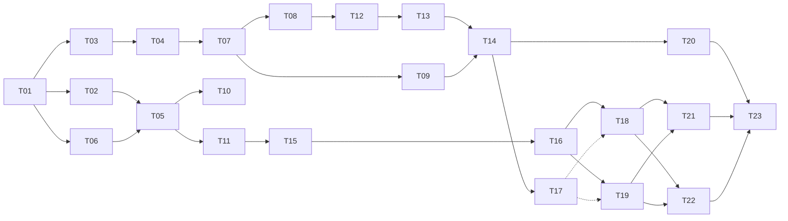

# Danh sách task phát triển — Chat với tài liệu (MVP lõi)

> Chia từ [implement_plan.md](implement_plan.md). Căn cứ: [SDD UI/UX](../design/SDD_UIUX_Blueprint.md), [User stories BB-01/BB-02](../user_stories/US_Backbone_Upload_va_HoiDap.md), [PRD](../requirements/PRD.md), [prototype HTML](../design/html_design/index.html).
> **Ước tính** tính bằng người-ngày [Đề xuất], đã gồm viết test của chính task. Tổng **82 người-ngày**: FE 30 · BE 32 · QA 13 · hạ tầng, hợp đồng API và phát hành 7. Chưa gồm dự phòng tích hợp FE–BE (nên giữ thêm khoảng 10–15%).

## 1. Bảng task

| Task | Tên | GĐ | Loại | Ngày | Phụ thuộc |
|---|---|---|---|---|---|
| [T01](T01_repo-ci-scaffold.md) | Khởi tạo repo, scaffold, CI, luật ranh giới | 0 | Hạ tầng | 2 | — |
| [T02](T02_fe-ui-tokens-components.md) | Design tokens và thư viện UI cơ sở | 0 | FE | 3 | T01 |
| [T03](T03_be-foundation-db.md) | Backend nền tảng và lược đồ CSDL | 0 | BE | 3 | T01 |
| [T04](T04_be-auth-session.md) | Backend đăng nhập và phiên | 0 | BE | 3 | T03 |
| [T05](T05_fe-shell-auth-api-client.md) | Frontend: khung ứng dụng, đăng nhập, API client | 0 | FE | 4 | T01, T02, T06 |
| [T06](T06_api-contract-and-mocks.md) | Hợp đồng API (OpenAPI) và API giả (MSW) | 0 | FE+BE | 2 | T01 |
| [T07](T07_be-upload-api.md) | Backend: API tải lên tài liệu | 1 | BE | 3 | T03, T04 |
| [T08](T08_be-pdf-processing-pipeline.md) | Backend: pipeline xử lý PDF | 1 | BE | 5 | T07 |
| [T09](T09_be-documents-list-events-analytics.md) | Backend: danh sách tài liệu, SSE sự kiện, analytics | 1 | BE | 3 | T07 |
| [T10](T10_fe-upload-client.md) | Frontend: kiểm tra file, kéo-thả, hàng đợi tải lên | 1 | FE | 4 | T05, T06 |
| [T11](T11_fe-documents-panel-realtime.md) | Frontend: bảng Tài liệu và đồng bộ thời gian thực | 1 | FE | 4 | T05, T06 |
| [T12](T12_be-retrieval.md) | Backend: truy hồi đa tài liệu | 2 | BE | 3 | T08 |
| [T13](T13_be-answer-generation.md) | Backend: sinh câu trả lời có trích dẫn | 2 | BE | 5 | T12 |
| [T14](T14_be-chat-sse-api.md) | Backend: API hội thoại và hỏi đáp SSE | 2 | BE | 4 | T09, T13 |
| [T15](T15_fe-composer-chat-layout.md) | Frontend: ô nhập, khung chat, danh sách hội thoại | 2 | FE | 3 | T05, T06, T11 |
| [T16](T16_fe-answer-stream-render.md) | Frontend: nhận luồng và hiển thị câu trả lời | 2 | FE | 5 | T15 |
| [T17](T17_be-citations-file-stop-regenerate.md) | Backend: trích dẫn, tải file PDF, dừng, tạo lại | 3 | BE | 3 | T14 |
| [T18](T18_fe-source-viewer.md) | Frontend: bảng Xem nguồn (pdf.js) | 3 | FE | 4 | T16, T17 (hoặc mock) |
| [T19](T19_fe-stop-retry-errors-offline.md) | Frontend: Dừng, Tạo lại, lỗi, mất kết nối | 3 | FE | 3 | T16, T17 (hoặc mock) |
| [T20](T20_qa-eval-dataset-harness.md) | QA: bộ câu hỏi chuẩn DEP-002 và công cụ đánh giá | 1→4 | QA | 5 | T14 |
| [T21](T21_qa-e2e-accessibility.md) | QA: E2E Playwright và khả năng tiếp cận | 4 | QA | 4 | T19, T18 |
| [T22](T22_qa-load-security.md) | QA: thử tải và kiểm thử bảo mật | 4 | QA | 4 | T19 |
| [T23](T23_release-readiness.md) | Sẵn sàng phát hành: giám sát, UAT, runbook, hướng dẫn | 4 | Vận hành | 3 | T20 – T22 |

## 2. Thứ tự và đường găng



- **Đường găng (BE):** T01 → T03 → T04 → T07 → T08 → T12 → T13 → T14 → T17.
- **Đường găng (FE):** T01 → T06 → T05 → T11 → T15 → T16 → T18/T19. FE không phải chờ BE vì dùng API giả của T06; chỉ tích hợp thật khi BE tương ứng xong.
- **Song song được:** T02 ∥ T03 ∥ T06 · T08 ∥ T09 ∥ T10 ∥ T11 · T17 ∥ T18/T19 (FE dùng mock).
- **Bắt đầu sớm nhất có thể:** T20 (soạn bộ câu hỏi và corpus) vì phụ thuộc con người, không phụ thuộc code.

## 3. Quy ước chung (mọi task phải tuân theo)

**Cấu trúc repo [Đề xuất]**
```
web/        Vue 3 + TypeScript (Vite)      api/       Spring Boot (Java 21, Maven)
contracts/  openapi.yaml                   e2e/       Playwright
eval/       bộ câu hỏi + công cụ đánh giá  ops/       docker-compose, CI, runbook
```

**API**
- Tiền tố `/api`; JSON UTF-8; ID là UUID v4; thời gian ISO 8601 UTC (`2026-10-23T09:02:00Z`); tên trường `snake_case`.
- Cookie phiên `sid`: `HttpOnly; Secure; SameSite=Strict`. Mọi yêu cầu có thay đổi dữ liệu (POST/PUT/PATCH/DELETE) phải kèm header `X-Requested-With: fetch`, thiếu → `403 FORBIDDEN`.
- **Định dạng lỗi duy nhất:** `{"error":{"code":"DOCUMENT_LIMIT_REACHED","message_key":"documents.limit_reached","details":{}}}`. FE chỉ tra thông điệp theo `message_key`, không hiển thị chuỗi từ máy chủ.
- Mã lỗi dùng chung: `UNAUTHENTICATED` 401 · `SESSION_EXPIRED` 401 · `FORBIDDEN` 403 · `PASSWORD_CHANGE_REQUIRED` 403 · `NOT_FOUND` 404 · `VALIDATION_ERROR` 422. Mã riêng của từng nhóm nằm trong task tương ứng (hợp đồng đầy đủ ở [T06](T06_api-contract-and-mocks.md)).

**Cấu hình (biến môi trường)**: `DB_URL` (JDBC, ví dụ `jdbc:postgresql://localhost:5432/chatdoc`), `DB_USER`, `DB_PASSWORD`, `SESSION_IDLE_HOURS=8`, `STORAGE_DIR`, `MAX_DOCS=20`, `MAX_FILE_MB=10`, `MAX_PAGES=100`, `EMBEDDING_PROVIDER` (`ollama` | `fake` cho test), `EMBEDDING_BASE_URL`, `EMBEDDING_MODEL=bge-m3`, `EMBEDDING_DIM=1024`, `LLM_PROVIDER` (`anthropic` | `fake` cho test), `LLM_MODEL=claude-sonnet-5-5`, `LLM_API_KEY`, `RETRIEVAL_TOP_K=8`, `RETRIEVAL_MIN_SCORE=0.30`, `LLM_FIRST_TOKEN_TIMEOUT_S=30`, `STREAM_STALL_SECONDS=31` (chỉ FakeLLM); frontend: `VITE_POLL_FALLBACK`.

**Nhà cung cấp AI [Đã chốt 2026-10-26]:** embedding `bge-m3` (đa ngôn ngữ, 1024 chiều) chạy qua Ollama; LLM Anthropic Claude `claude-sonnet-5-5`. Lưu ý: từ 2026-10-21 Messages API trả 400 nếu gửi `temperature`/`top_p`/`top_k` — không đặt các tham số này (T13).

**Ngăn xếp [Đã chốt theo môi trường PC]**: Backend — Java 21, Spring Boot 3 (Web, Security, Validation, Data JPA), Flyway, Apache PDFBox, Argon2 (Spring Security + BouncyCastle), Maven, JUnit 5 + Testcontainers · Cơ sở dữ liệu — PostgreSQL 16 + pgvector (+ citext) · Frontend — Vue 3 (Composition API), TypeScript, Vite, Vue Router, Pinia, TanStack Query (`@tanstack/vue-query`), Reka UI (Radix Vue), Tailwind, `pdfjs-dist`, `markdown-it` + DOMPurify, vue-i18n, Vitest, Vue Test Utils + Testing Library, MSW, Playwright, axe-core.

**Quy tắc bảo mật xuyên suốt**
- Không ghi nội dung câu hỏi, câu trả lời, văn bản tài liệu vào log, analytics hay công cụ giám sát lỗi.
- Nội dung do LLM sinh và văn bản trích từ PDF là dữ liệu không tin cậy: chỉ render qua `shared/lib/markdown`, cấm `v-html`/`innerHTML` ở nơi khác.
- Không lưu token trong `localStorage`; bản nháp câu hỏi chỉ ở `sessionStorage`.
- Nhà cung cấp LLM/embedding chỉ được gọi từ backend, qua các "port" (interface) để thay đổi được.

**Thông điệp người dùng:** dùng đúng khóa i18n và câu chữ ở [SDD 3.5.3](../design/SDD_UIUX_Blueprint.md) và AC-012.x của PRD; không tự đặt câu mới.

## 4. Định nghĩa "sẵn sàng làm" (DoR) và "hoàn thành" (DoD) chung

**DoR:** các task phụ thuộc đã xong hoặc đã có mock; hợp đồng API liên quan có trong `contracts/openapi.yaml`; câu hỏi mở chặn task đã được trả lời.

**DoD:**
- [ ] Mọi mục trong "Tiêu chí hoàn thành" của task đạt, kèm test tự động tương ứng.
- [ ] Lint, kiểm tra kiểu và toàn bộ test trong CI đều xanh; không giảm độ phủ.
- [ ] Không có nội dung nghiệp vụ trong log/analytics; không có lỗ hổng mới theo quét phụ thuộc.
- [ ] Giao diện (nếu có) dùng được bằng bàn phím, axe-core 0 lỗi serious/critical, khớp [prototype](../design/html_design/index.html).
- [ ] Pull request được ít nhất một người khác duyệt; tài liệu liên quan được cập nhật (README, OpenAPI).
- [ ] Task được tích hợp và demo được trên staging hoặc, với task FE chưa có BE, trên API giả.

## 5. Theo dõi tiến độ

Đánh dấu trạng thái ngay trong bảng ở mục 1 bằng cách thêm cột hoặc dùng bảng công việc của nhóm. Khi một task thay đổi phạm vi, sửa file task và ghi lại ở mục "Ghi chú" của task đó.
