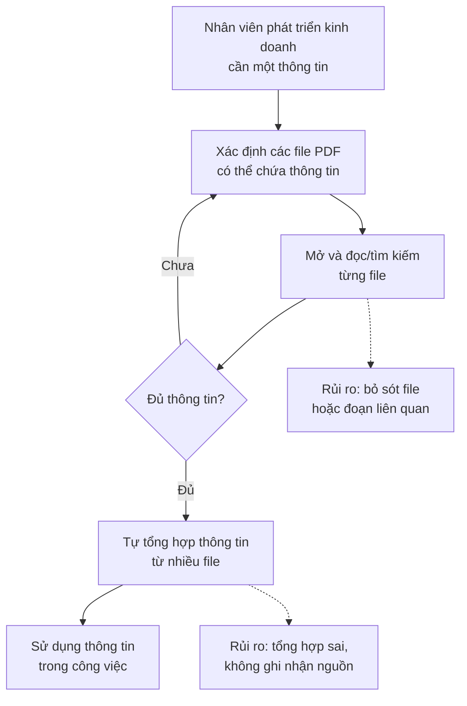
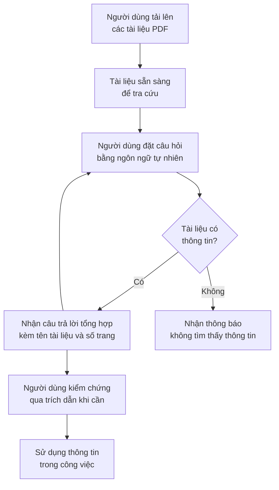

# Tài liệu Yêu cầu Nghiệp vụ (BRD) — Công cụ "Chat với tài liệu" (MVP)

> **Chuẩn áp dụng:** IEEE 29148-2018 — Requirements engineering
> **Giai đoạn SDLC:** 5.2 Requirements and discovery
> **Prompt nguồn:** [docs/BRD_Prompt_IEEE_standard.md](../BRD_Prompt_IEEE_standard.md)

---

## 0. Tóm tắt kiểm tra đầu vào

### 0.1 Đầu vào đã nhận

| Source ID | Nguồn | Loại | Chủ sở hữu | Ngày / Phiên bản | Nội dung chứng minh |
|---|---|---|---|---|---|
| SRC-001 | Yêu cầu từ quản lý (mục 2.1 của prompt BRD) | Sponsor brief (mô tả ngắn) | Quản lý — [TBD: OQ-012] | Nhận ngày 2026-10-19 | Vấn đề nghiệp vụ (khó nắm bắt, mất thời gian tổng hợp từ nhiều PDF), mục tiêu MVP (web app, upload PDF, chat với AI), cho phép BA đề xuất thêm tính năng |
| SRC-002 | IEEE 29148-2018 và prompt BRD | Chuẩn / phương pháp | — | 2018 / v1.0 | Cấu trúc tài liệu, quy tắc chất lượng yêu cầu (không phải bằng chứng nghiệp vụ) |

### 0.2 Đầu vào còn thiếu

- Không có phỏng vấn người dùng, số liệu nền (baseline), quy trình hiện tại được tài liệu hóa, ngân sách, mốc thời gian, chính sách bảo mật dữ liệu.
- Không có tên nhà tài trợ (executive sponsor), chủ sở hữu nghiệp vụ (business owner).
- Không có thông tin về số lượng, kích thước, ngôn ngữ, mức độ bảo mật của bộ tài liệu PDF.

Mọi nội dung không có nguồn được đánh dấu `[Unverified]` hoặc `[TBD: OQ-xxx]`.

### 0.3 Ba rủi ro lớn nhất đối với chất lượng yêu cầu

1. **Không có số liệu nền** → các mục tiêu (BO) chưa thể kiểm chứng được lợi ích (OQ-001, OQ-002).
2. **Chưa rõ phân loại bảo mật của tài liệu và việc có được phép gửi nội dung đến dịch vụ AI bên ngoài** → có thể chặn toàn bộ phương án triển khai (OQ-006).
3. **Chưa có ngưỡng chấp nhận về độ chính xác và thời gian phản hồi** → các yêu cầu Must cốt lõi (BR-007, BR-008, BR-009, BR-013) chưa kiểm chứng được (OQ-009, OQ-015).

---

## 1. Kiểm soát tài liệu

| Thuộc tính | Giá trị |
|---|---|
| Tiêu đề | Tài liệu Yêu cầu Nghiệp vụ — Công cụ "Chat với tài liệu" (MVP) |
| Mã tài liệu | BRD-CVD-001 |
| Phiên bản | 0.1 |
| Trạng thái | Draft |
| Tác giả | nguoidinguocgio (Business Analyst) |
| Người đóng góp | Đội BA — [TBD] |
| Người rà soát | Đội phát triển kinh doanh, Đội phát triển, An toàn thông tin — [TBD] |
| Người phê duyệt | Quản lý (người yêu cầu) — [TBD: OQ-012] |
| Phân loại bảo mật | Nội bộ |

### 1.1 Lịch sử phiên bản

| Phiên bản | Ngày | Tác giả | Tóm tắt thay đổi |
|---|---|---|---|
| 0.1 | 2026-10-19 | nguoidinguocgio | Bản nháp đầu tiên dựa trên SRC-001 |

### 1.2 Danh sách phân phối

| Bên nhận | Mục đích |
|---|---|
| Quản lý (người yêu cầu) | Phê duyệt |
| Đội phát triển kinh doanh | Xác nhận nhu cầu, cung cấp dữ liệu nền |
| Đội BA | Rà soát, đề xuất tính năng |
| Đội phát triển | Đánh giá khả thi, đầu vào cho PRD/SRS |
| An toàn thông tin / Pháp chế | Rà soát ràng buộc dữ liệu |

### 1.3 Quy ước ngôn ngữ yêu cầu

| Từ dùng trong tài liệu | Tương đương IEEE | Ý nghĩa |
|---|---|---|
| **phải** | shall | Bắt buộc |
| **nên** | should | Mong muốn, không bắt buộc |
| **có thể** | may | Được phép, tùy chọn |

---

## 2. Tóm tắt điều hành

**Vấn đề.** Đội phát triển kinh doanh làm việc với nhiều tài liệu PDF của dự án. Họ khó nắm bắt đầy đủ nội dung, và mỗi lần cần một thông tin thường mất thời gian tổng hợp từ nhiều file (SRC-001). Mức độ thiệt hại (số giờ, số lần tra cứu, lỗi do bỏ sót) chưa được đo: [TBD: OQ-001].

**Thay đổi đề xuất.** Xây dựng một MVP ứng dụng web cho phép người dùng tải lên các tài liệu PDF và đặt câu hỏi bằng ngôn ngữ tự nhiên cho AI. AI trả lời dựa trên nội dung các tài liệu đã tải lên, có kèm nguồn trích dẫn để người dùng kiểm chứng (SRC-001).

**Lợi ích kỳ vọng và cách đo.**
- Giảm thời gian tìm thông tin (MET-001).
- Câu trả lời đầy đủ và chính xác hơn khi thông tin nằm ở nhiều tài liệu (MET-002).
- Có bằng chứng để quyết định đầu tư tiếp sau MVP (MET-003, MET-004).

Giá trị nền và mục tiêu của các chỉ số này chưa có: [TBD: OQ-001, OQ-002].

**Đầu tư, thời gian, rủi ro chính.** Ngân sách và thời gian: [TBD: OQ-011]. Rủi ro chính: AI trả lời sai hoặc bịa thông tin (RSK-001), lộ tài liệu bảo mật (RSK-002), PDF dạng scan không trích xuất được nội dung (RSK-003).

**Quyết định cần từ người phê duyệt.**
1. Xác nhận phạm vi MVP (mục 5) và danh sách yêu cầu Must (mục 7).
2. Chỉ định chủ sở hữu và hạn trả lời cho các câu hỏi mở chặn phê duyệt (OQ-006, OQ-007, OQ-009, OQ-015).

---

## 3. Bối cảnh nghiệp vụ và phát biểu vấn đề

### 3.1 Quy trình hiện tại

Quy trình dưới đây được suy ra từ SRC-001 và chưa được xác nhận qua quan sát hoặc phỏng vấn `[Unverified]` (OQ-017).

### 3.2 Quy trình đề xuất (mức nghiệp vụ)

### 3.3 Đối tượng bị ảnh hưởng

| Đối tượng | Ảnh hưởng | Bằng chứng |
|---|---|---|
| Đội phát triển kinh doanh | Mất thời gian tìm và tổng hợp thông tin; khó nắm bắt đầy đủ tài liệu | SRC-001 |
| Quản lý | Hiệu suất đội và chất lượng quyết định phụ thuộc vào thông tin được tổng hợp | `[Unverified]` |

### 3.4 Chi phí của việc không hành động

- **Chi phí thời gian:** số giờ tra cứu thủ công tiếp tục phát sinh. Chưa định lượng: [TBD: OQ-001].
- **Rủi ro chất lượng:** thông tin bị bỏ sót hoặc tổng hợp sai có thể dẫn đến quyết định kinh doanh sai `[Unverified]`.
- **Doanh thu, tuân thủ, khách hàng:** chưa có bằng chứng: [TBD: OQ-001].

### 3.5 Nguyên nhân gốc và triệu chứng

| Triệu chứng (quan sát được) | Nguyên nhân gốc (giả thuyết) | Trạng thái |
|---|---|---|
| Tra cứu một thông tin mất nhiều thời gian (SRC-001) | Thông tin phân tán trong nhiều file PDF; không có cách tra cứu xuyên suốt toàn bộ tài liệu | `[Unverified]` |
| Đội khó nắm bắt đầy đủ tài liệu (SRC-001) | Khối lượng tài liệu lớn so với thời gian có thể dành để đọc | `[Unverified]` — khối lượng chưa đo (OQ-004) |
| Khó kiểm chứng thông tin đã tổng hợp | Không ghi nhận nguồn khi tổng hợp thủ công | `[Unverified]` |

### 3.6 Vì sao làm ngay bây giờ

Quản lý đã yêu cầu phát triển MVP (SRC-001). Sự kiện kích hoạt và mức độ khẩn cấp cụ thể chưa được nêu: [TBD: OQ-018].

---

## 4. Động lực và mục tiêu nghiệp vụ

| ID | Động lực nghiệp vụ | Mục tiêu (kết quả, không phải hoạt động) | Metric ID | Baseline | Target | Thời hạn | Nguồn |
|---|---|---|---|---|---|---|---|
| BO-001 | Mất nhiều thời gian tìm thông tin trong nhiều PDF | Giảm thời gian người dùng cần để có câu trả lời cho một câu hỏi nghiệp vụ dựa trên tài liệu dự án | MET-001 | [TBD: OQ-001] | [TBD: OQ-002] | [TBD: OQ-011] | SRC-001 |
| BO-002 | Khó nắm bắt đầy đủ; tổng hợp từ nhiều file dễ bỏ sót | Câu trả lời đầy đủ, chính xác và kiểm chứng được khi thông tin nằm ở nhiều tài liệu | MET-002 | [TBD: OQ-001] | [TBD: OQ-015] | [TBD: OQ-011] | SRC-001 |
| BO-003 | MVP là bước thử nghiệm | Có đủ bằng chứng về mức độ sử dụng và mức độ hài lòng để quyết định đầu tư tiếp | MET-003, MET-004 | Không áp dụng (sản phẩm mới) | [TBD: OQ-002] | Cuối giai đoạn thử nghiệm MVP — [TBD: OQ-011] | SRC-001 (từ "MVP") |

### 4.1 Định nghĩa chỉ số

| Metric ID | Định nghĩa | Công thức | Nguồn dữ liệu | Chủ sở hữu | Tần suất | Ngày đo baseline |
|---|---|---|---|---|---|---|
| MET-001 | Thời gian trung bình để có câu trả lời đúng cho một câu hỏi nghiệp vụ dựa trên tài liệu | Tổng thời gian từ lúc bắt đầu tra cứu đến lúc có câu trả lời đúng ÷ số câu hỏi, trên bộ câu hỏi kiểm thử chuẩn (DEP-002) | Baseline: bấm giờ tra cứu thủ công. Sau MVP: bấm giờ dùng công cụ trên cùng bộ câu hỏi | Trưởng nhóm phát triển kinh doanh — [TBD] | Một lần trước MVP, một lần cuối giai đoạn thử nghiệm | [TBD: OQ-001] |
| MET-002 | Tỷ lệ câu trả lời đạt yêu cầu | Số câu trả lời được chuyên gia nghiệp vụ đánh giá "đúng và đầy đủ, trích dẫn đúng nguồn" ÷ tổng số câu hỏi trong bộ kiểm thử × 100% | Đánh giá của chuyên gia trên bộ câu hỏi kiểm thử chuẩn (DEP-002) | Trưởng nhóm phát triển kinh doanh — [TBD] | Mỗi lần nghiệm thu | [TBD: OQ-001] |
| MET-003 | Tỷ lệ người dùng hoạt động hằng tuần | Số người dùng mục tiêu đặt ít nhất 1 câu hỏi trong tuần ÷ tổng số người dùng mục tiêu × 100% | Số liệu sử dụng (BR-019) | Quản lý — [TBD] | Hằng tuần | Không áp dụng |
| MET-004 | Tỷ lệ câu trả lời được đánh giá hữu ích | Số đánh giá "hữu ích" ÷ tổng số đánh giá × 100% | Phản hồi người dùng (BR-018) | Quản lý — [TBD] | Hằng tuần | Không áp dụng |

> Mục tiêu (target) của tất cả các chỉ số chưa được nhà tài trợ đặt ra. Theo IEEE 29148, các mục tiêu BO-001 và BO-002 chưa hợp lệ cho tới khi có baseline (OQ-001) và target (OQ-002, OQ-015).

---

## 5. Phạm vi

### 5.1 Trong phạm vi (MVP)

- **Năng lực nghiệp vụ:** tải lên tài liệu PDF; quản lý danh sách tài liệu; hỏi đáp bằng ngôn ngữ tự nhiên trên nội dung tài liệu; trích dẫn nguồn; kiểm soát truy cập; thu thập số liệu để đánh giá MVP (SRC-001).
- **Đơn vị tổ chức:** đội phát triển kinh doanh của dự án (SRC-001).
- **Kênh:** ứng dụng web (SRC-001).
- **Miền dữ liệu:** tài liệu PDF của dự án kinh doanh do người dùng tải lên (SRC-001).
- **Địa lý:** [TBD: OQ-019].

### 5.2 Ngoài phạm vi

| Hạng mục | Lý do |
|---|---|
| Định dạng tài liệu khác PDF (Word, Excel, PowerPoint, ảnh) | SRC-001 chỉ nêu PDF; giữ MVP nhỏ gọn |
| Ứng dụng di động native | SRC-001 chỉ nêu ứng dụng web |
| Tự động đồng bộ tài liệu từ kho lưu trữ khác (ổ chia sẻ, hệ thống quản lý tài liệu) | Không có trong SRC-001; làm tăng phạm vi tích hợp |
| Chỉnh sửa nội dung tài liệu PDF | Mục tiêu là tra cứu, không phải biên tập |
| Đưa ra quyết định nghiệp vụ tự động dựa trên câu trả lời | Câu trả lời chỉ hỗ trợ con người; người dùng chịu trách nhiệm kiểm chứng |

### 5.3 Hoãn sang giai đoạn sau

| Hạng mục | Lý do hoãn |
|---|---|
| Nhận dạng ký tự (OCR) cho PDF dạng ảnh scan | Chờ OQ-010; phụ thuộc tỷ lệ tài liệu scan trong thực tế |
| Hiểu nội dung bảng biểu, hình ảnh, biểu đồ trong PDF | Độ phức tạp cao; đánh giá sau MVP |
| Các tính năng BA đề xuất có ưu tiên Could (BR-020, BR-021) | Chỉ làm nếu còn nguồn lực trong MVP (OQ-014) |

### 5.4 Ranh giới

- **Bắt đầu:** khi người dùng có file PDF và tải lên ứng dụng.
- **Kết thúc:** khi người dùng nhận được câu trả lời có trích dẫn hoặc thông báo không tìm thấy thông tin. Việc người dùng sử dụng thông tin đó sau này nằm ngoài phạm vi.
- **Các chương trình liên quan:** chưa xác định [TBD: OQ-018].

---

## 6. Các bên liên quan và nhu cầu

### 6.1 Danh sách các bên liên quan

| ID | Bên liên quan / nhóm | Vai trò nghiệp vụ | Mối quan tâm | Ảnh hưởng | Nhu cầu (SN) | Nguồn |
|---|---|---|---|---|---|---|
| STK-001 | Quản lý (người yêu cầu) | Nhà tài trợ, người phê duyệt | Hiệu suất đội, bằng chứng giá trị của MVP | Cao | SN-006, SN-012 | SRC-001 |
| STK-002 | Đội phát triển kinh doanh | Người dùng chính | Tìm thông tin nhanh, đầy đủ, đáng tin cậy | Cao | SN-001 – SN-009 | SRC-001 |
| STK-003 | Đội BA | Phân tích, đề xuất tính năng | Giải pháp đáp ứng đúng nhu cầu; được đóng góp tính năng | Trung bình | SN-011 | SRC-001 |
| STK-004 | Đội phát triển | Xây dựng và vận hành MVP | Yêu cầu rõ ràng, phạm vi có giới hạn | Trung bình | SN-013 | `[Unverified]` — suy ra từ việc phải "phát triển MVP" |
| STK-005 | CNTT / An toàn thông tin | Bảo vệ dữ liệu của tổ chức; **có thể chặn triển khai** | Tài liệu kinh doanh không bị lộ | Cao | SN-010 | `[Unverified]` (OQ-006) |
| STK-006 | Pháp chế / Tuân thủ | Đảm bảo tuân thủ quy định và hợp đồng bảo mật; **có thể chặn triển khai** | Việc gửi tài liệu tới dịch vụ AI bên ngoài tuân thủ quy định và cam kết bảo mật với đối tác | Cao | SN-014 | `[Unverified]` (OQ-006) |

### 6.2 Nhu cầu của các bên liên quan

| ID | Bên liên quan | Phát biểu nhu cầu | Vấn đề hiện tại | Bằng chứng | Ưu tiên |
|---|---|---|---|---|---|
| SN-001 | STK-002 | "Tôi cần có câu trả lời cho câu hỏi nghiệp vụ mà không phải đọc lại nhiều file PDF." | Mất thời gian mở và đọc nhiều file | SRC-001 | Must |
| SN-002 | STK-002 | "Tôi cần câu trả lời gom đủ thông tin từ tất cả các tài liệu liên quan." | Tổng hợp thủ công từ nhiều file, dễ bỏ sót | SRC-001 | Must |
| SN-003 | STK-002 | "Tôi cần biết những tài liệu nào đang được dùng để trả lời." | Không rõ nguồn nào đã được tra cứu | `[Unverified]` | Must |
| SN-004 | STK-002 | "Tôi cần biết khi một tài liệu không dùng được để tra cứu." | Có thể tin nhầm rằng tài liệu đã được tra cứu | `[Unverified]` | Must |
| SN-005 | STK-002 | "Tôi cần loại bỏ tài liệu đã lỗi thời hoặc tải nhầm." | Thông tin cũ có thể làm sai câu trả lời | `[Unverified]` | Should |
| SN-006 | STK-002, STK-001 | "Tôi cần kiểm chứng được câu trả lời lấy từ đâu." | Thông tin tổng hợp thủ công không ghi nguồn | `[Unverified]` | Must |
| SN-007 | STK-002 | "Tôi muốn chỉ hỏi trong một vài tài liệu cụ thể." | Kết quả bị nhiễu bởi tài liệu không liên quan | `[Unverified]` | Should |
| SN-008 | STK-002 | "Tôi muốn hỏi tiếp mà không phải nhắc lại bối cảnh." | Phải lặp lại ngữ cảnh mỗi câu hỏi | `[Unverified]` | Should |
| SN-009 | STK-002 | "Tôi muốn xem lại các câu đã hỏi trước đó." | Phải tra cứu lại từ đầu | `[Unverified]` | Should |
| SN-010 | STK-005 | "Chỉ người được phép mới truy cập được tài liệu kinh doanh." | Chưa rõ — tài liệu có thể chứa thông tin bảo mật | `[Unverified]` | Must |
| SN-011 | STK-003 | "Người dùng cần nắm nhanh nội dung tổng quan của một tài liệu." | Khó nắm bắt đầy đủ tài liệu | SRC-001 (vấn đề); đề xuất của BA | Could |
| SN-012 | STK-001 | "Tôi cần số liệu để quyết định có đầu tư tiếp sau MVP hay không." | Chưa có cách đo giá trị | SRC-001 (từ "MVP") | Must |
| SN-013 | STK-004 | "Chúng tôi cần phạm vi MVP rõ ràng và có giới hạn." | Nguy cơ phạm vi phình to do các đề xuất bổ sung | `[Unverified]` | Must |
| SN-014 | STK-006 | "Việc xử lý tài liệu phải tuân thủ quy định và cam kết bảo mật." | Chưa rõ chính sách | `[Unverified]` (OQ-006) | Must |

---

## 7. Yêu cầu nghiệp vụ

Mẫu câu: **[BR-xxx]** [Điều kiện, nếu có], [tác nhân] **phải / nên / có thể** [năng lực hoặc kết quả] [đối tượng và ràng buộc].

Phương pháp kiểm chứng: **Kiểm thử** (Test), **Trình diễn** (Demonstration), **Kiểm tra** (Inspection), **Phân tích** (Analysis), **Rà soát** (Review).

### 7.1 Nhóm A — Quản lý tài liệu

| ID | Yêu cầu | Lý do | Nguồn | Ưu tiên | Tiêu chí chấp nhận | Kiểm chứng | Trạng thái |
|---|---|---|---|---|---|---|---|
| BR-001 | Người dùng **phải** tải lên được một tài liệu PDF để làm nguồn tra cứu. | Không có tài liệu thì không có gì để hỏi đáp | BO-001 / SN-001 | Must | **AC-001:** Với một file PDF dạng văn bản nằm trong giới hạn BRU-004, sau khi tải lên, tài liệu xuất hiện trong danh sách với trạng thái "Sẵn sàng" và nội dung của nó được dùng để trả lời ít nhất một câu hỏi kiểm thử về tài liệu đó. | Kiểm thử | Draft |
| BR-002 | Người dùng **phải** tải lên được tối đa [TBD: OQ-004] tài liệu PDF để cùng tạo thành một bộ tài liệu tra cứu. | Vấn đề gốc là thông tin nằm rải rác trong nhiều file | BO-002 / SN-002 | Must | **AC-002:** Sau khi tải lên đủ số tài liệu tối đa đã chốt, tất cả đều ở trạng thái "Sẵn sàng" và mỗi tài liệu được trích dẫn đúng trong ít nhất một câu trả lời kiểm thử. | Kiểm thử | Draft |
| BR-003 | Người dùng **phải** xem được danh sách các tài liệu đã tải lên, gồm tên và trạng thái xử lý của từng tài liệu. | Người dùng cần biết nguồn nào đang được dùng để trả lời | SN-003 | Must | **AC-003:** Sau khi tải lên 3 tài liệu (2 hợp lệ, 1 lỗi), danh sách hiển thị đủ 3 tên tài liệu, 2 tài liệu "Sẵn sàng" và 1 tài liệu "Lỗi". | Trình diễn | Draft |
| BR-004 | Khi một tài liệu không dùng được để tra cứu, người dùng **phải** nhận được thông báo nêu rõ lý do. | Tránh việc người dùng tưởng tài liệu đã được tra cứu | SN-004 / RSK-003 | Must | **AC-004:** Với mỗi trường hợp: (a) file không phải PDF, (b) PDF có mật khẩu, (c) vượt giới hạn BRU-004, (d) không trích xuất được nội dung văn bản — thông báo nêu đúng lý do tương ứng và tài liệu không ở trạng thái "Sẵn sàng". | Kiểm thử | Draft |
| BR-005 | Người dùng **nên** xóa được một tài liệu đã tải lên khỏi bộ tài liệu tra cứu. | Loại bỏ tài liệu lỗi thời hoặc tải nhầm | SN-005 | Should | **AC-005:** Sau khi xóa tài liệu A, A không còn trong danh sách; câu hỏi về nội dung chỉ có trong A nhận thông báo không tìm thấy thông tin (BR-009); không câu trả lời nào trích dẫn A. | Kiểm thử | Draft |

### 7.2 Nhóm B — Hỏi đáp trên tài liệu

| ID | Yêu cầu | Lý do | Nguồn | Ưu tiên | Tiêu chí chấp nhận | Kiểm chứng | Trạng thái |
|---|---|---|---|---|---|---|---|
| BR-006 | Người dùng **phải** đặt được câu hỏi bằng ngôn ngữ tự nhiên về nội dung bộ tài liệu đã tải lên và nhận được câu trả lời dạng văn bản. | Năng lực cốt lõi của MVP | BO-001 / SN-001 / SRC-001 | Must | **AC-006:** Trên bộ câu hỏi kiểm thử chuẩn (DEP-002), 100% câu hỏi nhận được hoặc một câu trả lời, hoặc thông báo không tìm thấy thông tin; không câu hỏi nào kết thúc mà không có phản hồi. | Kiểm thử | Draft |
| BR-007 | Khi thông tin cần để trả lời nằm ở nhiều tài liệu, câu trả lời **phải** tổng hợp thông tin từ tất cả các tài liệu liên quan. | Giải quyết việc tổng hợp thủ công dễ bỏ sót | BO-002 / SN-002 | Must | **AC-007:** Với các câu hỏi đa tài liệu trong bộ kiểm thử, tỷ lệ câu trả lời được chuyên gia đánh giá "đầy đủ" (có thông tin từ mọi tài liệu liên quan theo đáp án chuẩn) ≥ [TBD: OQ-015]. | Kiểm thử + Phân tích | Draft |
| BR-008 | Mỗi câu trả lời có nội dung **phải** chỉ rõ tên tài liệu và số trang chứa thông tin đã dùng. | Người dùng cần kiểm chứng; giảm tác động của câu trả lời sai | BO-002 / SN-006 / RSK-001 | Must | **AC-008:** 100% câu trả lời có nội dung trong bộ kiểm thử có ít nhất một trích dẫn (tên tài liệu + số trang); tỷ lệ trích dẫn trỏ đúng trang chứa thông tin ≥ [TBD: OQ-015]. | Kiểm tra + Kiểm thử | Draft |
| BR-009 | Khi bộ tài liệu không chứa thông tin để trả lời, người dùng **phải** nhận được thông báo rằng không tìm thấy thông tin trong tài liệu, thay cho một câu trả lời không có căn cứ. | Câu trả lời bịa đặt có thể dẫn đến quyết định sai | BO-002 / SN-006 / RSK-001 | Must | **AC-009:** Với ít nhất 10 câu hỏi "ngoài phạm vi tài liệu" trong bộ kiểm thử, tỷ lệ nhận thông báo không tìm thấy ≥ [TBD: OQ-015]. | Kiểm thử | Draft |
| BR-010 | Người dùng **nên** giới hạn được phạm vi câu hỏi vào một hoặc một số tài liệu do mình chọn. | Giảm nhiễu từ tài liệu không liên quan | SN-007 | Should | **AC-010:** Khi chỉ chọn tài liệu A và B, 100% trích dẫn trong các câu trả lời kiểm thử chỉ thuộc A hoặc B. | Kiểm thử | Draft |
| BR-011 | Trong cùng một cuộc hội thoại, người dùng **nên** đặt được câu hỏi tiếp nối tham chiếu đến câu hỏi hoặc câu trả lời trước đó mà không cần nhắc lại ngữ cảnh. | Hỏi đáp tự nhiên hơn, tiết kiệm thời gian | BO-001 / SN-008 | Should | **AC-011:** Với 5 kịch bản hội thoại, mỗi kịch bản có ít nhất 1 câu hỏi tiếp nối không nhắc lại chủ đề, ít nhất 4/5 kịch bản có câu trả lời được chuyên gia đánh giá đúng ngữ cảnh. | Kiểm thử | Draft |
| BR-012 | Người dùng **phải** đặt được câu hỏi và nhận câu trả lời bằng [TBD: OQ-005] (ngôn ngữ). | Người dùng cần làm việc bằng ngôn ngữ của mình và của tài liệu | SN-001 | Must | **AC-012:** Với mỗi ngôn ngữ đã chốt, các câu hỏi kiểm thử viết bằng ngôn ngữ đó nhận câu trả lời bằng cùng ngôn ngữ. | Kiểm thử | Draft |
| BR-013 | Người dùng **phải** nhận được câu trả lời trong vòng [TBD: OQ-009] kể từ khi gửi câu hỏi. | Thời gian chờ là thành phần của MET-001 | BO-001 / SN-001 | Must | **AC-013:** Đo trên bộ câu hỏi kiểm thử với bộ tài liệu ở mức tối đa (BR-002), tỷ lệ câu trả lời trong ngưỡng thời gian đã chốt đạt mức đã chốt tại OQ-009. | Kiểm thử + Phân tích | Draft |
| BR-014 | Người dùng **nên** xem lại được các câu hỏi và câu trả lời trước đó của chính mình trong thời hạn [TBD: OQ-013]. | Tránh phải tra cứu lại từ đầu | SN-009 | Should | **AC-014:** Sau khi đăng xuất và truy cập lại, người dùng thấy các cuộc hội thoại trước đó còn trong thời hạn lưu giữ, với nội dung câu hỏi và câu trả lời không thay đổi. | Trình diễn | Draft |

### 7.3 Nhóm C — Truy cập và bảo vệ tài liệu

| ID | Yêu cầu | Lý do | Nguồn | Ưu tiên | Tiêu chí chấp nhận | Kiểm chứng | Trạng thái |
|---|---|---|---|---|---|---|---|
| BR-015 | Tổ chức **phải** giới hạn quyền truy cập ứng dụng chỉ cho những người dùng được cấp quyền. | Tài liệu kinh doanh có thể chứa thông tin bảo mật | SN-010 | Must | **AC-015:** Một người chưa được cấp quyền không xem được danh sách tài liệu, không đặt được câu hỏi và không xem được câu trả lời nào. | Kiểm thử | Draft |
| BR-016 | Người dùng **phải** chỉ xem và truy vấn được những tài liệu thuộc phạm vi được phép theo mô hình chia sẻ [TBD: OQ-007]. | Tránh lộ tài liệu giữa các người dùng hoặc nhóm không được phép | SN-010 | Must | **AC-016:** Với hai người dùng X và Y không được chia sẻ tài liệu cho nhau, tài liệu của X không xuất hiện trong danh sách của Y và không được trích dẫn trong câu trả lời cho Y. | Kiểm thử | Draft |
| BR-017 | Nội dung tài liệu được tải lên **phải** được xử lý tuân thủ chính sách bảo mật thông tin và phân loại dữ liệu của tổ chức [TBD: OQ-006]. | Lộ tài liệu có thể gây thiệt hại pháp lý và thương mại | SN-010 / SN-014 / CON-005 | Must | **AC-017:** Bộ phận An toàn thông tin và Pháp chế ký xác nhận giải pháp tuân thủ chính sách trước khi đưa MVP cho người dùng. | Rà soát | Draft |

### 7.4 Nhóm D — Đo lường MVP

| ID | Yêu cầu | Lý do | Nguồn | Ưu tiên | Tiêu chí chấp nhận | Kiểm chứng | Trạng thái |
|---|---|---|---|---|---|---|---|
| BR-018 | Người dùng **nên** đánh giá được từng câu trả lời là "hữu ích" hoặc "không hữu ích". | Nguồn dữ liệu cho MET-004; phát hiện câu trả lời kém | BO-003 / SN-012 | Should | **AC-018:** Sau khi người dùng đánh giá một câu trả lời, đánh giá đó xuất hiện trong số liệu tổng hợp của MET-004 trong kỳ báo cáo tiếp theo. | Trình diễn | Draft |
| BR-019 | Tổ chức **phải** thu thập được số liệu sử dụng hằng tuần, gồm số người dùng hoạt động, số câu hỏi và số tài liệu đã tải lên. | Nguồn dữ liệu cho MET-003; bằng chứng để quyết định đầu tư tiếp | BO-003 / SN-012 | Must | **AC-019:** Sau một tuần thử nghiệm có kịch bản (số người dùng, câu hỏi, tài liệu đã biết trước), báo cáo tuần hiển thị đúng cả ba số liệu. | Kiểm thử | Draft |

### 7.5 Nhóm E — Tính năng đề xuất bởi đội BA

| ID | Yêu cầu | Lý do | Nguồn | Ưu tiên | Tiêu chí chấp nhận | Kiểm chứng | Trạng thái |
|---|---|---|---|---|---|---|---|
| BR-020 | Người dùng **có thể** yêu cầu bản tóm tắt nội dung của một tài liệu đã tải lên. | Giúp nắm nhanh tổng quan tài liệu — giải quyết "khó nắm bắt đầy đủ" (SRC-001) | BO-002 / SN-011 | Could | **AC-020:** Với 5 tài liệu mẫu, chuyên gia nghiệp vụ đánh giá ít nhất 4/5 bản tóm tắt bao quát đúng các ý chính và không chứa thông tin không có trong tài liệu. | Kiểm thử + Rà soát | Draft |
| BR-021 | Người dùng **có thể** sao chép một câu trả lời kèm trích dẫn để dùng trong tài liệu công việc. | Giảm thao tác chép lại thủ công | BO-001 / SN-001 | Could | **AC-021:** Nội dung được sao chép chứa đầy đủ văn bản câu trả lời và các trích dẫn của nó. | Trình diễn | Draft |
| BR-022 | Người dùng **nên** xem được đoạn văn bản gốc trong tài liệu tương ứng với mỗi trích dẫn. | Kiểm chứng câu trả lời nhanh, không cần tự mở file | BO-002 / SN-006 | Should | **AC-022:** Với 10 trích dẫn ngẫu nhiên, người dùng mở được đoạn văn bản gốc tương ứng và đoạn đó chứa thông tin đã được trích dẫn. | Trình diễn | Draft |

### 7.6 Nhóm F — Loại trừ rõ ràng trong bản phát hành này (Won't)

| ID | Yêu cầu | Lý do | Nguồn | Ưu tiên | Tiêu chí chấp nhận | Kiểm chứng | Trạng thái |
|---|---|---|---|---|---|---|---|
| BR-023 | Người dùng tải lên được tài liệu định dạng khác PDF. | Ngoài phạm vi MVP (mục 5.2) | SRC-001 | Won't | Không áp dụng trong bản phát hành này | — | Draft |
| BR-024 | Tổ chức tự động đồng bộ tài liệu từ kho lưu trữ có sẵn. | Ngoài phạm vi MVP (mục 5.2) | SN-013 | Won't | Không áp dụng trong bản phát hành này | — | Draft |

---

## 8. Quy tắc nghiệp vụ

| ID | Quy tắc | Loại | Phạm vi | Người chịu trách nhiệm thực thi | Nguồn |
|---|---|---|---|---|---|
| BRU-001 | Chỉ tài liệu định dạng PDF được chấp nhận làm nguồn tra cứu trong MVP. | Chính sách | Tải lên tài liệu | Product Owner — [TBD] | SRC-001 |
| BRU-002 | Câu trả lời chỉ được dựa trên nội dung các tài liệu đã tải lên, không dùng kiến thức bên ngoài tài liệu. | Quyết định | Hỏi đáp | Product Owner — [TBD] | Đề xuất của BA — **chờ xác nhận tại OQ-016** |
| BRU-003 | Tài liệu đã bị xóa không được dùng làm nguồn cho bất kỳ câu trả lời nào sau thời điểm xóa. | Chính sách | Quản lý tài liệu, hỏi đáp | Product Owner — [TBD] | Suy ra từ SN-005 |
| BRU-004 | Mỗi tài liệu tải lên không vượt quá [TBD: OQ-004] MB và [TBD: OQ-004] trang. | Chính sách | Tải lên tài liệu | Product Owner — [TBD] | [TBD: OQ-004] |
| BRU-005 | Tài liệu và lịch sử hội thoại được lưu giữ trong [TBD: OQ-013] và bị xóa sau thời hạn đó. | Pháp lý / Chính sách | Lưu giữ dữ liệu | An toàn thông tin — [TBD] | [TBD: OQ-013] |

---

## 9. Ràng buộc

| ID | Ràng buộc | Loại | Bên áp đặt | Tác động | Nguồn |
|---|---|---|---|---|---|
| CON-001 | Sản phẩm bàn giao là một MVP (phạm vi tối thiểu để kiểm chứng giá trị). | Tổ chức | Quản lý | Chỉ các yêu cầu Must được bảo đảm; Should/Could tùy nguồn lực | SRC-001 |
| CON-002 | Sản phẩm là ứng dụng web. | Kỹ thuật | Quản lý | Loại trừ ứng dụng desktop/di động native | SRC-001 |
| CON-003 | Tài liệu đầu vào là file PDF. | Kỹ thuật | Quản lý | Loại trừ các định dạng khác (BR-023) | SRC-001 |
| CON-004 | Hỏi đáp được thực hiện bởi AI. | Kỹ thuật | Quản lý | Kéo theo rủi ro câu trả lời sai (RSK-001) và chi phí sử dụng AI (RSK-007) | SRC-001 |
| CON-005 | Xử lý dữ liệu phải tuân thủ chính sách bảo mật thông tin của tổ chức. | Pháp lý / Quy định | An toàn thông tin, Pháp chế | Có thể giới hạn việc dùng dịch vụ AI bên ngoài | `[Unverified]` — nội dung cụ thể chờ OQ-006 |
| CON-006 | Ngân sách | Ngân sách | Quản lý | [TBD: OQ-011] | [TBD: OQ-011] |
| CON-007 | Thời hạn bàn giao | Thời gian | Quản lý | [TBD: OQ-011] | [TBD: OQ-011] |

---

## 10. Giả định, phụ thuộc và rủi ro

| ID | Hạng mục | Loại | Mô tả | Tác động nếu sai | Chủ sở hữu | Kiểm chứng / giảm thiểu | Hạn |
|---|---|---|---|---|---|---|---|
| ASM-001 | PDF chủ yếu là dạng văn bản | Giả định | Phần lớn tài liệu có lớp văn bản, không phải ảnh scan | Nhiều tài liệu không tra cứu được; phải đưa OCR vào MVP | Đội phát triển kinh doanh | Lấy mẫu bộ tài liệu thực tế, đếm tỷ lệ file scan (OQ-010) | [TBD] |
| ASM-002 | Ngôn ngữ tài liệu | Giả định | Tài liệu chủ yếu bằng tiếng Việt và/hoặc tiếng Anh `[Unverified]` | Chất lượng trả lời giảm với ngôn ngữ khác | Đội phát triển kinh doanh | Xác nhận tại OQ-005 | [TBD] |
| ASM-003 | Quy mô người dùng nhỏ | Giả định | MVP chỉ phục vụ đội phát triển kinh doanh của một dự án | Yêu cầu về tải và chi phí thay đổi | Quản lý | Xác nhận tại OQ-003 | [TBD] |
| ASM-004 | Người dùng có trình duyệt web và kết nối mạng ổn định | Giả định | Phù hợp với CON-002 | Một số người dùng không truy cập được | Đội phát triển | Khảo sát môi trường làm việc | [TBD] |
| ASM-005 | Được phép xử lý tài liệu bằng dịch vụ AI | Giả định | Chính sách bảo mật cho phép đưa nội dung tài liệu vào dịch vụ AI được chọn | **Chặn phương án triển khai**; có thể phải dùng AI nội bộ, tăng chi phí và thời gian | An toàn thông tin | Xác nhận tại OQ-006 trước khi thiết kế | [TBD] |
| DEP-001 | Quyết định về dịch vụ AI | Phụ thuộc | Cần quyết định dịch vụ/mô hình AI được phép sử dụng | Không thể bắt đầu xây dựng | Đội phát triển + An toàn thông tin | Theo dõi tại OQ-006; đây là quyết định thiết kế (SAD) | [TBD] |
| DEP-002 | Bộ tài liệu mẫu và bộ câu hỏi kiểm thử chuẩn | Phụ thuộc | Đội phát triển kinh doanh cung cấp bộ PDF đại diện và bộ câu hỏi có đáp án chuẩn (gồm câu hỏi đa tài liệu và câu hỏi ngoài phạm vi) | Không đo được MET-001, MET-002; không nghiệm thu được BR-006 – BR-009 | Trưởng nhóm phát triển kinh doanh | Lập danh sách và chốt hạn bàn giao | [TBD] |
| DEP-003 | Phê duyệt của An toàn thông tin / Pháp chế | Phụ thuộc | Cần xác nhận AC-017 trước khi đưa cho người dùng | Không thể phát hành MVP | An toàn thông tin, Pháp chế | Mời tham gia rà soát BRD | [TBD] |
| RSK-001 | AI trả lời sai hoặc bịa thông tin | Rủi ro | Mô hình AI tạo nội dung không có trong tài liệu → người dùng tin và dùng → quyết định kinh doanh sai | Cao | Product Owner | BR-008, BR-009, BR-022 (trích dẫn, kiểm chứng); truyền thông rõ cho người dùng rằng phải kiểm chứng | [TBD] |
| RSK-002 | Lộ tài liệu bảo mật | Rủi ro | Tài liệu nhạy cảm được tải lên → bị truy cập trái phép hoặc gửi đến bên thứ ba không được phép → thiệt hại pháp lý, thương mại | Cao | An toàn thông tin | BR-015, BR-016, BR-017; chốt OQ-006, OQ-007 trước thiết kế | [TBD] |
| RSK-003 | Không trích xuất được nội dung PDF | Rủi ro | PDF scan, bảng biểu, hình ảnh → nội dung không được đọc → câu trả lời thiếu | Trung bình | Đội phát triển | BR-004 (thông báo rõ); lấy mẫu tài liệu thực tế (ASM-001) | [TBD] |
| RSK-004 | Người dùng không áp dụng | Rủi ro | Câu trả lời không đủ tin cậy hoặc chậm → người dùng quay lại tra cứu thủ công → MVP không chứng minh được giá trị | Trung bình | Quản lý | Theo dõi MET-003, MET-004 hằng tuần; mời người dùng tham gia nghiệm thu | [TBD] |
| RSK-005 | Phình phạm vi | Rủi ro | Nhiều đề xuất tính năng bổ sung → trễ hạn MVP | Trung bình | Product Owner | Giữ ưu tiên MoSCoW; tính năng Could chỉ làm khi Must đã xong (OQ-014) | [TBD] |
| RSK-006 | Không chứng minh được lợi ích | Rủi ro | Không có baseline → không so sánh được trước/sau → không ra được quyết định đầu tư | Cao | Quản lý | Đo baseline MET-001, MET-002 trước khi phát hành MVP (OQ-001) | [TBD] |
| RSK-007 | Chi phí sử dụng AI vượt ngân sách | Rủi ro | Số lượng câu hỏi/tài liệu tăng → chi phí dịch vụ AI tăng → vượt ngân sách | Trung bình | Quản lý | Chốt ngân sách (OQ-011); theo dõi số liệu BR-019 | [TBD] |

---

## 11. Truy vết

### 11.1 Ma trận truy vết

| Mục tiêu nghiệp vụ | Nhu cầu | Yêu cầu nghiệp vụ | Tiêu chí chấp nhận | ID PRD/SRS |
|---|---|---|---|---|
| BO-001 | SN-001 | BR-001 | AC-001 | [TBD] |
| BO-002 | SN-002 | BR-002 | AC-002 | [TBD] |
| — | SN-003 | BR-003 | AC-003 | [TBD] |
| — | SN-004 | BR-004 | AC-004 | [TBD] |
| — | SN-005 | BR-005 | AC-005 | [TBD] |
| BO-001 | SN-001 | BR-006 | AC-006 | [TBD] |
| BO-002 | SN-002 | BR-007 | AC-007 | [TBD] |
| BO-002 | SN-006 | BR-008 | AC-008 | [TBD] |
| BO-002 | SN-006 | BR-009 | AC-009 | [TBD] |
| — | SN-007 | BR-010 | AC-010 | [TBD] |
| BO-001 | SN-008 | BR-011 | AC-011 | [TBD] |
| — | SN-001 | BR-012 | AC-012 | [TBD] |
| BO-001 | SN-001 | BR-013 | AC-013 | [TBD] |
| — | SN-009 | BR-014 | AC-014 | [TBD] |
| — | SN-010 | BR-015 | AC-015 | [TBD] |
| — | SN-010 | BR-016 | AC-016 | [TBD] |
| — | SN-010, SN-014 | BR-017 | AC-017 | [TBD] |
| BO-003 | SN-012 | BR-018 | AC-018 | [TBD] |
| BO-003 | SN-012 | BR-019 | AC-019 | [TBD] |
| BO-002 | SN-011 | BR-020 | AC-020 | [TBD] |
| BO-001 | SN-001 | BR-021 | AC-021 | [TBD] |
| BO-002 | SN-006 | BR-022 | AC-022 | [TBD] |
| — | SN-013 | BR-023, BR-024 (Won't) | — | Không áp dụng |

### 11.2 Báo cáo độ bao phủ

| Kiểm tra | Kết quả |
|---|---|
| Mục tiêu không có yêu cầu | Không có. BO-001: BR-001, 006, 011, 013, 021. BO-002: BR-002, 007, 008, 009, 020, 022. BO-003: BR-018, 019. |
| Yêu cầu không có mục tiêu hoặc nhu cầu (mồ côi) | Không có. Mọi BR đều truy vết tới ít nhất một SN. |
| Nhu cầu không có yêu cầu | **SN-013** (phạm vi MVP rõ ràng) không có BR riêng — được đáp ứng bằng mục 5 (Phạm vi), CON-001 và các BR Won't. Đây là nhu cầu về quản lý dự án, không phải năng lực nghiệp vụ. |
| Yêu cầu không có tiêu chí chấp nhận hoặc phương pháp kiểm chứng | Không có, ngoại trừ BR-023, BR-024 (Won't — có chủ đích). **Lưu ý:** AC-002, 007, 008, 009, 012, 013, 017 chứa giá trị [TBD] nên **chưa thể quyết định khách quan** cho tới khi OQ-004, 005, 006, 009, 015 được giải quyết. |

---

## 12. Câu hỏi mở và quyết định

| ID | Câu hỏi / quyết định cần đưa ra | Vì sao quan trọng | Chủ sở hữu | Hạn | Trạng thái | Giải quyết |
|---|---|---|---|---|---|---|
| OQ-001 | Thời gian hiện tại để tìm một thông tin là bao lâu? Bao nhiêu lần tra cứu mỗi tuần? Đã có sai sót nào do bỏ sót thông tin? | Baseline cho MET-001, MET-002; chi phí của việc không hành động | Trưởng nhóm phát triển kinh doanh | Trước khi phê duyệt BRD | Open | — |
| OQ-002 | Giá trị mục tiêu cho MET-001, MET-003, MET-004 là bao nhiêu? | BO-001, BO-003 chưa hợp lệ khi chưa có target | Quản lý (nhà tài trợ) | Trước khi phê duyệt BRD | Open | — |
| OQ-003 | Có bao nhiêu người dùng trong MVP? | ASM-003; quy mô, chi phí | Quản lý | Trước khi viết PRD | Open | — |
| OQ-004 | Bộ tài liệu có bao nhiêu file? Kích thước và số trang tối đa của một file? | BR-002, BRU-004, AC-002 | Đội phát triển kinh doanh | Trước khi viết PRD | Open | — |
| OQ-005 | Tài liệu và câu hỏi dùng những ngôn ngữ nào? | BR-012, ASM-002 | Đội phát triển kinh doanh | Trước khi viết PRD | Open | — |
| OQ-006 | Phân loại bảo mật của tài liệu là gì? Có được phép gửi nội dung tài liệu tới dịch vụ AI bên ngoài không? Có cam kết bảo mật nào với đối tác? | BR-017, CON-005, ASM-005, DEP-001 — **có thể chặn toàn bộ phương án** | An toàn thông tin + Pháp chế | Trước khi phê duyệt BRD | Open | — |
| OQ-007 | Tài liệu được chia sẻ chung cho cả đội hay riêng từng người dùng? | BR-016 | Quản lý | Trước khi phê duyệt BRD | Open | — |
| OQ-008 | Người dùng được cấp quyền truy cập theo cách nào (tài khoản riêng, tài khoản công ty có sẵn)? | BR-015 | CNTT | Trước khi viết PRD | Open | — |
| OQ-009 | Thời gian phản hồi chấp nhận được là bao nhiêu giây, cho bao nhiêu phần trăm câu hỏi? | BR-013, AC-013 | Đội phát triển kinh doanh + Đội phát triển | Trước khi phê duyệt BRD | Open | — |
| OQ-010 | Tỷ lệ tài liệu PDF dạng scan là bao nhiêu? Có cần hỗ trợ trong MVP không? | ASM-001, RSK-003, phạm vi hoãn | Đội phát triển kinh doanh | Trước khi viết PRD | Open | — |
| OQ-011 | Ngân sách và thời hạn bàn giao MVP? | CON-006, CON-007, thời hạn các BO | Quản lý | Trước khi phê duyệt BRD | Open | — |
| OQ-012 | Ai là nhà tài trợ (executive sponsor) và chủ sở hữu nghiệp vụ (business owner)? | Phê duyệt, chủ sở hữu chỉ số | Quản lý | Trước khi phê duyệt BRD | Open | — |
| OQ-013 | Tài liệu và lịch sử hội thoại được lưu giữ bao lâu? | BR-014, BRU-005 | An toàn thông tin | Trước khi viết PRD | Open | — |
| OQ-014 | Những tính năng BA đề xuất (BR-020, BR-021, BR-022) nào được đưa vào MVP? | Phạm vi, RSK-005 | Quản lý | Trước khi phê duyệt BRD | Open | — |
| OQ-015 | Ngưỡng chấp nhận về độ đầy đủ, độ chính xác trích dẫn và tỷ lệ nhận diện câu hỏi ngoài phạm vi là bao nhiêu (%)? | AC-007, AC-008, AC-009; target MET-002 | Quản lý + Đội phát triển kinh doanh | Trước khi phê duyệt BRD | Open | — |
| OQ-016 | AI có được phép bổ sung kiến thức chung ngoài tài liệu khi trả lời không? | BRU-002 | Quản lý | Trước khi viết PRD | Open | — |
| OQ-017 | Quy trình tra cứu hiện tại có đúng như mô tả ở mục 3.1? | Xác thực vấn đề nghiệp vụ | BA + Đội phát triển kinh doanh | Trước khi phê duyệt BRD | Open | — |
| OQ-018 | Sự kiện kích hoạt và mức độ khẩn cấp là gì? Có chương trình nào liên quan? | Mục 3.6, 5.4 | Quản lý | Trước khi phê duyệt BRD | Open | — |
| OQ-019 | MVP dùng cho những địa điểm/văn phòng nào? | Phạm vi địa lý, có thể ảnh hưởng quy định dữ liệu | Quản lý | Trước khi viết PRD | Open | — |

Hạn cụ thể (ngày) sẽ được gán khi lên lịch buổi rà soát BRD.

---

## 13. Thuật ngữ và tài liệu tham chiếu

### 13.1 Thuật ngữ

| Thuật ngữ | Định nghĩa |
|---|---|
| MVP (Minimum Viable Product) | Phiên bản sản phẩm có phạm vi tối thiểu, đủ để kiểm chứng giá trị với người dùng thật |
| Tài liệu | Một file PDF do người dùng tải lên |
| Bộ tài liệu tra cứu | Tập hợp các tài liệu ở trạng thái "Sẵn sàng" mà người dùng được phép truy vấn |
| Sẵn sàng | Trạng thái của tài liệu khi nội dung của nó có thể được dùng để trả lời câu hỏi |
| PDF dạng văn bản | PDF có lớp văn bản có thể chọn/sao chép được |
| PDF dạng scan | PDF chỉ chứa ảnh chụp trang, không có lớp văn bản |
| Câu trả lời | Văn bản phản hồi một câu hỏi, dựa trên nội dung bộ tài liệu tra cứu |
| Trích dẫn | Tham chiếu tới tên tài liệu và số trang chứa thông tin được dùng trong câu trả lời |
| Câu hỏi đa tài liệu | Câu hỏi mà đáp án chuẩn cần thông tin từ hai tài liệu trở lên |
| Câu hỏi ngoài phạm vi | Câu hỏi mà bộ tài liệu không chứa thông tin để trả lời |
| Bộ câu hỏi kiểm thử chuẩn | Tập câu hỏi có đáp án chuẩn do đội phát triển kinh doanh cung cấp (DEP-002), dùng để đo chỉ số và nghiệm thu |
| Cuộc hội thoại | Chuỗi câu hỏi và câu trả lời liên tiếp của một người dùng, trong đó câu hỏi sau có thể tham chiếu câu trước |
| Người dùng hoạt động | Người dùng đặt ít nhất một câu hỏi trong kỳ đo |
| AI | Trí tuệ nhân tạo; trong tài liệu này chỉ thành phần tạo câu trả lời bằng ngôn ngữ tự nhiên |
| MoSCoW | Thang ưu tiên Must / Should / Could / Won't |
| PRD / SRS / SAD | Product Requirements Document / Software Requirements Specification / Software Architecture Document — các tài liệu hạ nguồn |

### 13.2 Tài liệu tham chiếu

| Tên | Phiên bản | Vị trí | Ngày truy cập |
|---|---|---|---|
| ISO/IEC/IEEE 29148:2018 — Requirements engineering | 2018 | Chuẩn IEEE | 2026-10-19 |
| Prompt BRD theo chuẩn IEEE | 1.0 | [docs/BRD_Prompt_IEEE_standard.md](../BRD_Prompt_IEEE_standard.md) | 2026-10-19 |

---

## 14. Phê duyệt

| Vai trò | Họ tên | Quyết định | Chữ ký / ngày |
|---|---|---|---|
| Nhà tài trợ (Executive sponsor) | [TBD: OQ-012] | [Phê duyệt / Phê duyệt có điều kiện / Từ chối] | |
| Chủ sở hữu nghiệp vụ (Business owner) | [TBD: OQ-012] | [Phê duyệt / Từ chối] | |
| Product Manager / Product Owner | [TBD] | [Phê duyệt / Từ chối] | |
| An toàn thông tin / Pháp chế | [TBD] | [Phê duyệt / Từ chối] | |

**Phiên bản được phê duyệt:** sẽ là v1.0 (bản baseline) sau khi các câu hỏi mở chặn phê duyệt được giải quyết.

**Điều kiện phê duyệt:** OQ-001, OQ-002, OQ-006, OQ-007, OQ-009, OQ-011, OQ-012, OQ-014, OQ-015 đã có câu trả lời và được cập nhật vào tài liệu.

---

## 15. Phụ lục

### Phụ lục A — Ghi chú chuyển cho PRD/SAD (không phải yêu cầu nghiệp vụ)

Các ý tưởng thiết kế sau xuất hiện trong quá trình phân tích. Chúng được ghi lại để các tài liệu hạ nguồn cân nhắc, **không** ràng buộc giải pháp:

- Cơ chế tìm kiếm ngữ nghĩa trên nội dung tài liệu kết hợp với mô hình ngôn ngữ để tạo câu trả lời có trích dẫn.
- Lựa chọn giữa dịch vụ AI bên ngoài và mô hình triển khai nội bộ — phụ thuộc OQ-006.
- Hiển thị câu trả lời dần dần (streaming) để giảm cảm nhận thời gian chờ — liên quan BR-013.

### Phụ lục B — Kết quả kiểm tra chất lượng (mục 5 của prompt)

**B.1 Chất lượng yêu cầu**

| Kiểm tra | Kết quả | Ghi chú |
|---|---|---|
| Mọi yêu cầu dùng cú pháp phải/nên/có thể và chỉ có một nghĩa vụ | Đạt | BR-006 gồm "đặt câu hỏi" và "nhận câu trả lời" — được xem là một giao dịch hỏi đáp duy nhất |
| Không có ngôn ngữ giải pháp/thiết kế | Đạt | Ý tưởng thiết kế được chuyển sang Phụ lục A |
| Được định lượng khi số lượng ảnh hưởng đến nghiệm thu | **Chưa đạt** | BR-002, BR-007, BR-008, BR-009, BR-013 chứa [TBD] |
| Không còn từ ngữ mơ hồ | Đạt | |
| Thuật ngữ chuyên biệt có trong bảng thuật ngữ | Đạt | |
| Không trùng lặp hoặc mâu thuẫn | Đạt | |
| ID duy nhất, cố định | Đạt | |

**B.2 Tính đầy đủ và truy vết**

| Kiểm tra | Kết quả | Ghi chú |
|---|---|---|
| Mọi BO có ít nhất một BR | Đạt | |
| Mọi BR truy vết tới BO hoặc SN | Đạt | |
| Mọi BR có tiêu chí chấp nhận | Đạt | Trừ BR Won't (có chủ đích) |
| Mọi BR có phương pháp kiểm chứng | Đạt | |
| Mọi nhóm bên liên quan có ít nhất một nhu cầu | Đạt | SN của STK-004, 005, 006 là `[Unverified]` |
| Phạm vi, loại trừ, giả định, phụ thuộc, rủi ro đều có nội dung | Đạt | |
| Mọi câu hỏi mở có chủ sở hữu và hạn | Đạt một phần | Hạn được nêu theo mốc ("trước khi phê duyệt BRD"), chưa có ngày cụ thể |

**B.3 Xác nhận nghiệp vụ**

| Kiểm tra | Kết quả | Ghi chú |
|---|---|---|
| Vấn đề được chứng minh bằng bằng chứng | **Chưa đạt** | Chỉ có SRC-001; cần OQ-001, OQ-017 |
| Baseline và target có nguồn, đo được | **Chưa đạt** | OQ-001, OQ-002, OQ-015 |
| Lợi ích và chi phí nêu bằng ngôn ngữ nghiệp vụ | Đạt một phần | Chi phí chưa có (OQ-011) |
| Nhà tài trợ xác nhận vấn đề và kết quả mong muốn | **Chưa đạt** | Chờ buổi rà soát |
| Người đọc nghiệp vụ hiểu được mà không cần diễn giải kỹ thuật | Đạt | |

**Khiếm khuyết đối với các yêu cầu Must:** BR-002 (OQ-004), BR-007 (OQ-015), BR-008 (OQ-015), BR-009 (OQ-015), BR-012 (OQ-005), BR-013 (OQ-009), BR-016 (OQ-007), BR-017 (OQ-006).

---

## Kết luận về mức độ sẵn sàng

**Trạng thái: Ready with conditions (Sẵn sàng rà soát có điều kiện) — CHƯA sẵn sàng phê duyệt.**

Tài liệu đủ để đưa vào buổi rà soát với các bên liên quan nhằm xác nhận vấn đề, phạm vi và danh sách yêu cầu. Tài liệu **không** được phê duyệt làm baseline cho tới khi các mục chặn sau được giải quyết:

- **Yêu cầu Must chưa kiểm chứng được:** BR-002, BR-007, BR-008, BR-009, BR-012, BR-013, BR-016, BR-017.
- **Câu hỏi mở chặn phê duyệt:** OQ-001, OQ-002, OQ-006, OQ-007, OQ-009, OQ-011, OQ-012, OQ-014, OQ-015.
- **Rủi ro cao cần chủ sở hữu xác nhận:** RSK-001, RSK-002, RSK-006.
