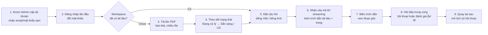

# Tài liệu Yêu cầu Sản phẩm (PRD) — Công cụ "Chat với tài liệu" (MVP)

> **Chuẩn áp dụng:** ISO/IEC/IEEE 29148:2018 — Requirements engineering
> **Tài liệu thượng nguồn:** [BRD-CVD-001 v0.1](BRD.md)
> **Prompt nguồn:** [docs/PRD_Prompt_IEEE_standard.md](../PRD_Prompt_IEEE_standard.md)

---

## 0. Xác nhận các trụ cột sản phẩm

Trước khi viết PRD, các trụ cột của sản phẩm được kiểm tra với BRD và các quyết định đã chốt trong phiên làm việc ngày 2026-10-22 (mục 1.3).

| # | Trụ cột | Phát biểu | Căn cứ | Đánh giá |
|---|---|---|---|---|
| P-1 | **Vấn đề có thật** | Đội phát triển kinh doanh mất nhiều thời gian tìm và tổng hợp thông tin rải rác trong nhiều PDF. | BRD §3, SRC-001 | **Hợp lệ, chưa định lượng.** Chưa có baseline (OQ-001). PRD đặt yêu cầu đo baseline trước launch (mục 5.1). |
| P-2 | **Giá trị cốt lõi** | Hỏi một lần, nhận câu trả lời tổng hợp từ nhiều tài liệu, **có trích dẫn kiểm chứng được**. | BR-006 – BR-009, BR-022 | **Hợp lệ.** Trích dẫn + từ chối khi không có căn cứ là yếu tố phân biệt so với tự đọc PDF hoặc dùng chatbot chung. |
| P-3 | **Niềm tin** | Người dùng chỉ dùng tiếp nếu câu trả lời đáng tin. Câu trả lời bịa đặt nguy hiểm hơn không trả lời. | RSK-001, BRU-002 | **Hợp lệ.** Đây là trụ cột quyết định thành bại; được đo bằng bộ câu hỏi chuẩn (DEP-002) làm launch gate. |
| P-4 | **An toàn dữ liệu** | Tài liệu kinh doanh chỉ người được cấp quyền truy cập; việc gửi tới LLM bên ngoài phải được An toàn thông tin phê duyệt. | BR-015 – BR-017, D-006 | **Hợp lệ có điều kiện.** Phụ thuộc thỏa thuận với nhà cung cấp LLM (không lưu, không huấn luyện) và chữ ký của An toàn thông tin. |
| P-5 | **MVP có giới hạn** | Workspace chung, 20 file, chỉ PDF dạng văn bản, web. Đủ nhỏ để làm nhanh, đủ lớn để chứng minh giá trị. | CON-001 – CON-003, D-001, D-002 | **Hợp lệ.** Rủi ro: 20 file có thể nhỏ hơn bộ tài liệu thực tế (OQ-020). |

**Kết luận:** Các trụ cột nhất quán với nhau và với BRD. Hai điều kiện phải thỏa trước khi launch: (1) có baseline MET-001/MET-002 để chứng minh lợi ích; (2) An toàn thông tin phê duyệt việc dùng LLM bên ngoài.

---

## 1. Kiểm soát tài liệu

| Thuộc tính | Giá trị |
|---|---|
| Tiêu đề | Tài liệu Yêu cầu Sản phẩm — Công cụ "Chat với tài liệu" (MVP) |
| Mã tài liệu | PRD-CVD-001 |
| Phiên bản | 0.1 |
| Trạng thái | Draft |
| Tác giả | nguoidinguocgio (Product Manager / BA) |
| Người rà soát | Đội phát triển, Design, QA, Đội phát triển kinh doanh, An toàn thông tin — [TBD] |
| Người phê duyệt | Quản lý (người yêu cầu) — [TBD: OQ-012] |
| Phân loại bảo mật | Nội bộ |

### 1.1 Lịch sử phiên bản

| Phiên bản | Ngày | Tác giả | Tóm tắt thay đổi |
|---|---|---|---|
| 0.1 | 2026-10-22 | nguoidinguocgio | Bản nháp đầu tiên dựa trên BRD-CVD-001 v0.1 và các quyết định D-001 – D-008 |

### 1.2 Quy ước

- **Ưu tiên:** **P0** — bắt buộc để launch; **P1** — nên có, thuộc phạm vi MVP nếu kịp tiến độ; **P2** — có thể có, mặc định chuyển sang giai đoạn sau.
- **Ánh xạ từ BRD:** Must → P0; Should → P1; Could → P2; trừ khi có quyết định khác (mục 1.3).
- **ID:** `EP-x` (epic), `US-xxx` (user story), `NFR-xxx` (yêu cầu phi chức năng), `EV-xxx` (sự kiện analytics), `D-xxx` (quyết định), `OQ-xxx` (câu hỏi mở, tiếp nối đánh số của BRD).
- Giá trị có nhãn **[Đề xuất]** là đề xuất của PM, cần nhà tài trợ phê duyệt trước khi baseline PRD.

### 1.3 Nhật ký quyết định (giải quyết câu hỏi mở của BRD)

| ID | Câu hỏi BRD | Quyết định | Ảnh hưởng |
|---|---|---|---|
| D-001 | OQ-007 — Mô hình chia sẻ | **Một workspace chung cho cả đội.** Mọi thành viên thấy và hỏi trên toàn bộ tài liệu của workspace. Lịch sử hội thoại là **riêng tư** của từng người. | BR-016, EP-1, EP-2 |
| D-002 | OQ-004 — Giới hạn tài liệu | **Tối đa 20 file trong workspace; mỗi file ≤ 10 MB và ≤ 100 trang.** | BR-002, BRU-004 |
| D-003 | OQ-009, OQ-015 — Ngưỡng định lượng | PM đề xuất giá trị cụ thể, gắn nhãn [Đề xuất] (mục 1.4). | BR-007, BR-008, BR-009, BR-013 |
| D-004 | OQ-014 — Tính năng BA đề xuất | **Đưa vào MVP:** xem đoạn gốc của trích dẫn (BR-022, P1), tóm tắt tài liệu (BR-020, nâng từ Could lên P1). **Không đưa vào:** lọc theo tài liệu (BR-010, P2), sao chép câu trả lời (BR-021, P2). | EP-2, EP-4 |
| D-005 | OQ-005 — Ngôn ngữ | **Tiếng Việt và tiếng Anh**, hỗ trợ hỏi chéo ngôn ngữ. Câu trả lời dùng ngôn ngữ của câu hỏi. | BR-012 |
| D-006 | OQ-006 — Dịch vụ AI | **Được dùng LLM bên ngoài, có điều kiện:** nhà cung cấp cam kết bằng hợp đồng không lưu giữ và không dùng dữ liệu để huấn luyện; An toàn thông tin ký xác nhận trước launch. | BR-017, NFR-S06, Launch gate |
| D-007 | OQ-008 — Đăng nhập | **Email + mật khẩu do Admin tạo.** Không có tự đăng ký. | BR-015, EP-1 |
| D-008 | OQ-010, OQ-013 — PDF scan và lưu giữ | **Không hỗ trợ OCR** — PDF dạng scan bị từ chối kèm thông báo. **Lịch sử hội thoại lưu 90 ngày**; tài liệu lưu đến khi bị xóa. | BR-004, BR-014, BRU-005 |

### 1.4 Ngưỡng định lượng [Đề xuất]

| ID | Chỉ tiêu | Ngưỡng | Điều kiện đo |
|---|---|---|---|
| TH-01 | Thời gian tới token đầu tiên của câu trả lời | p90 ≤ 3 giây | Workspace đầy (20 file × 100 trang), 5 người dùng đồng thời |
| TH-02 | Thời gian tới khi câu trả lời hoàn chỉnh | p90 ≤ 15 giây | Như TH-01 |
| TH-03 | Thời gian xử lý tài liệu tới trạng thái "Sẵn sàng" | p90 ≤ 60 giây cho file 100 trang | Đo từ lúc tải lên xong |
| TH-04 | Tỷ lệ trích dẫn trỏ đúng trang chứa thông tin | ≥ 90% | Bộ câu hỏi chuẩn (DEP-002) |
| TH-05 | Tỷ lệ câu trả lời "đầy đủ" cho câu hỏi đa tài liệu | ≥ 80% | Bộ câu hỏi chuẩn, chuyên gia chấm |
| TH-06 | Tỷ lệ câu hỏi ngoài phạm vi nhận thông báo "không tìm thấy" | ≥ 90% | ≥ 10 câu hỏi ngoài phạm vi |
| TH-07 | Tỷ lệ câu trả lời chứa thông tin không có trong tài liệu (bịa đặt) | ≤ 5% | Bộ câu hỏi chuẩn, chuyên gia chấm |
| TH-08 | Thời gian tải trang ban đầu | ≤ 2 giây (LCP, p75) | Mạng văn phòng, Chrome/Edge bản mới nhất |

---

## 2. Tóm tắt điều hành và chiến lược

### 2.1 Tầm nhìn sản phẩm

> **Mọi thành viên đội kinh doanh có được câu trả lời đúng, có nguồn, từ toàn bộ tri thức tài liệu của dự án trong vài giây, thay vì vài chục phút đọc PDF.**

Trong dài hạn, sản phẩm trở thành lớp tra cứu tri thức chung của đội kinh doanh: mở rộng sang các định dạng và nguồn tài liệu khác, nhiều workspace theo dự án, và tích hợp vào quy trình soạn đề xuất, báo cáo. MVP chỉ chứng minh một giả thuyết: **hỏi đáp có trích dẫn trên bộ PDF của dự án giúp tiết kiệm thời gian đáng kể mà người dùng vẫn tin được kết quả.**

### 2.2 Mục tiêu và kết quả then chốt (OKRs)

Thời hạn đo: 4 tuần sau launch MVP (giai đoạn thử nghiệm). Ngày cụ thể: [TBD: OQ-011].

**O1 — Rút ngắn đáng kể thời gian tìm thông tin trong tài liệu dự án** (BO-001)

| KR | Kết quả then chốt | Chỉ số | Ngưỡng |
|---|---|---|---|
| KR1.1 | Giảm thời gian trung bình để có câu trả lời đúng trên bộ câu hỏi chuẩn so với tra cứu thủ công | MET-001 | Giảm ≥ 50% so với baseline [Đề xuất] |
| KR1.2 | Câu trả lời bắt đầu hiển thị nhanh | TH-01 | p90 ≤ 3 giây |

**O2 — Câu trả lời đủ tin cậy để dùng trong công việc** (BO-002)

| KR | Kết quả then chốt | Chỉ số | Ngưỡng |
|---|---|---|---|
| KR2.1 | Câu trả lời đạt yêu cầu (đúng, đầy đủ, trích dẫn đúng) trên bộ câu hỏi chuẩn | MET-002 | ≥ 85% [Đề xuất] |
| KR2.2 | Trích dẫn trỏ đúng trang | TH-04 | ≥ 90% |
| KR2.3 | Tỷ lệ câu trả lời bịa đặt | TH-07 | ≤ 5% |

**O3 — Chứng minh mức độ chấp nhận để quyết định đầu tư tiếp** (BO-003)

| KR | Kết quả then chốt | Chỉ số | Ngưỡng |
|---|---|---|---|
| KR3.1 | Người dùng hoạt động hằng tuần ở tuần 4 | MET-003 | ≥ 60% người dùng mục tiêu [Đề xuất] |
| KR3.2 | Câu trả lời được đánh giá hữu ích | MET-004 | ≥ 70% số đánh giá [Đề xuất] |

---

## 3. Chân dung người dùng và hành trình

### 3.1 Chân dung người dùng mục tiêu

#### PER-01 — Chuyên viên phát triển kinh doanh (chính)

| Thuộc tính | Mô tả |
|---|---|
| Bên liên quan BRD | STK-002 |
| Công việc | Chuẩn bị đề xuất, trả lời câu hỏi của đối tác và quản lý, đối chiếu điều khoản và số liệu trong tài liệu dự án |
| Bối cảnh | Làm việc với 10–20 PDF (hợp đồng, đề xuất, báo cáo, biên bản) bằng tiếng Việt và tiếng Anh; thường cần câu trả lời trong cuộc họp hoặc khi đang soạn email |
| Nỗi đau | Phải mở nhiều file, dùng Ctrl+F theo từ khóa, dễ bỏ sót khi thông tin dùng từ ngữ khác; không nhớ thông tin nằm ở file nào |
| Mục tiêu | Có câu trả lời đúng trong < 1 phút, biết chính xác nguồn để trích lại hoặc kiểm chứng |
| Mức độ kỹ thuật | Dùng thành thạo ứng dụng văn phòng và web; không có kiến thức về AI |
| Điều khiến họ bỏ dùng | Một lần phát hiện câu trả lời sai mà không có cách kiểm chứng |

#### PER-02 — Trưởng nhóm / Quản lý (phụ)

| Thuộc tính | Mô tả |
|---|---|
| Bên liên quan BRD | STK-001 |
| Công việc | Nắm tình hình dự án, ra quyết định; quyết định có đầu tư tiếp sau MVP hay không |
| Nhu cầu với sản phẩm | Hỏi nhanh để nắm tổng quan tài liệu (tóm tắt); xem số liệu sử dụng và mức độ hài lòng hằng tuần |
| Mục tiêu | Có bằng chứng định lượng về giá trị của MVP |

#### PER-03 — Quản trị viên (Admin) (phụ)

| Thuộc tính | Mô tả |
|---|---|
| Bên liên quan BRD | STK-004 / STK-005 |
| Công việc | Tạo và vô hiệu hóa tài khoản, đặt lại mật khẩu, xóa tài liệu vi phạm |
| Mục tiêu | Chỉ đúng người có quyền truy cập; thao tác quản trị đơn giản, có nhật ký |

### 3.2 Hành trình người dùng tổng quát



| Bước | Mục tiêu người dùng | Điểm chạm sản phẩm | Rủi ro rơi khỏi phễu | Sự kiện đo |
|---|---|---|---|---|
| 1–2 | Vào được hệ thống | Email mời, màn hình đăng nhập, đổi mật khẩu | Không nhận email, quên mật khẩu | EV-001, EV-002 |
| 3–4 | Đưa tài liệu vào | Vùng kéo-thả, danh sách tài liệu, trạng thái | File scan/quá lớn bị từ chối, chờ xử lý lâu | EV-010 – EV-014 |
| 5–6 | Có câu trả lời | Ô nhập câu hỏi, câu trả lời streaming, trích dẫn | Trả lời chậm, "không tìm thấy" quá nhiều | EV-020 – EV-024 |
| 7 | Kiểm chứng | Bảng xem đoạn gốc | Trích dẫn sai trang | EV-030 |
| 8–9 | Dùng lại thường xuyên | Hỏi tiếp, đánh giá, lịch sử | Câu trả lời không hữu ích | EV-031, EV-040, EV-041 |

**Khoảnh khắc "aha" (activation):** người dùng nhận câu trả lời có trích dẫn đầu tiên và bấm vào trích dẫn để kiểm chứng. Định nghĩa đo: người dùng phát sinh EV-023 (`answer_type = answered`) trong 24 giờ kể từ lần đăng nhập đầu tiên.

---

## 4. Yêu cầu chức năng và user stories

### 4.1 Ma trận epic / tính năng

| Epic | Tên | Mô tả | User stories | BR nguồn | Ưu tiên cao nhất |
|---|---|---|---|---|---|
| EP-1 | Truy cập và quản trị người dùng | Đăng nhập email/mật khẩu, Admin quản lý tài khoản | US-001 – US-005 | BR-015, BR-016 | P0 |
| EP-2 | Quản lý tài liệu | Tải lên, xử lý, danh sách, xóa, tóm tắt | US-010 – US-015 | BR-001 – BR-005, BR-020 | P0 |
| EP-3 | Hỏi đáp có trích dẫn | Hỏi đáp ngôn ngữ tự nhiên, tổng hợp đa tài liệu, trích dẫn, từ chối khi không có căn cứ | US-020 – US-026 | BR-006 – BR-009, BR-011 – BR-013 | P0 |
| EP-4 | Kiểm chứng nguồn | Xem đoạn văn gốc của trích dẫn | US-030 | BR-022 | P1 |
| EP-5 | Lịch sử hội thoại | Xem lại, tiếp tục hội thoại cũ | US-040 – US-041 | BR-014 | P1 |
| EP-6 | Đo lường và phản hồi | Đánh giá câu trả lời, báo cáo sử dụng hằng tuần | US-050 – US-051 | BR-018, BR-019 | P0 |
| EP-7 | Bảo vệ dữ liệu | Lưu giữ, mã hóa, tuân thủ chính sách | US-060 – US-061 | BR-017, BRU-005 | P0 |
| — | Hoãn (P2) | Lọc theo tài liệu, sao chép câu trả lời, OCR | US-090 – US-091 | BR-010, BR-021 | P2 |

### 4.2 EP-1 — Truy cập và quản trị người dùng

| ID | User story | Ưu tiên | BR |
|---|---|---|---|
| US-001 | Là **Chuyên viên PTKD**, tôi muốn **đăng nhập bằng email và mật khẩu**, để **chỉ tôi truy cập được tài liệu của đội bằng tài khoản của mình**. | **P0** | BR-015 |
| US-002 | Là **Admin**, tôi muốn **tạo tài khoản cho thành viên mới với mật khẩu tạm**, để **cấp quyền truy cập mà không cần tự đăng ký công khai**. | **P0** | BR-015 |
| US-003 | Là **Admin**, tôi muốn **vô hiệu hóa tài khoản của người rời đội**, để **họ không còn truy cập được tài liệu ngay lập tức**. | **P0** | BR-015, BR-016 |
| US-004 | Là **Admin**, tôi muốn **đặt lại mật khẩu cho người dùng**, để **người quên mật khẩu lấy lại được quyền truy cập**. | P1 | BR-015 |
| US-005 | Là **Chuyên viên PTKD**, tôi muốn **tự đổi mật khẩu**, để **bảo vệ tài khoản của mình**. | P1 | BR-015 |

**Tiêu chí chấp nhận P0**

**US-001**
- **AC-001.1** — *Given* người dùng có tài khoản đang hoạt động, *When* nhập đúng email và mật khẩu, *Then* hệ thống mở trang chat của workspace trong ≤ 2 giây.
- **AC-001.2** — *Given* người dùng nhập sai email hoặc mật khẩu, *When* bấm "Đăng nhập", *Then* hệ thống hiển thị "Email hoặc mật khẩu không đúng" (không tiết lộ trường nào sai) và không tạo phiên.
- **AC-001.3** — *Given* một tài khoản đã nhập sai mật khẩu 5 lần liên tiếp trong 15 phút, *When* thử đăng nhập lần thứ 6, *Then* tài khoản bị khóa 15 phút và hiển thị thông báo khóa tạm thời.
- **AC-001.4** — *Given* người dùng đăng nhập bằng mật khẩu tạm lần đầu, *When* đăng nhập thành công, *Then* hệ thống bắt buộc đổi mật khẩu (≥ 10 ký tự, có chữ và số) trước khi vào trang chat.
- **AC-001.5** — *Given* một phiên không có thao tác trong 8 giờ, *When* người dùng thực hiện thao tác bất kỳ, *Then* hệ thống chuyển về trang đăng nhập và giữ lại nội dung câu hỏi đang soạn dở sau khi đăng nhập lại.
- **AC-001.6** — *Given* người chưa đăng nhập, *When* truy cập trực tiếp URL của trang chat, tài liệu hoặc API, *Then* hệ thống trả về trang đăng nhập (UI) hoặc HTTP 401 (API) và không trả về dữ liệu nào (BR-015 / AC-015).

**US-002**
- **AC-002.1** — *Given* Admin đang ở trang Quản lý người dùng, *When* nhập email hợp lệ chưa tồn tại và bấm "Tạo", *Then* tài khoản được tạo với vai trò Member, trạng thái "Chờ đổi mật khẩu", và hệ thống hiển thị mật khẩu tạm một lần duy nhất để Admin gửi cho người dùng.
- **AC-002.2** — *Given* email đã tồn tại, *When* Admin bấm "Tạo", *Then* hệ thống báo "Email đã được sử dụng" và không tạo tài khoản.
- **AC-002.3** — *Given* người dùng có vai trò Member, *When* truy cập trang Quản lý người dùng, *Then* hệ thống từ chối (HTTP 403) và không hiển thị danh sách người dùng.

**US-003**
- **AC-003.1** — *Given* người dùng X đang đăng nhập, *When* Admin vô hiệu hóa X, *Then* yêu cầu tiếp theo của X bị từ chối trong ≤ 60 giây và X được chuyển về trang đăng nhập.
- **AC-003.2** — *Given* X đã bị vô hiệu hóa, *When* X đăng nhập bằng thông tin đúng, *Then* hệ thống báo "Tài khoản đã bị vô hiệu hóa, liên hệ Admin".
- **AC-003.3** — *Given* X đã bị vô hiệu hóa, *When* xem danh sách tài liệu của workspace, *Then* các tài liệu X đã tải lên vẫn còn và vẫn được dùng để trả lời (tài liệu thuộc workspace, không thuộc cá nhân — D-001).

### 4.3 EP-2 — Quản lý tài liệu

| ID | User story | Ưu tiên | BR |
|---|---|---|---|
| US-010 | Là **Chuyên viên PTKD**, tôi muốn **tải lên một hoặc nhiều file PDF bằng kéo-thả hoặc chọn file**, để **đưa tài liệu dự án vào bộ tra cứu chung**. | **P0** | BR-001, BR-002 |
| US-011 | Là **Chuyên viên PTKD**, tôi muốn **xem danh sách tài liệu của workspace kèm tên, số trang, người tải lên và trạng thái**, để **biết tài liệu nào đang được dùng để trả lời**. | **P0** | BR-003 |
| US-012 | Là **Chuyên viên PTKD**, tôi muốn **nhận thông báo rõ lý do khi một file không dùng được**, để **không tưởng nhầm rằng nội dung của nó đã được tra cứu**. | **P0** | BR-004 |
| US-013 | Là **Chuyên viên PTKD**, tôi muốn **xóa tài liệu mình đã tải lên** (Admin xóa được mọi tài liệu), để **loại bỏ tài liệu lỗi thời hoặc tải nhầm khỏi bộ tra cứu**. | P1 | BR-005, BRU-003 |
| US-014 | Là **Trưởng nhóm**, tôi muốn **yêu cầu bản tóm tắt của một tài liệu**, để **nắm nhanh nội dung chính mà không cần đọc hết**. | P1 | BR-020 (D-004) |
| US-015 | Là **Chuyên viên PTKD**, tôi muốn **được cảnh báo khi tải lên file trùng với file đã có**, để **bộ tài liệu không bị trùng lặp làm nhiễu trích dẫn**. | P1 | BR-002 |

**Tiêu chí chấp nhận P0**

**US-010**
- **AC-010.1** — *Given* workspace có ít hơn 20 tài liệu, *When* người dùng tải lên một PDF dạng văn bản ≤ 10 MB và ≤ 100 trang, *Then* tài liệu xuất hiện trong danh sách với trạng thái "Đang xử lý", rồi chuyển sang "Sẵn sàng" trong ≤ 60 giây (p90, TH-03).
- **AC-010.2** — *Given* tài liệu A vừa chuyển sang "Sẵn sàng", *When* người dùng hỏi một câu mà đáp án chỉ có trong A, *Then* câu trả lời trích dẫn A (BR-001 / AC-001).
- **AC-010.3** — *Given* người dùng chọn 5 file cùng lúc, *When* tải lên, *Then* mỗi file có thanh tiến trình và trạng thái riêng; một file lỗi không làm dừng các file còn lại.
- **AC-010.4** — *Given* workspace đã có 20 tài liệu (tính cả tài liệu đang xử lý), *When* người dùng tải thêm, *Then* hệ thống từ chối với thông báo "Workspace đã đạt giới hạn 20 tài liệu. Xóa bớt tài liệu để tải lên tài liệu mới." và không tải file lên máy chủ.
- **AC-010.5** — *Given* workspace có 18 tài liệu, *When* người dùng chọn 4 file, *Then* hệ thống nhận 2 file đầu theo thứ tự chọn, từ chối 2 file còn lại với thông báo giới hạn.

**US-011**
- **AC-011.1** — *Given* workspace có 3 tài liệu (2 hợp lệ, 1 lỗi), *When* người dùng mở bảng Tài liệu, *Then* hiển thị đủ 3 dòng: tên file, số trang, người tải lên, thời điểm tải lên, trạng thái — 2 "Sẵn sàng", 1 "Lỗi" kèm lý do (BR-003 / AC-003).
- **AC-011.2** — *Given* người dùng A tải lên tài liệu, *When* người dùng B (cùng workspace) mở bảng Tài liệu, *Then* B thấy tài liệu đó trong ≤ 5 giây sau khi trạng thái thay đổi, không cần tải lại trang.
- **AC-011.3** — *Given* bảng Tài liệu, *When* đọc phần đầu bảng, *Then* hiển thị bộ đếm "x/20 tài liệu".

**US-012** — với mỗi trường hợp, *Given* người dùng tải lên file thuộc loại tương ứng, *When* hệ thống kiểm tra/xử lý, *Then* file **không** ở trạng thái "Sẵn sàng" và hiển thị đúng thông báo:

| AC | Trường hợp | Thời điểm phát hiện | Thông báo |
|---|---|---|---|
| AC-012.1 | Không phải PDF (kiểm tra cả phần mở rộng và nội dung file) | Trước khi tải lên | "Chỉ hỗ trợ file PDF." |
| AC-012.2 | Lớn hơn 10 MB | Trước khi tải lên | "File vượt quá 10 MB." |
| AC-012.3 | Nhiều hơn 100 trang | Khi xử lý | "File có {n} trang, vượt giới hạn 100 trang." |
| AC-012.4 | PDF có mật khẩu | Khi xử lý | "File được bảo vệ bằng mật khẩu. Hãy gỡ mật khẩu rồi tải lên lại." |
| AC-012.5 | PDF dạng scan (không có lớp văn bản, D-008) | Khi xử lý | "Không đọc được văn bản trong file (có thể là bản scan). Hiện chưa hỗ trợ PDF dạng ảnh." |
| AC-012.6 | File hỏng, không mở được | Khi xử lý | "File bị lỗi, không mở được." |
| AC-012.7 | Lỗi hệ thống khi xử lý | Khi xử lý | "Xử lý thất bại do lỗi hệ thống." kèm nút "Thử lại" |

- **AC-012.8** — *Given* một PDF có một phần trang dạng scan (≥ 1 trang có văn bản), *When* xử lý xong, *Then* tài liệu ở trạng thái "Sẵn sàng" kèm cảnh báo "{k} trang không đọc được văn bản: trang …".

**Tiêu chí chấp nhận P1 (rút gọn)**
- **US-013:** Sau khi xóa A: A biến mất khỏi danh sách của mọi người dùng trong ≤ 5 giây; câu hỏi về nội dung chỉ có trong A nhận "không tìm thấy"; không câu trả lời mới nào trích dẫn A (BRU-003). Có hộp thoại xác nhận. Member chỉ xóa được tài liệu mình tải lên; Admin xóa được mọi tài liệu. Trích dẫn tới A trong lịch sử cũ hiển thị "Tài liệu đã bị xóa".
- **US-014:** Tóm tắt chỉ tạo được cho tài liệu "Sẵn sàng"; trả về trong ≤ 30 giây (p90); tóm tắt có trích dẫn trang; tóm tắt được lưu lại, lần mở sau không phải tạo lại. Nghiệm thu: ≥ 4/5 tài liệu mẫu được chuyên gia đánh giá đúng ý chính, không có thông tin ngoài tài liệu (AC-020).
- **US-015:** Nhận diện trùng bằng mã băm nội dung; hiển thị "File này đã có trong workspace với tên {tên}" và cho phép hủy hoặc vẫn tải lên.

### 4.4 EP-3 — Hỏi đáp có trích dẫn

| ID | User story | Ưu tiên | BR |
|---|---|---|---|
| US-020 | Là **Chuyên viên PTKD**, tôi muốn **đặt câu hỏi bằng ngôn ngữ tự nhiên và nhận câu trả lời hiển thị dần**, để **có thông tin mà không phải đọc lại nhiều file**. | **P0** | BR-006, BR-013 |
| US-021 | Là **Chuyên viên PTKD**, tôi muốn **câu trả lời tổng hợp thông tin từ tất cả tài liệu liên quan**, để **không bỏ sót khi thông tin nằm ở nhiều file**. | **P0** | BR-007 |
| US-022 | Là **Chuyên viên PTKD**, tôi muốn **mỗi ý trong câu trả lời có trích dẫn tên tài liệu và số trang**, để **kiểm chứng và trích lại nguồn chính xác**. | **P0** | BR-008 |
| US-023 | Là **Chuyên viên PTKD**, tôi muốn **được báo rõ khi tài liệu không có thông tin để trả lời**, để **không dùng nhầm một câu trả lời không có căn cứ**. | **P0** | BR-009, BRU-002 |
| US-024 | Là **Chuyên viên PTKD**, tôi muốn **hỏi bằng tiếng Việt hoặc tiếng Anh trên tài liệu bằng ngôn ngữ bất kỳ trong hai ngôn ngữ đó**, để **làm việc bằng ngôn ngữ thuận tiện nhất**. | **P0** | BR-012 (D-005) |
| US-025 | Là **Chuyên viên PTKD**, tôi muốn **hỏi tiếp mà không cần nhắc lại ngữ cảnh**, để **đào sâu một chủ đề nhanh hơn**. | P1 | BR-011 |
| US-026 | Là **Chuyên viên PTKD**, tôi muốn **dừng một câu trả lời đang tạo**, để **đặt lại câu hỏi khi thấy hỏi chưa đúng ý**. | P1 | BR-013 |

**Tiêu chí chấp nhận P0**

**US-020**
- **AC-020.1** — *Given* workspace có ≥ 1 tài liệu "Sẵn sàng", *When* người dùng gửi câu hỏi 1–2.000 ký tự, *Then* token đầu tiên của câu trả lời hiển thị trong ≤ 3 giây (p90, TH-01) và câu trả lời hoàn chỉnh trong ≤ 15 giây (p90, TH-02).
- **AC-020.2** — *Given* bộ câu hỏi chuẩn (DEP-002), *When* chạy toàn bộ, *Then* 100% câu hỏi kết thúc bằng một câu trả lời, một thông báo "không tìm thấy" hoặc một thông báo lỗi có nút thử lại — không câu hỏi nào treo vô thời hạn (BR-006 / AC-006).
- **AC-020.3** — *Given* câu trả lời đang được tạo, *When* người dùng xem ô nhập, *Then* nút gửi bị vô hiệu hóa cho tới khi câu trả lời kết thúc hoặc bị dừng.
- **AC-020.4** — *Given* workspace không có tài liệu "Sẵn sàng" nào, *When* người dùng mở trang chat, *Then* ô nhập bị vô hiệu hóa và hiển thị "Tải lên ít nhất một tài liệu PDF để bắt đầu hỏi" kèm nút "Tải lên".

**US-021**
- **AC-021.1** — *Given* bộ câu hỏi đa tài liệu trong DEP-002 (≥ 10 câu), *When* chuyên gia chấm câu trả lời theo đáp án chuẩn, *Then* ≥ 80% câu trả lời được đánh giá "đầy đủ" (TH-05).
- **AC-021.2** — *Given* một câu hỏi mà đáp án chuẩn dùng thông tin từ tài liệu A và B, *When* hệ thống trả lời, *Then* câu trả lời có trích dẫn tới cả A và B.
- **AC-021.3** — *Given* hai tài liệu chứa thông tin mâu thuẫn về cùng một nội dung, *When* người dùng hỏi về nội dung đó, *Then* câu trả lời nêu cả hai thông tin kèm trích dẫn riêng và nói rõ là có mâu thuẫn, không tự chọn một bên.

**US-022**
- **AC-022.1** — *Given* một câu trả lời có nội dung, *When* hiển thị xong, *Then* mỗi đoạn có chứa thông tin từ tài liệu có ít nhất một trích dẫn dạng `[n]`, và cuối câu trả lời có danh sách nguồn "[n] {tên tài liệu}, trang {p}".
- **AC-022.2** — *Given* bộ câu hỏi chuẩn, *When* kiểm tra từng trích dẫn, *Then* 100% câu trả lời có nội dung có ≥ 1 trích dẫn và ≥ 90% trích dẫn trỏ đúng trang chứa thông tin (TH-04, BR-008 / AC-008).
- **AC-022.3** — *Given* bộ câu hỏi chuẩn, *When* chuyên gia chấm, *Then* ≤ 5% câu trả lời chứa thông tin không có trong tài liệu (TH-07).

**US-023**
- **AC-023.1** — *Given* ≥ 10 câu hỏi ngoài phạm vi trong DEP-002, *When* gửi từng câu, *Then* ≥ 90% nhận thông báo "Không tìm thấy thông tin này trong các tài liệu hiện có." (TH-06, BR-009 / AC-009).
- **AC-023.2** — *Given* câu hỏi về kiến thức chung không có trong tài liệu (ví dụ "Thủ đô của Pháp là gì?"), *When* hệ thống trả lời, *Then* hệ thống không dùng kiến thức bên ngoài tài liệu để trả lời (BRU-002) và hiển thị thông báo "không tìm thấy".
- **AC-023.3** — *Given* tài liệu chỉ chứa một phần thông tin, *When* hệ thống trả lời, *Then* câu trả lời nêu phần tìm thấy kèm trích dẫn và nói rõ phần nào không tìm thấy.

**US-024**
- **AC-024.1** — *Given* câu hỏi bằng tiếng Việt, *When* hệ thống trả lời, *Then* câu trả lời bằng tiếng Việt; tương tự với tiếng Anh.
- **AC-024.2** — *Given* thông tin chỉ có trong tài liệu tiếng Anh, *When* người dùng hỏi bằng tiếng Việt, *Then* câu trả lời bằng tiếng Việt, trích dẫn đúng tài liệu tiếng Anh, và tỷ lệ đạt trên tập câu hỏi chéo ngôn ngữ của DEP-002 không thấp hơn tập cùng ngôn ngữ quá 10 điểm phần trăm.

**Tiêu chí chấp nhận P1 (rút gọn)**
- **US-025:** Ngữ cảnh gồm tối thiểu 10 lượt hỏi đáp gần nhất của hội thoại. Với 5 kịch bản có câu hỏi tiếp nối không nhắc chủ đề, ≥ 4/5 kịch bản được đánh giá đúng ngữ cảnh (AC-011). Nút "Hội thoại mới" xóa ngữ cảnh.
- **US-026:** Nút "Dừng" xuất hiện khi đang tạo câu trả lời; sau khi bấm, việc tạo dừng trong ≤ 1 giây, phần đã hiển thị được giữ lại kèm nhãn "Đã dừng".

### 4.5 EP-4 — Kiểm chứng nguồn

| ID | User story | Ưu tiên | BR |
|---|---|---|---|
| US-030 | Là **Chuyên viên PTKD**, tôi muốn **bấm vào một trích dẫn để xem đoạn văn gốc và trang PDF tương ứng**, để **kiểm chứng câu trả lời mà không phải tự mở file**. | P1 | BR-022 (D-004) |

**Tiêu chí chấp nhận (P1)**
- **AC-030.1** — *Given* câu trả lời có trích dẫn `[n]`, *When* người dùng bấm `[n]`, *Then* bảng bên phải mở trong ≤ 1,5 giây, hiển thị trang PDF được trích dẫn và **làm nổi bật** đoạn văn bản đã dùng.
- **AC-030.2** — *Given* 10 trích dẫn ngẫu nhiên, *When* mở từng trích dẫn, *Then* đoạn được làm nổi bật chứa thông tin đã được trích dẫn ở ≥ 9/10 trường hợp (AC-022).
- **AC-030.3** — *Given* tài liệu được trích dẫn đã bị xóa, *When* bấm trích dẫn, *Then* hiển thị "Tài liệu đã bị xóa khỏi workspace" thay cho nội dung.

### 4.6 EP-5 — Lịch sử hội thoại

| ID | User story | Ưu tiên | BR |
|---|---|---|---|
| US-040 | Là **Chuyên viên PTKD**, tôi muốn **xem danh sách các hội thoại trước của mình**, để **tìm lại câu trả lời đã có mà không phải hỏi lại**. | P1 | BR-014 |
| US-041 | Là **Chuyên viên PTKD**, tôi muốn **mở lại và hỏi tiếp trong một hội thoại cũ**, để **tiếp tục công việc dang dở**. | P1 | BR-014, BR-011 |

**Tiêu chí chấp nhận (P1, rút gọn)**
- Danh sách hội thoại ở thanh bên trái, sắp xếp mới nhất trước, tiêu đề tự sinh từ câu hỏi đầu tiên.
- Sau khi đăng xuất và đăng nhập lại, nội dung câu hỏi, câu trả lời, trích dẫn không thay đổi (AC-014).
- Người dùng chỉ thấy hội thoại của chính mình (D-001); Admin cũng **không** xem được hội thoại của người khác qua giao diện.
- Hội thoại không có hoạt động quá 90 ngày bị xóa tự động (D-008, BRU-005); hội thoại còn ≤ 7 ngày trước khi xóa hiển thị nhãn "Sẽ bị xóa sau {d} ngày".
- Người dùng xóa được hội thoại của mình.

### 4.7 EP-6 — Đo lường và phản hồi

| ID | User story | Ưu tiên | BR |
|---|---|---|---|
| US-050 | Là **Trưởng nhóm**, tôi muốn **xem báo cáo hằng tuần gồm số người dùng hoạt động, số câu hỏi, số tài liệu tải lên và tỷ lệ đánh giá hữu ích**, để **có bằng chứng quyết định đầu tư tiếp sau MVP**. | **P0** | BR-019 |
| US-051 | Là **Chuyên viên PTKD**, tôi muốn **đánh giá từng câu trả lời là 👍 hữu ích / 👎 không hữu ích, kèm lý do tùy chọn**, để **đội sản phẩm cải thiện chất lượng câu trả lời**. | P1 | BR-018 |

**Tiêu chí chấp nhận P0**

**US-050**
- **AC-050.1** — *Given* một tuần thử nghiệm có kịch bản với số người dùng, câu hỏi và tài liệu đã biết trước, *When* Admin hoặc Trưởng nhóm mở trang Báo cáo, *Then* báo cáo tuần hiển thị đúng cả ba số liệu: người dùng hoạt động, số câu hỏi, số tài liệu tải lên (BR-019 / AC-019).
- **AC-050.2** — *Given* trang Báo cáo, *When* xem, *Then* có thêm: tỷ lệ câu trả lời 👍 (MET-004), tỷ lệ "không tìm thấy", độ trễ p50/p90, và cho phép chọn tuần bất kỳ trong 12 tuần gần nhất.
- **AC-050.3** — *Given* người dùng có vai trò Member, *When* truy cập trang Báo cáo, *Then* bị từ chối (HTTP 403). Quyền xem báo cáo: Admin và vai trò "Trưởng nhóm" [TBD: OQ-021].
- **AC-050.4** — *Given* báo cáo, *When* xem, *Then* báo cáo không chứa nội dung câu hỏi, câu trả lời hoặc tài liệu, chỉ số liệu tổng hợp.

**US-051 (P1, rút gọn):** Mỗi câu trả lời có 👍/👎; chọn 👎 mở các lý do: "Sai thông tin", "Thiếu thông tin", "Trích dẫn sai", "Khác" + ô ghi chú ≤ 500 ký tự. Người dùng đổi được đánh giá. Đánh giá xuất hiện trong báo cáo tuần kế tiếp (AC-018).

### 4.8 EP-7 — Bảo vệ dữ liệu

| ID | User story | Ưu tiên | BR |
|---|---|---|---|
| US-060 | Là **Bộ phận An toàn thông tin**, tôi muốn **tài liệu và hội thoại được mã hóa, chỉ gửi tới nhà cung cấp LLM đã được phê duyệt với cam kết không lưu giữ**, để **tài liệu kinh doanh không bị lộ ra ngoài phạm vi cho phép**. | **P0** | BR-017 (D-006) |
| US-061 | Là **Admin**, tôi muốn **mọi thao tác tải lên, xóa tài liệu, tạo/vô hiệu hóa tài khoản được ghi nhật ký**, để **truy vết khi có sự cố**. | **P0** | BR-015, BR-017 |

**Tiêu chí chấp nhận P0**

**US-060**
- **AC-060.1** — *Given* hệ thống triển khai, *When* An toàn thông tin rà soát, *Then* có bằng chứng: dữ liệu truyền qua TLS ≥ 1.2; tài liệu, nội dung đã trích xuất và hội thoại được mã hóa khi lưu trữ; mật khẩu được băm bằng thuật toán có salt (bcrypt/argon2).
- **AC-060.2** — *Given* hợp đồng/điều khoản với nhà cung cấp LLM, *When* Pháp chế và An toàn thông tin rà soát, *Then* có xác nhận bằng văn bản: không lưu giữ dữ liệu sau khi xử lý (hoặc thời gian lưu giữ được phê duyệt) và không dùng dữ liệu để huấn luyện.
- **AC-060.3** — *Given* một tài liệu bị xóa, *When* quá 24 giờ, *Then* file gốc, nội dung trích xuất và chỉ mục tìm kiếm của nó đều bị xóa khỏi lưu trữ chính (bản sao lưu hết hạn theo chính sách sao lưu [TBD: OQ-022]).
- **AC-060.4** — *Given* tất cả các điều kiện trên, *When* trước launch, *Then* An toàn thông tin và Pháp chế ký xác nhận (BR-017 / AC-017). **Thiếu chữ ký = không launch.**

**US-061**
- **AC-061.1** — *Given* một trong các thao tác: đăng nhập thành công/thất bại, tạo/vô hiệu hóa tài khoản, đặt lại mật khẩu, tải lên/xóa tài liệu, *When* thao tác xảy ra, *Then* nhật ký ghi: thời điểm, người thực hiện, loại thao tác, đối tượng, kết quả.
- **AC-061.2** — *Given* nhật ký kiểm toán, *When* Admin xem, *Then* lọc được theo người dùng và khoảng thời gian; nhật ký không sửa/xóa được qua giao diện và được lưu ≥ 1 năm [Đề xuất].

### 4.9 Hoãn sang giai đoạn sau (P2)

| ID | User story | BR | Lý do hoãn |
|---|---|---|---|
| US-090 | Là **Chuyên viên PTKD**, tôi muốn **chọn chỉ hỏi trong một số tài liệu**, để **giảm nhiễu từ tài liệu không liên quan**. | BR-010 | D-004; với 20 tài liệu, nhiễu còn thấp |
| US-091 | Là **Chuyên viên PTKD**, tôi muốn **sao chép câu trả lời kèm trích dẫn bằng một nút bấm**, để **dán vào email hoặc báo cáo**. | BR-021 | D-004; người dùng vẫn bôi đen và sao chép được |
| — | Hỗ trợ OCR cho PDF dạng scan | BRD §5.3 | D-008; đánh giá lại theo tỷ lệ EV-013 với lý do `scanned_pdf` |
| — | Định dạng khác PDF, đồng bộ từ kho tài liệu | BR-023, BR-024 | Won't trong BRD |

### 4.10 Yêu cầu phi chức năng

| ID | Loại | Yêu cầu | Ngưỡng | Nguồn |
|---|---|---|---|---|
| NFR-P01 | Hiệu năng | Thời gian tới token đầu tiên | TH-01 | BR-013 |
| NFR-P02 | Hiệu năng | Thời gian tới câu trả lời hoàn chỉnh | TH-02 | BR-013 |
| NFR-P03 | Hiệu năng | Thời gian xử lý tài liệu | TH-03 | BR-001 |
| NFR-P04 | Hiệu năng | Tải trang ban đầu | TH-08 | OKR |
| NFR-C01 | Dung lượng | Số người dùng đồng thời mà vẫn đạt NFR-P01/P02 | ≥ 10 [Đề xuất; chờ OQ-003] | ASM-003 |
| NFR-A01 | Độ sẵn sàng | Thời gian hoạt động trong giờ làm việc (8:00–19:00, T2–T6) | ≥ 99% / tháng [Đề xuất] | — |
| NFR-S01 | Bảo mật | Không có lỗ hổng mức High/Critical theo OWASP Top 10 | 0 | BR-015 |
| NFR-S02 | Bảo mật | Mã hóa khi truyền và khi lưu | AC-060.1 | BR-017 |
| NFR-S03 | Bảo mật | Chống dò mật khẩu | AC-001.3 | BR-015 |
| NFR-S04 | Bảo mật | Kiểm soát quyền theo vai trò (Admin / Trưởng nhóm / Member) ở cả UI và API | AC-002.3, AC-050.3 | BR-015 |
| NFR-S05 | Bảo mật | Chống prompt injection từ nội dung tài liệu: chỉ thị nằm trong tài liệu không được làm thay đổi hành vi hệ thống (ví dụ bỏ qua quy tắc trích dẫn, tiết lộ prompt hệ thống) | 0 trường hợp vượt qua trong bộ kiểm thử injection ≥ 10 ca | RSK-001, RSK-002 |
| NFR-S06 | Tuân thủ | Chỉ dùng nhà cung cấp LLM đã được phê duyệt | AC-060.2 | D-006 |
| NFR-D01 | Lưu giữ | Hội thoại xóa sau 90 ngày không hoạt động; tài liệu lưu đến khi bị xóa | D-008 | BRU-005 |
| NFR-U01 | Khả dụng | Hỗ trợ Chrome và Edge (2 phiên bản mới nhất); màn hình rộng ≥ 1280 px. Màn hình nhỏ hơn hiển thị được nhưng không tối ưu | — | CON-002 |
| NFR-U02 | Khả dụng | Giao diện tiếng Việt | — | D-005 |
| NFR-U03 | Khả năng tiếp cận | Thao tác chính dùng được bằng bàn phím; độ tương phản đạt WCAG 2.1 AA | — | — |
| NFR-O01 | Vận hành | Theo dõi chi phí LLM theo ngày; cảnh báo khi vượt ngân sách ngày | Ngưỡng [TBD: OQ-011] | RSK-007 |

---

## 5. Yêu cầu UX và UI

### 5.1 Bố cục và luồng tương tác cốt lõi

#### Bố cục chính (màn hình ≥ 1280 px)

```
┌───────────────────────────────────────────────────────────────────────────┐
│  [Logo] Chat với tài liệu           Tài liệu (12/20) ▾     [Avatar ▾]    │
├──────────────┬──────────────────────────────────────┬─────────────────────┤
│ + Hội thoại  │                                      │  BẢNG BÊN PHẢI      │
│   mới        │   Câu hỏi của người dùng       [Bạn] │  (một trong hai):   │
│              │                                      │                     │
│ Hôm nay      │   [AI] Câu trả lời streaming ...     │  ① Tài liệu         │
│ • Điều khoản │   ... theo hợp đồng A [1], đề xuất   │   ⬆ Kéo-thả PDF     │
│   thanh toán │   B nêu khác [2] ...                 │   ✓ HopDong_A.pdf   │
│ • Doanh thu  │                                      │   ⏳ BaoCao_Q3.pdf   │
│   Q3         │   Nguồn:                             │   ✕ Scan_01.pdf  ⓘ  │
│              │   [1] HopDong_A.pdf, tr. 12          │                     │
│ 7 ngày trước │   [2] DeXuat_B.pdf, tr. 4            │  ② Xem nguồn [1]    │
│ • ...        │                         👍 👎        │   Trang 12 PDF      │
│              │                                      │   ██ đoạn nổi bật   │
│              ├──────────────────────────────────────┤                     │
│              │ [ Đặt câu hỏi về tài liệu...   ] [➤] │                     │
└──────────────┴──────────────────────────────────────┴─────────────────────┘
```

| Vùng | Nội dung | Tương tác quan trọng |
|---|---|---|
| Thanh trên | Tên sản phẩm, bộ đếm tài liệu "x/20" (bấm để mở bảng Tài liệu), menu tài khoản (Đổi mật khẩu, Quản trị — chỉ Admin, Báo cáo — Admin/Trưởng nhóm, Đăng xuất) | Bộ đếm đổi màu cảnh báo khi ≥ 18/20 |
| Thanh trái | Nút "Hội thoại mới"; danh sách hội thoại nhóm theo Hôm nay / 7 ngày / 30 ngày / Cũ hơn | Hover hiện nút xóa hội thoại |
| Khu vực chat | Câu hỏi, câu trả lời streaming, trích dẫn `[n]` dạng chip bấm được, danh sách nguồn cuối câu trả lời, 👍/👎, nút "Dừng" khi đang tạo | `Enter` gửi, `Shift+Enter` xuống dòng; tự cuộn theo câu trả lời trừ khi người dùng đã cuộn lên |
| Bảng phải ① Tài liệu | Vùng kéo-thả, danh sách tài liệu với trạng thái, số trang, người tải lên; menu "⋯": Tóm tắt, Xóa | Trạng thái cập nhật thời gian thực; biểu tượng ⓘ hiện lý do lỗi |
| Bảng phải ② Xem nguồn | Trang PDF được trích dẫn, đoạn được làm nổi bật, tên tài liệu, nút chuyển trang trước/sau | Mở khi bấm `[n]`; bấm `[m]` khác thì thay nội dung; nút đóng quay về bảng Tài liệu |

#### Luồng tương tác quan trọng

1. **Lần đầu vào workspace trống:** khu vực chat hiển thị trạng thái trống với minh họa, dòng "Tải lên tài liệu PDF của dự án để bắt đầu", nút "Tải lên" và giới hạn (20 file, 10 MB, 100 trang, PDF có văn bản). Ô nhập bị vô hiệu hóa.
2. **Tải lên:** kéo-thả vào bất kỳ đâu trên màn hình → lớp phủ "Thả file để tải lên" → kiểm tra phía client (loại file, dung lượng, số lượng) → thanh tiến trình từng file → "Đang xử lý" → "Sẵn sàng" / "Lỗi". Thông báo toast khi tài liệu đầu tiên sẵn sàng: "Đã sẵn sàng. Hãy đặt câu hỏi."
3. **Hỏi đáp:** gửi → hiển thị chỉ báo "Đang tìm trong tài liệu…" → câu trả lời streaming → trích dẫn xuất hiện cùng nội dung → danh sách nguồn → 👍/👎.
4. **Gợi ý câu hỏi:** hội thoại mới hiển thị 3 câu hỏi mẫu chung (ví dụ "Tóm tắt các điều khoản thanh toán", "So sánh các mốc thời gian giữa các tài liệu") để giảm rào cản ban đầu.
5. **Tuyên bố trách nhiệm:** dưới ô nhập luôn hiển thị một dòng: "AI có thể sai. Hãy kiểm tra trích dẫn trước khi sử dụng thông tin." (RSK-001).
6. **Tóm tắt tài liệu:** menu "⋯" → "Tóm tắt" → kết quả hiển thị như một câu trả lời trong hội thoại hiện tại, có trích dẫn trang.

### 5.2 Trường hợp biên và trạng thái lỗi

#### Trạng thái trống

| Tình huống | Hành vi |
|---|---|
| Workspace chưa có tài liệu | Như luồng 1; ô nhập vô hiệu hóa |
| Có tài liệu nhưng tất cả đang xử lý | Ô nhập vô hiệu hóa, thông báo "Đang xử lý {n} tài liệu, bạn có thể hỏi khi ít nhất một tài liệu sẵn sàng" |
| Có tài liệu nhưng tất cả lỗi | Ô nhập vô hiệu hóa, thông báo "Chưa có tài liệu nào dùng được" + liên kết tới bảng Tài liệu |
| Chưa có hội thoại | Thanh trái hiển thị "Chưa có hội thoại nào" |
| Báo cáo tuần không có dữ liệu | Hiển thị "Chưa có hoạt động trong tuần này", không hiển thị biểu đồ rỗng |

#### Đầu vào không hợp lệ

| Tình huống | Hành vi |
|---|---|
| File sai định dạng, quá dung lượng, quá số trang, có mật khẩu, scan, hỏng | Theo bảng AC-012.1 – AC-012.7 |
| Vượt giới hạn 20 tài liệu | AC-010.4, AC-010.5 |
| File trùng | US-015 |
| Câu hỏi rỗng hoặc chỉ có khoảng trắng | Nút gửi vô hiệu hóa |
| Câu hỏi > 2.000 ký tự | Bộ đếm ký tự chuyển đỏ, nút gửi vô hiệu hóa, thông báo "Câu hỏi tối đa 2.000 ký tự" |
| Câu hỏi không liên quan (chào hỏi, kiểm tra hệ thống) | Trả lời ngắn gọn giới thiệu chức năng, không gọi là lỗi |
| Tên file có ký tự đặc biệt/rất dài | Hiển thị đầy đủ khi hover, rút gọn bằng "…" ở giữa trong danh sách |

#### Mạng và hệ thống

| Tình huống | Hành vi | Không được xảy ra |
|---|---|---|
| Mất mạng khi đang tải file | Thanh tiến trình chuyển "Gián đoạn", tự thử lại 3 lần (giãn cách tăng dần); sau đó hiện nút "Thử lại". File chưa tải xong không xuất hiện ở người dùng khác | Tài liệu "ma" nằm mãi ở trạng thái đang tải |
| Mất mạng khi đang nhận câu trả lời | Giữ phần đã hiển thị, gắn nhãn "Kết nối bị gián đoạn — câu trả lời chưa hoàn chỉnh" + nút "Tạo lại". Biểu ngữ "Mất kết nối" ở đầu trang cho tới khi có lại mạng | Câu trả lời dở dang trông như hoàn chỉnh |
| Mất mạng khi đang soạn câu hỏi | Giữ nguyên nội dung ô nhập; nút gửi vô hiệu hóa cho tới khi có mạng | Mất nội dung đã gõ |
| LLM quá thời gian (> 30 giây không có token mới) | Dừng, hiển thị "Hệ thống phản hồi chậm hơn bình thường. Thử lại?" + nút "Thử lại" | Treo vô thời hạn |
| LLM trả lỗi / vượt hạn mức gọi | "Dịch vụ AI tạm thời không khả dụng. Vui lòng thử lại sau ít phút." Ghi EV-024 với mã lỗi | Hiển thị thông báo lỗi kỹ thuật thô |
| Xử lý tài liệu thất bại do lỗi hệ thống | AC-012.7, có nút "Thử lại" | — |
| Tài liệu bị người khác xóa trong khi đang trả lời câu hỏi có dùng nó | Câu trả lời đang tạo được hoàn tất; trích dẫn tới tài liệu đó hiển thị "Tài liệu đã bị xóa" | Lỗi khi bấm trích dẫn |
| Hai người cùng tải file trong khi workspace còn 1 chỗ | Máy chủ chấp nhận yêu cầu đến trước, từ chối yêu cầu sau với thông báo giới hạn | Workspace vượt 20 tài liệu |
| Phiên hết hạn | AC-001.5 — giữ nội dung đang soạn | Mất câu hỏi đang soạn |
| Tài khoản bị vô hiệu hóa trong khi đang dùng | AC-003.1 | — |
| Mở nhiều tab | Các tab đồng bộ danh sách tài liệu; hội thoại hoạt động độc lập | — |

---

## 6. Tiêu chí phát hành và chỉ số sau launch

### 6.1 Tiêu chí launch (launch gate)

Tất cả các mục dưới đây phải **Đạt** trước khi mở cho người dùng thật. Người chịu trách nhiệm ký từng nhóm được ghi trong cột cuối.

| # | Nhóm | Tiêu chí | Bằng chứng | Người ký |
|---|---|---|---|---|
| G-01 | Chức năng | 100% AC của user story P0 đạt | Báo cáo kiểm thử | QA Lead |
| G-02 | Chức năng | Không có lỗi mức Blocker/Critical đang mở; lỗi Major ≤ 3 và đều có cách xử lý tạm | Bug tracker | QA Lead |
| G-03 | Chất lượng AI | Bộ câu hỏi chuẩn DEP-002 sẵn sàng: ≥ 50 câu, gồm ≥ 10 câu đa tài liệu, ≥ 10 câu ngoài phạm vi, ≥ 10 câu chéo ngôn ngữ, ≥ 10 ca prompt injection | Bộ dữ liệu được Đội PTKD ký | Trưởng nhóm PTKD |
| G-04 | Chất lượng AI | Đạt TH-04, TH-05, TH-06, TH-07 trên DEP-002; MET-002 ≥ 85% | Báo cáo đánh giá | Product Owner |
| G-05 | Hiệu năng | Đạt TH-01, TH-02, TH-03, TH-08 trong kiểm thử tải với 20 tài liệu × 100 trang và NFR-C01 người dùng đồng thời | Báo cáo kiểm thử tải | Tech Lead |
| G-06 | Bảo mật | Quét OWASP Top 10 (công cụ tự động + kiểm thử thủ công các luồng xác thực/phân quyền): 0 lỗi High/Critical | Báo cáo quét | An toàn thông tin |
| G-07 | Bảo mật | Kiểm thử phân quyền: Member không gọi được API của Admin/Báo cáo; người chưa đăng nhập không truy cập được dữ liệu; người dùng không đọc được hội thoại của người khác | Báo cáo kiểm thử | QA Lead |
| G-08 | Tuân thủ | AC-060.2, AC-060.4: An toàn thông tin và Pháp chế ký xác nhận | Biên bản ký | An toàn thông tin, Pháp chế |
| G-09 | Kiểm thử | Unit test cho logic nghiệp vụ backend (kiểm tra file, phân quyền, xử lý tài liệu, ghép trích dẫn) độ phủ dòng ≥ 70%; E2E tự động cho mọi luồng P0 trên Chrome và Edge | Báo cáo CI | Tech Lead |
| G-10 | Analytics | Mọi sự kiện mục 6.2 được ghi nhận đúng trên môi trường staging; báo cáo tuần (US-050) hiển thị số liệu thử | Kết quả kiểm tra sự kiện | Product Owner |
| G-11 | Baseline | Đã đo baseline MET-001 và MET-002 bằng tra cứu thủ công trên DEP-002 (OQ-001) | Bảng số liệu baseline | Trưởng nhóm PTKD |
| G-12 | UAT | ≥ 5 người dùng thuộc PER-01 hoàn thành kịch bản UAT; ≥ 4/5 người hoàn thành nhiệm vụ "tải lên – hỏi – kiểm chứng trích dẫn" không cần hỗ trợ | Biên bản UAT | Product Owner |
| G-13 | Vận hành | Có giám sát lỗi và độ trễ, cảnh báo chi phí LLM (NFR-O01), sao lưu dữ liệu, và kế hoạch rollback đã diễn tập | Runbook | Tech Lead |
| G-14 | Truyền thông | Hướng dẫn sử dụng 1 trang, gồm giới hạn của sản phẩm và yêu cầu kiểm chứng trích dẫn | Tài liệu hướng dẫn | Product Owner |

**Tiêu chí dừng/rollback sau launch:** phát hiện rò rỉ tài liệu giữa các phiên/người dùng, hoặc tỷ lệ lỗi câu trả lời (EV-024) > 10% trong 1 giờ, hoặc một sự cố bảo mật được An toàn thông tin xác nhận → tạm ngừng dịch vụ và điều tra.

### 6.2 Analytics và theo dõi

**Nguyên tắc:**
- Sự kiện analytics **không chứa** nội dung câu hỏi, câu trả lời hoặc tài liệu; chỉ chứa ID, số đếm, độ dài, thời gian, mã lỗi.
- Mọi sự kiện có thuộc tính chung: `event_id`, `timestamp`, `user_id` (ID nội bộ, không phải email), `session_id`, `role`, `app_version`.
- Tên sự kiện theo dạng `object_action`, thời gian tính bằng mili giây.

#### Danh mục sự kiện

| ID | Sự kiện | Khi nào ghi | Thuộc tính riêng | Phục vụ |
|---|---|---|---|---|
| EV-001 | `auth_login_succeeded` | Đăng nhập thành công | `is_first_login` | Phễu, MET-003 |
| EV-002 | `auth_login_failed` | Đăng nhập thất bại | `reason` (`invalid_credentials`, `locked`, `disabled`) | Bảo mật |
| EV-003 | `admin_user_created` / `admin_user_disabled` | Admin tạo / vô hiệu hóa tài khoản | `target_user_id` | Số người dùng mục tiêu (mẫu số MET-003) |
| EV-010 | `document_upload_started` | Người dùng chọn/thả file qua được kiểm tra client | `file_size_bytes`, `batch_size` | Phễu |
| EV-011 | `document_upload_rejected` | Kiểm tra client hoặc máy chủ từ chối | `reason` (`not_pdf`, `too_large`, `limit_reached`, `duplicate`) | Ma sát tải lên |
| EV-012 | `document_processing_completed` | Tài liệu chuyển sang "Sẵn sàng" | `document_id`, `page_count`, `processing_ms`, `unreadable_page_count` | TH-03 |
| EV-013 | `document_processing_failed` | Tài liệu chuyển sang "Lỗi" | `document_id`, `reason` (`too_many_pages`, `password_protected`, `scanned_pdf`, `corrupted`, `system_error`) | Quyết định OCR (D-008), RSK-003 |
| EV-014 | `document_deleted` | Xóa tài liệu | `document_id`, `deleted_by_role`, `age_days` | Sức khỏe bộ tài liệu |
| EV-015 | `document_summary_requested` / `_completed` | Yêu cầu / nhận tóm tắt | `document_id`, `latency_ms`, `cached` | Mức dùng tính năng BA (D-004) |
| EV-020 | `chat_question_submitted` | Gửi câu hỏi | `conversation_id`, `turn_index`, `question_length`, `question_lang` (`vi`/`en`), `ready_document_count` | MET-003, khối lượng |
| EV-021 | `chat_answer_first_token` | Token đầu tiên tới client | `question_id`, `ttft_ms` | TH-01 |
| EV-022 | `chat_answer_stopped` | Người dùng bấm "Dừng" | `question_id`, `elapsed_ms` | Chất lượng/UX |
| EV-023 | `chat_answer_completed` | Câu trả lời kết thúc | `question_id`, `total_ms`, `answer_type` (`answered`, `not_found`, `partial`), `citation_count`, `distinct_document_count`, `llm_input_tokens`, `llm_output_tokens` | TH-02, tỷ lệ "không tìm thấy", chi phí (RSK-007) |
| EV-024 | `chat_answer_failed` | Câu trả lời lỗi | `question_id`, `error_code` (`timeout`, `llm_error`, `rate_limited`, `network`) | Độ tin cậy, tiêu chí rollback |
| EV-025 | `chat_answer_regenerated` | Bấm "Tạo lại"/"Thử lại" | `question_id`, `previous_outcome` | Chất lượng |
| EV-030 | `citation_clicked` | Bấm trích dẫn `[n]` | `question_id`, `document_id`, `page`, `citation_index`, `viewer_load_ms` | Mức độ kiểm chứng, activation |
| EV-031 | `answer_feedback_submitted` | Gửi 👍/👎 | `question_id`, `rating` (`up`/`down`), `reason` (`wrong`, `incomplete`, `bad_citation`, `other`) | MET-004 |
| EV-040 | `conversation_created` | Tạo hội thoại mới | `conversation_id` | Hành vi |
| EV-041 | `conversation_resumed` | Mở lại hội thoại cũ (> 1 giờ từ lượt cuối) | `conversation_id`, `age_hours` | Giá trị của lịch sử (BR-014) |
| EV-050 | `client_network_lost` / `_restored` | Mất / có lại kết nối | `context` (`upload`, `streaming`, `idle`), `duration_ms` | Trường hợp biên |

#### Phễu và chỉ số theo dõi

**Phễu activation (theo người dùng, trong 7 ngày đầu):**
`auth_login_succeeded (is_first_login)` → `document_upload_started` *hoặc* workspace đã có tài liệu → `chat_question_submitted` → `chat_answer_completed (answered)` → `citation_clicked` → `answer_feedback_submitted`

**Dashboard tuần (nguồn cho US-050 và đánh giá OKR):**

| Chỉ số | Công thức | Mục tiêu | Liên kết |
|---|---|---|---|
| Người dùng hoạt động tuần | Số `user_id` khác nhau có EV-020 ÷ số tài khoản đang hoạt động (EV-003) | ≥ 60% ở tuần 4 | MET-003, KR3.1 |
| Tỷ lệ hữu ích | EV-031 `up` ÷ tổng EV-031 | ≥ 70% | MET-004, KR3.2 |
| Tỷ lệ "không tìm thấy" | EV-023 `not_found` ÷ tổng EV-023 | Theo dõi; > 30% → rà soát chất lượng tìm kiếm hoặc bộ tài liệu thiếu | O2 |
| Tỷ lệ lỗi câu trả lời | EV-024 ÷ (EV-023 + EV-024) | ≤ 2% | NFR-A01 |
| Độ trễ p50/p90 | Từ EV-021, EV-023 | TH-01, TH-02 | KR1.2 |
| Tỷ lệ kiểm chứng | Số câu trả lời có ≥ 1 EV-030 ÷ EV-023 `answered` | Theo dõi; cao kèm 👎 → nghi ngờ trích dẫn | O2 |
| Tỷ lệ tài liệu bị từ chối do scan | EV-013 `scanned_pdf` ÷ EV-010 | > 20% → đưa OCR vào lộ trình | D-008, RSK-003 |
| Số câu hỏi / người dùng hoạt động / tuần | EV-020 ÷ người dùng hoạt động | Theo dõi | Mức độ gắn bó |
| Chi phí LLM / câu hỏi | Tổng token × đơn giá ÷ EV-020 | Trong ngân sách [TBD: OQ-011] | RSK-007 |
| Tỷ lệ dùng tóm tắt | Người dùng có EV-015 ÷ người dùng hoạt động | Theo dõi | D-004 |

**Đánh giá chất lượng định kỳ:** mỗi tuần, chạy lại DEP-002 trên phiên bản đang chạy để phát hiện suy giảm chất lượng; xem xét mẫu các câu trả lời có 👎 (nội dung được truy cập theo quy trình do An toàn thông tin phê duyệt [TBD: OQ-023]).

---

## 7. Truy vết

| BR (BRD) | Ưu tiên BRD | User story | Ưu tiên PRD | Ghi chú |
|---|---|---|---|---|
| BR-001 | Must | US-010 | P0 | |
| BR-002 | Must | US-010, US-015 | P0 / P1 | Giới hạn 20 file (D-002) |
| BR-003 | Must | US-011 | P0 | |
| BR-004 | Must | US-012 | P0 | Gồm PDF scan (D-008) |
| BR-005 | Should | US-013 | P1 | |
| BR-006 | Must | US-020 | P0 | |
| BR-007 | Must | US-021 | P0 | TH-05 |
| BR-008 | Must | US-022 | P0 | TH-04 |
| BR-009 | Must | US-023 | P0 | TH-06 |
| BR-010 | Should | US-090 | **P2** | Hạ ưu tiên theo D-004 |
| BR-011 | Should | US-025, US-041 | P1 | |
| BR-012 | Must | US-024 | P0 | D-005 |
| BR-013 | Must | US-020, US-026 | P0 / P1 | TH-01, TH-02 |
| BR-014 | Should | US-040, US-041 | P1 | Lưu 90 ngày (D-008) |
| BR-015 | Must | US-001 – US-005, US-061 | P0 / P1 | D-007 |
| BR-016 | Must | US-003, US-011 | P0 | Workspace chung (D-001) |
| BR-017 | Must | US-060, US-061 | P0 | D-006 |
| BR-018 | Should | US-051 | P1 | |
| BR-019 | Must | US-050 | P0 | |
| BR-020 | Could | US-014 | **P1** | Nâng ưu tiên theo D-004 |
| BR-021 | Could | US-091 | P2 | |
| BR-022 | Should | US-030 | P1 | D-004 |
| BR-023, BR-024 | Won't | — | — | Ngoài phạm vi |

**Kiểm tra độ bao phủ:** mọi BR có ít nhất một user story hoặc được loại trừ có chủ đích; mọi user story truy vết về ít nhất một BR; mọi user story P0 có AC dạng Given-When-Then.

---

## 8. Giả định, phụ thuộc và câu hỏi mở còn lại

### 8.1 Giả định mới của PRD

| ID | Giả định | Tác động nếu sai |
|---|---|---|
| ASM-101 | Một workspace duy nhất đủ cho MVP (một dự án / một đội) | Cần mô hình nhiều workspace (đã loại khỏi MVP) |
| ASM-102 | 20 tài liệu × 100 trang đủ cho phần lớn câu hỏi thực tế của đội | Người dùng gặp giới hạn sớm, giảm MET-003 — theo dõi qua EV-011 `limit_reached` |
| ASM-103 | Admin có kênh an toàn để gửi mật khẩu tạm cho người dùng (trực tiếp hoặc tin nhắn nội bộ) | Cần thêm luồng gửi email mời |

### 8.2 Câu hỏi mở

| ID | Câu hỏi | Chặn | Chủ sở hữu |
|---|---|---|---|
| OQ-001 | Baseline MET-001, MET-002 (kế thừa BRD) | Launch gate G-11 | Trưởng nhóm PTKD |
| OQ-002 | Phê duyệt các ngưỡng [Đề xuất] trong mục 1.4 và OKR | Baseline PRD | Quản lý |
| OQ-003 | Số người dùng MVP (ảnh hưởng NFR-C01) | Kiểm thử tải | Quản lý |
| OQ-011 | Ngân sách, thời hạn, ngưỡng chi phí LLM | NFR-O01, lập kế hoạch | Quản lý |
| OQ-012 | Nhà tài trợ và chủ sở hữu nghiệp vụ | Phê duyệt | Quản lý |
| OQ-016 | Xác nhận AI **không** dùng kiến thức ngoài tài liệu (PRD đang giả định "không", AC-023.2) | AC-023.2 | Quản lý |
| OQ-020 | Bộ tài liệu thực tế của dự án có vượt 20 file không? | ASM-102 | Đội PTKD |
| OQ-021 | Ai giữ vai trò "Trưởng nhóm" được xem báo cáo? | AC-050.3 | Quản lý |
| OQ-022 | Chính sách sao lưu và thời gian giữ bản sao lưu | AC-060.3 | An toàn thông tin |
| OQ-023 | Quy trình được phép xem nội dung câu trả lời bị đánh giá 👎 để cải thiện chất lượng | Mục 6.2 | An toàn thông tin |

---

## 9. Phê duyệt

| Vai trò | Họ tên | Quyết định | Chữ ký / ngày |
|---|---|---|---|
| Nhà tài trợ | [TBD: OQ-012] | [Phê duyệt / Phê duyệt có điều kiện / Từ chối] | |
| Product Owner | [TBD] | | |
| Tech Lead | [TBD] | | |
| QA Lead | [TBD] | | |
| Design Lead | [TBD] | | |
| An toàn thông tin / Pháp chế | [TBD] | | |

**Điều kiện baseline PRD v1.0:** OQ-002, OQ-012, OQ-016 được giải quyết; BRD-CVD-001 được phê duyệt.
