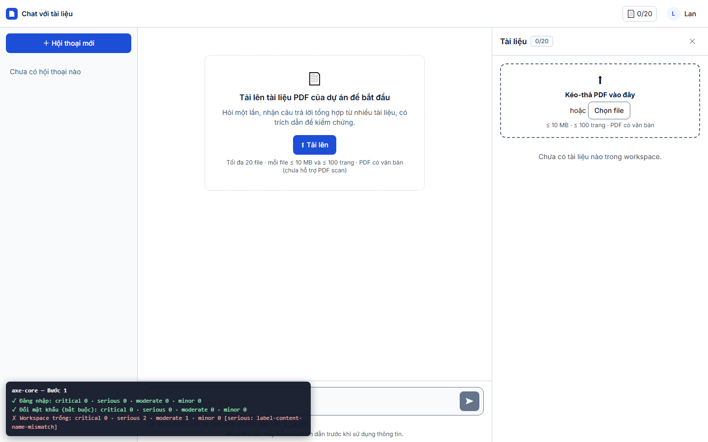
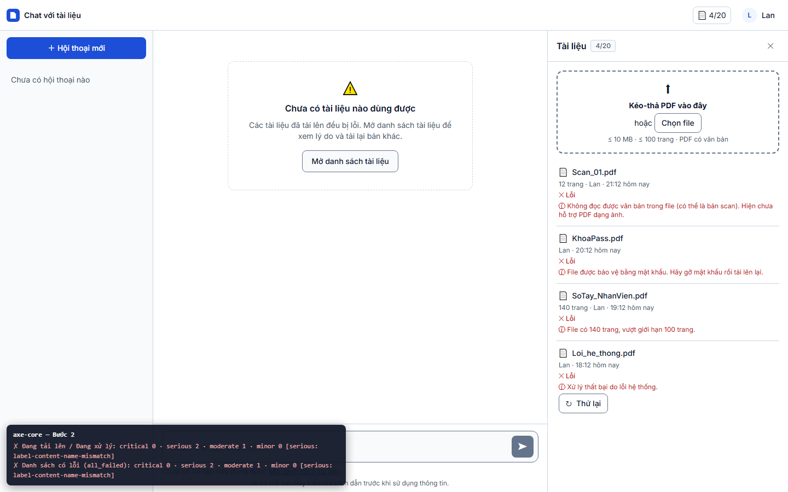
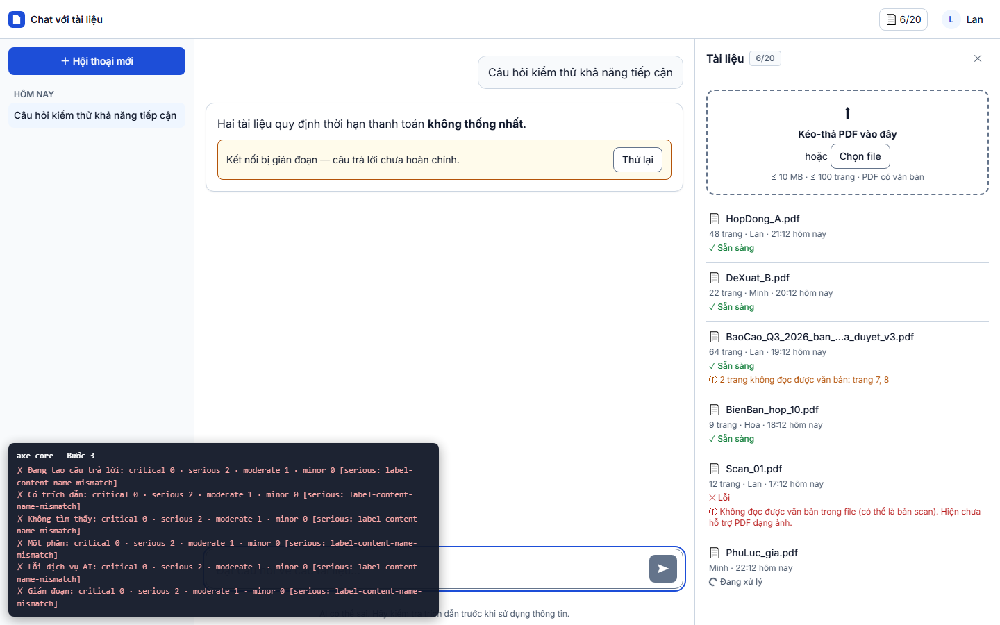
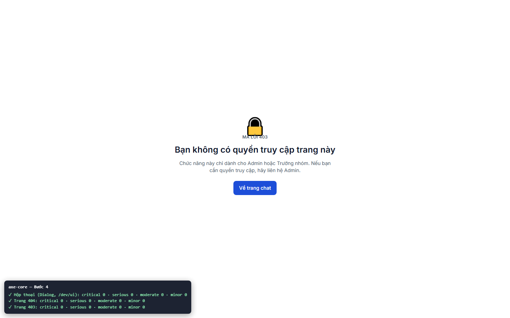

# Báo cáo kiểm thử — TC-A11Y-01: axe-core: 0 lỗi serious / critical ở mọi trạng thái chính

| | |
|---|---|
| **Test case** | [TC-A11Y-01](../../../docs/test/test_cases/TC-A11Y-01.md) |
| **Kết luận** | ☐ Đạt  ☑ **Không đạt**  ☐ Bị chặn (bước 4 còn bị chặn một phần) |
| **Ngày giờ chạy** | 2026-11-01 22:13 (UTC+7) |
| **Người chạy** | Claude Code (Playwright tự động) |
| **Commit** | `e508690` (kèm thay đổi chưa commit: `e2e/`) |
| **Chế độ chạy** | mock — `cd web; npm run dev:mock` (Playwright tự bật) |
| **Trình duyệt / công cụ** | Chromium 156.0.8078.4 (Playwright 1.64.1), viewport 1440×900. axe-core 4.14.0, lấy từ `web/node_modules`, bộ luật `wcag2a, wcag2aa, wcag21a, wcag21aa, best-practice` |
| **URL** | http://localhost:5173 (`?mock=empty_workspace`, `all_failed`, `answered`, `not_found`, `partial`, `llm_error`, `interrupted`) |
| **Tài khoản** | `lan@congty.vn`, `moi@congty.vn` (mock) |
| **Spec** | [e2e/tests/a11y/TC-A11Y-01.spec.ts](../../../e2e/tests/a11y/TC-A11Y-01.spec.ts) |
| **Video** | [TC-A11Y-01.webm](video/TC-A11Y-01.webm) |
| **Kết quả axe** | [axe-report.json](axe-report.json): 14 trạng thái, tổng **critical 0 · serious 18 · moderate 9 · minor 0** |
| **Mã lỗi** | BUG-002, BUG-003, BUG-004 |

Mỗi ảnh chính có bảng tóm tắt axe ở góc dưới trái, do spec chèn vào sau khi quét xong nên không ảnh hưởng kết quả. Ảnh của từng trạng thái riêng lẻ nằm trong [screenshots/extra/](screenshots/extra/).

## Kết quả từng bước

### Bước 1 — axe ở: đăng nhập, đổi mật khẩu, workspace trống
- **Mong đợi:** 0 serious / critical
- **Thực tế:**

  | Trạng thái | critical | serious | moderate | Ảnh |
  |---|---|---|---|---|
  | Đăng nhập | 0 | 0 | 0 | [01a](screenshots/extra/01a-login.png) |
  | Đổi mật khẩu (bắt buộc, `moi@`) | 0 | 0 | 0 | [01b](screenshots/extra/01b-change-password.png) |
  | Workspace trống | 0 | **2** | 1 | [01c](screenshots/extra/01c-empty-workspace.png) |
- **Trạng thái:** ☑ **Không đạt** (BUG-002)
- 

### Bước 2 — axe ở: đang tải lên, danh sách có lỗi (`?mock=all_failed`)
- **Mong đợi:** 0 serious / critical
- **Thực tế:**

  | Trạng thái | critical | serious | moderate | Ảnh |
  |---|---|---|---|---|
  | Đang tải lên / Đang xử lý (`HopDong_moi.pdf`) | 0 | **2** | 1 | [02a](screenshots/extra/02a-uploading.png) |
  | Danh sách có lỗi (4 file lỗi, nút "Thử lại") | 0 | **2** | 1 | [02b](screenshots/extra/02b-all-failed.png) |

  Chế độ mock tải file lên gần như tức thì, nên lúc axe quét, tài liệu đã ở trạng thái "Đang xử lý" chứ không còn thanh tiến trình tải lên.
- **Trạng thái:** ☑ **Không đạt** (BUG-002)
- 

### Bước 3 — axe ở: hỏi đáp — đang tạo, có trích dẫn, không tìm thấy, một phần, lỗi, gián đoạn
- **Mong đợi:** 0 serious / critical
- **Thực tế:**

  | Trạng thái | critical | serious | moderate | Ảnh |
  |---|---|---|---|---|
  | Đang tạo câu trả lời (`aria-busy=true`) | 0 | **2** | 1 | [03a](screenshots/extra/03a-streaming.png) |
  | Có trích dẫn (`answered`) | 0 | **2** | 1 | [03b](screenshots/extra/03b-answered.png) |
  | Không tìm thấy (`notfound`) | 0 | **2** | 1 | [03c](screenshots/extra/03c-not-found.png) |
  | Một phần (`partial`) | 0 | **2** | 1 | [03d](screenshots/extra/03d-partial.png) |
  | Lỗi dịch vụ AI (`failed`) | 0 | **2** | 1 | [03e](screenshots/extra/03e-llm-error.png) |
  | Gián đoạn (`interrupted`) | 0 | **2** | 1 | [03f](screenshots/extra/03f-interrupted.png) |

  Riêng các thành phần của câu trả lời (chip `[n]`, khối "Không tìm thấy", cảnh báo `role=alert`, nút "Thử lại") **không** bị axe báo lỗi nào. Toàn bộ vi phạm nằm ở thanh trên cùng (xem BUG-002).
- **Trạng thái:** ☑ **Không đạt** (BUG-002)
- 

### Bước 4 — axe ở: bảng Xem nguồn, hộp thoại, trang 403/404
- **Mong đợi:** 0 serious / critical
- **Thực tế:**

  | Trạng thái | critical | serious | moderate | Ảnh |
  |---|---|---|---|---|
  | Bảng Xem nguồn | — | — | — | **Không quét được**: bấm chip `[1]` không mở gì, vì T18 (`features/source-viewer`) chưa được implement. Xem [04a](screenshots/extra/04a-source-viewer-missing.png) |
  | Hộp thoại | 0 | 0 | 0 | [04b](screenshots/extra/04b-dialog.png) |
  | Trang 404 (`/khong-ton-tai`) | 0 | 0 | 0 | [04c](screenshots/extra/04c-404.png) |
  | Trang 403 (`/403`) | 0 | 0 | 0 | [04d](screenshots/extra/04d-403.png) |

  Về hộp thoại: luồng chính của ứng dụng hiện chưa dùng hộp thoại nào. Vì vậy spec quét component `Dialog` dùng chung, mở ở trang `/dev/ui` (chỉ có ở chế độ dev).
- **Trạng thái:** ☑ **Bị chặn một phần**. Phần quét được đạt 0 serious/critical; riêng bảng Xem nguồn chưa kiểm được.
- 

## Vi phạm chi tiết

| Luật axe | Mức | WCAG | Phần tử | Xuất hiện ở |
|---|---|---|---|---|
| `label-content-name-mismatch` | serious | 2.5.3 Label in Name (A) | Nút bộ đếm tài liệu `[data-testid=doc-counter]`. Chữ hiển thị là "6/20", nhưng tên trợ năng là `aria-label="Tài liệu: 6 trên 20"` | 9/9 trạng thái có thanh trên cùng |
| `label-content-name-mismatch` | serious | 2.5.3 Label in Name (A) | Nút menu tài khoản (`AccountMenu`). Chữ hiển thị là "L" (avatar) và "Lan", nhưng tên trợ năng là `aria-label="Tài khoản Lan"` | 9/9 trạng thái có thanh trên cùng |
| `page-has-heading-one` | moderate | best-practice | Trang workspace/chat không có thẻ `<h1>`. Tiêu đề "Chat với tài liệu" không phải heading cấp 1 | 9/9 trạng thái workspace |

## Lỗi phát hiện

| Mã lỗi | Mức độ | Mô tả | Bước |
|---|---|---|---|
| BUG-002 | **Major** (chặn tiêu chí NFR-U03 / G-01) | Hai nút ở thanh trên cùng vi phạm WCAG 2.5.3 Label in Name (axe: serious). Người dùng điều khiển bằng giọng nói đọc chữ đang thấy ("6/20", "Lan") sẽ không kích hoạt được nút. Nằm ở [web/src/app/TopBar.vue:30-33](../../../web/src/app/TopBar.vue#L30-L33) và [web/src/app/AccountMenu.vue:33](../../../web/src/app/AccountMenu.vue#L33). Hướng sửa: để tên trợ năng **bắt đầu bằng** chữ hiển thị, ví dụ "6/20 tài liệu" và "Lan — menu tài khoản". Cũng có thể bỏ `aria-label` và thêm chữ ẩn `sr-only` phía sau chữ hiển thị. | 1–3 |
| BUG-003 | Minor (moderate) | Trang workspace không có `<h1>` (`page-has-heading-one`). Ảnh hưởng người dùng trình đọc màn hình khi điều hướng theo heading. **Hạn xử lý đề xuất:** trước TC-A11Y-05 (NVDA), chậm nhất cuối GĐ 4. Hướng sửa: đặt `<h1 class="sr-only">` cho vùng chat, hoặc dùng `<h1>` cho tên ứng dụng ở TopBar. | 1–3 |
| BUG-004 | Minor (hiển thị, không do axe phát hiện) | Trang 403: biểu tượng ổ khóa đè lên dòng chữ "MÃ LỖI 403" (xem [04d](screenshots/extra/04d-403.png) và [ảnh bước 4](screenshots/04-axe-dialogs.png)). | 4 |

## Kết luận

**Không đạt.**
- Có **18 vi phạm serious**, nhưng chỉ do 2 lỗi gây ra (BUG-002). Hai lỗi này lặp lại ở cả 9 trạng thái có thanh trên cùng, thuộc bước 1–3. Không có vi phạm critical.
- Các trạng thái **đạt** 0 serious/critical: Đăng nhập, Đổi mật khẩu, Hộp thoại, 404, 403.
- Bước 4 còn **bị chặn một phần**: bảng Xem nguồn (T18) chưa có nên chưa quét được.
- Sau khi sửa BUG-002 và implement T18, cần chạy lại toàn bộ test case.

Test case yêu cầu chạy trên `--project=chromium --project=msedge`. Cấu hình hiện tại (`e2e/playwright.config.ts`) chỉ có project `chromium`, nên lần này **chưa chạy trên Edge**. Kết quả axe thường không phụ thuộc trình duyệt (vì cùng DOM), nhưng cần bổ sung project `msedge` để đúng yêu cầu.

## Bằng chứng đính kèm

- [x] Đủ 4 ảnh chính trong `screenshots/`, cộng 15 ảnh từng trạng thái trong `screenshots/extra/`
- [x] Video trong `video/TC-A11Y-01.webm`
- [x] `result.json` (có `axe_totals`)
- [x] `axe-report.json`: chi tiết vi phạm của từng trạng thái (luật, mức, selector, đoạn HTML)
- [x] `trace.zip`: Playwright trace của lần chạy Không đạt
- Lần chạy trước ở `attempt-1/`: bước 2 lỗi do locator của spec (chuỗi "Chưa có tài liệu nào dùng được" khớp 2 phần tử), không phải lỗi ứng dụng. Đã sửa locator rồi chạy lại. Kết quả axe của các bước còn lại giống hệt lần chạy cuối.
