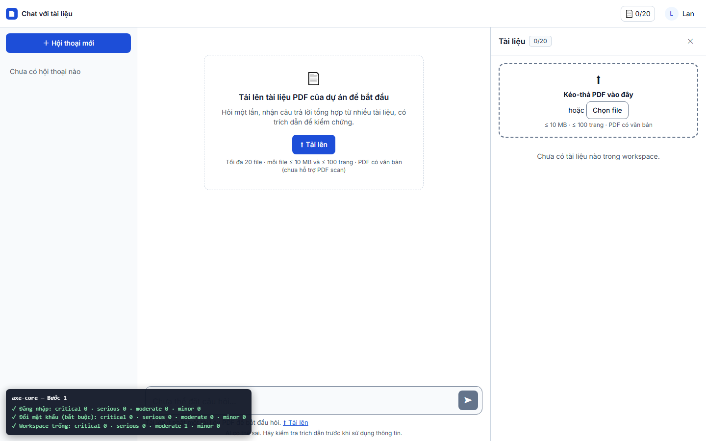
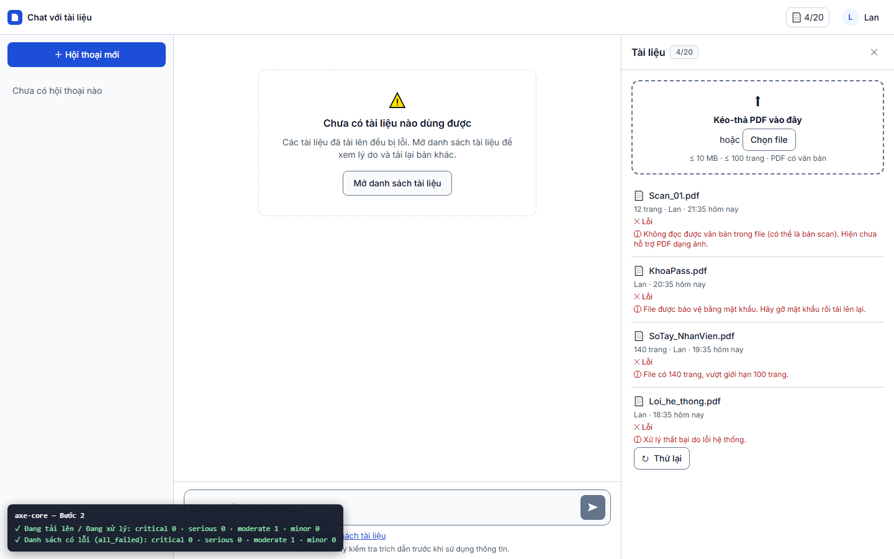
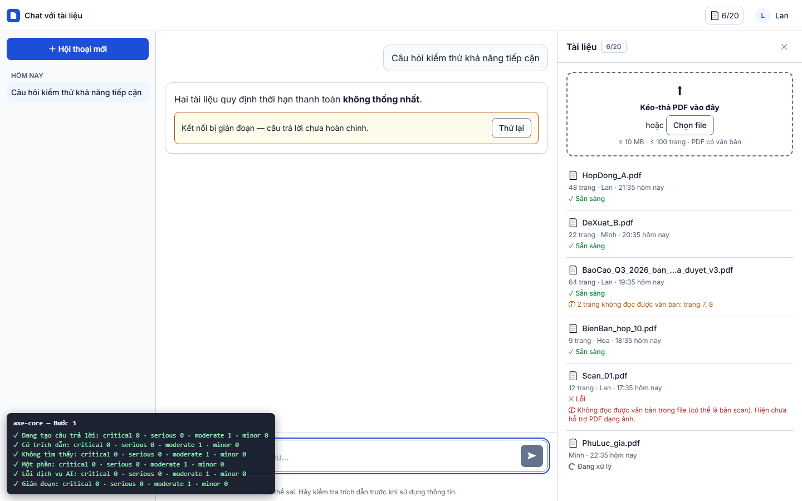
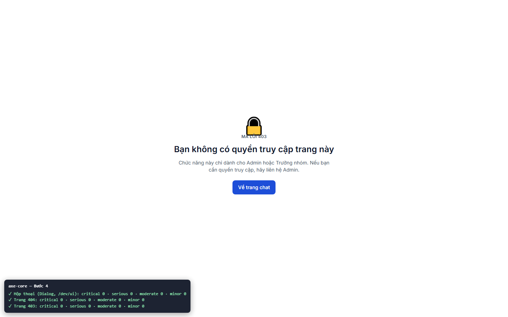

# Báo cáo kiểm thử — TC-A11Y-01 (Round 2, xác nhận sửa BUG-002): axe-core: 0 lỗi serious / critical ở mọi trạng thái chính

| | |
|---|---|
| **Test case** | [TC-A11Y-01](../../../docs/test/test_cases/TC-A11Y-01.md) |
| **Round** | 2: xác nhận sửa lỗi BUG-002 phát hiện ở [Round 1](../round-1/report.md) |
| **Kết luận** | ☐ Đạt  ☐ Không đạt  ☑ **Bị chặn (một phần)**: bước 1–3 Đạt; bước 4 chưa quét được bảng Xem nguồn vì T18 chưa làm |
| **Ngày giờ chạy** | 2026-11-01 22:35 (UTC+7) |
| **Người chạy** | Claude Code (Playwright tự động) |
| **Commit** | `e508690` kèm bản sửa BUG-002 chưa commit (xem mục "Thay đổi được kiểm") |
| **Chế độ chạy** | mock — `cd web; npm run dev:mock` (Playwright tự bật) |
| **Trình duyệt / công cụ** | Chromium 156.0.8078.4 (Playwright 1.64.1), viewport 1440×900. axe-core 4.14.0, bộ luật `wcag2a, wcag2aa, wcag21a, wcag21aa, best-practice` |
| **URL** | http://localhost:5173 (`?mock=empty_workspace`, `all_failed`, `answered`, `not_found`, `partial`, `llm_error`, `interrupted`) |
| **Tài khoản** | `lan@congty.vn`, `moi@congty.vn` (mock) |
| **Spec** | [e2e/tests/a11y/TC-A11Y-01.spec.ts](../../../e2e/tests/a11y/TC-A11Y-01.spec.ts), giữ nguyên như Round 1 |
| **Lệnh** | `$env:TC_ID="TC-A11Y-01"; $env:REPORT_DIR="test_report/TC-A11Y-01/round-2"; cd e2e; npx playwright test tests/a11y/TC-A11Y-01.spec.ts --project=chromium` |
| **Video** | [TC-A11Y-01.webm](video/TC-A11Y-01.webm) |
| **Kết quả axe** | [axe-report.json](axe-report.json): 14 trạng thái, tổng **critical 0 · serious 0** (Round 1: 18) **· moderate 9 · minor 0** |

## Thay đổi được kiểm (bản sửa BUG-002, WCAG 2.5.3 Label in Name)

| File | Trước | Sau |
|---|---|---|
| [web/src/locales/vi/documents.json](../../../web/src/locales/vi/documents.json) (`documents.count_label`, dùng cho nút "6/20" ở thanh trên và huy hiệu đếm trong bảng Tài liệu) | `aria-label="Tài liệu: 6 trên 20"`, không chứa chữ hiển thị "6/20" | `aria-label="6/20 tài liệu"`, bắt đầu bằng chữ hiển thị |
| [web/src/app/AccountMenu.vue](../../../web/src/app/AccountMenu.vue) (nút menu tài khoản) | Chữ cái đầu "L" của avatar là một text node: chữ hiển thị là "L Lan", nhưng tên trợ năng là "Tài khoản Lan" | "L" được vẽ bằng CSS `::before` (`data-initial`), không còn là text node. Chữ hiển thị là "Lan", nằm trong tên trợ năng "Tài khoản Lan". Giao diện không đổi (xem ảnh) |

Unit test (Vitest) 260/260 đạt. Các test dùng tên "Tài khoản Lan" vẫn đạt, vì tên trợ năng của nút tài khoản không đổi.

## Kết quả từng bước

### Bước 1 — axe ở: đăng nhập, đổi mật khẩu, workspace trống
- **Mong đợi:** 0 serious / critical
- **Thực tế:**

  | Trạng thái | critical | serious (R1 → R2) | moderate | Ảnh |
  |---|---|---|---|---|
  | Đăng nhập | 0 | 0 → 0 | 0 | [01a](screenshots/extra/01a-login.png) |
  | Đổi mật khẩu (bắt buộc) | 0 | 0 → 0 | 0 | [01b](screenshots/extra/01b-change-password.png) |
  | Workspace trống | 0 | 2 → **0** | 1 | [01c](screenshots/extra/01c-empty-workspace.png) |
- **Trạng thái:** ☑ **Đạt** (Round 1: Không đạt)
- 

### Bước 2 — axe ở: đang tải lên, danh sách có lỗi (`?mock=all_failed`)
- **Mong đợi:** 0 serious / critical
- **Thực tế:**

  | Trạng thái | critical | serious (R1 → R2) | moderate | Ảnh |
  |---|---|---|---|---|
  | Đang tải lên / Đang xử lý | 0 | 2 → **0** | 1 | [02a](screenshots/extra/02a-uploading.png) |
  | Danh sách có lỗi (all_failed) | 0 | 2 → **0** | 1 | [02b](screenshots/extra/02b-all-failed.png) |
- **Trạng thái:** ☑ **Đạt** (Round 1: Không đạt)
- 

### Bước 3 — axe ở: hỏi đáp — đang tạo, có trích dẫn, không tìm thấy, một phần, lỗi, gián đoạn
- **Mong đợi:** 0 serious / critical
- **Thực tế:**

  | Trạng thái | critical | serious (R1 → R2) | moderate | Ảnh |
  |---|---|---|---|---|
  | Đang tạo câu trả lời | 0 | 2 → **0** | 1 | [03a](screenshots/extra/03a-streaming.png) |
  | Có trích dẫn | 0 | 2 → **0** | 1 | [03b](screenshots/extra/03b-answered.png) |
  | Không tìm thấy | 0 | 2 → **0** | 1 | [03c](screenshots/extra/03c-not-found.png) |
  | Một phần | 0 | 2 → **0** | 1 | [03d](screenshots/extra/03d-partial.png) |
  | Lỗi dịch vụ AI | 0 | 2 → **0** | 1 | [03e](screenshots/extra/03e-llm-error.png) |
  | Gián đoạn | 0 | 2 → **0** | 1 | [03f](screenshots/extra/03f-interrupted.png) |
- **Trạng thái:** ☑ **Đạt** (Round 1: Không đạt)
- 

### Bước 4 — axe ở: bảng Xem nguồn, hộp thoại, trang 403/404
- **Mong đợi:** 0 serious / critical
- **Thực tế:**

  | Trạng thái | critical | serious | moderate | Ảnh |
  |---|---|---|---|---|
  | Bảng Xem nguồn | — | — | — | **Không quét được**: bấm chip `[1]` không mở gì, vì T18 chưa implement. Xem [04a](screenshots/extra/04a-source-viewer-missing.png) |
  | Hộp thoại (Dialog, `/dev/ui`) | 0 | 0 | 0 | [04b](screenshots/extra/04b-dialog.png) |
  | Trang 404 | 0 | 0 | 0 | [04c](screenshots/extra/04c-404.png) |
  | Trang 403 | 0 | 0 | 0 | [04d](screenshots/extra/04d-403.png) |
- **Trạng thái:** ☑ **Bị chặn một phần**, không đổi so với Round 1
- 

## Lỗi phát hiện

| Mã lỗi | Mức độ | Trạng thái sau Round 2 |
|---|---|---|
| BUG-002 | Major | **Đã sửa — đã xác nhận**. `label-content-name-mismatch` không còn xuất hiện ở trạng thái nào (serious 18 → 0) |
| BUG-003 | Minor (moderate) | **Còn mở**, không thuộc phạm vi Round 2. `page-has-heading-one` vẫn còn ở 9 trạng thái workspace. Hạn xử lý đề xuất: trước TC-A11Y-05, chậm nhất cuối GĐ 4 |
| BUG-004 | Minor | **Còn mở**, không thuộc phạm vi Round 2. Trên trang 403, icon ổ khóa vẫn đè lên dòng chữ "MÃ LỖI 403" (xem [04d](screenshots/extra/04d-403.png)) |

Không phát sinh lỗi mới.

## Kết luận

**Bị chặn (một phần).**
- **Đã xác nhận sửa BUG-002.** Bước 1–3 chuyển từ Không đạt sang **Đạt**: 0 critical, 0 serious ở 12/12 trạng thái quét được.
- **Lý do chưa thể đánh Đạt toàn bộ test case:** bảng Xem nguồn (bước 4) chưa kiểm được vì T18 chưa implement.
- Cần chạy Round 3 khi T18 xong, kèm project `msedge` mà test case yêu cầu.

## Bằng chứng đính kèm

- [x] Đủ 4 ảnh chính trong `screenshots/`, cộng 15 ảnh từng trạng thái trong `screenshots/extra/`
- [x] Video trong `video/TC-A11Y-01.webm`
- [x] `result.json` (`round: 2`, `status: blocked`, `axe_totals`)
- [x] `axe-report.json`
- [x] `trace.zip`: không có. Lần chạy không có bước Không đạt nên Playwright không lưu trace (`retain-on-failure`).
