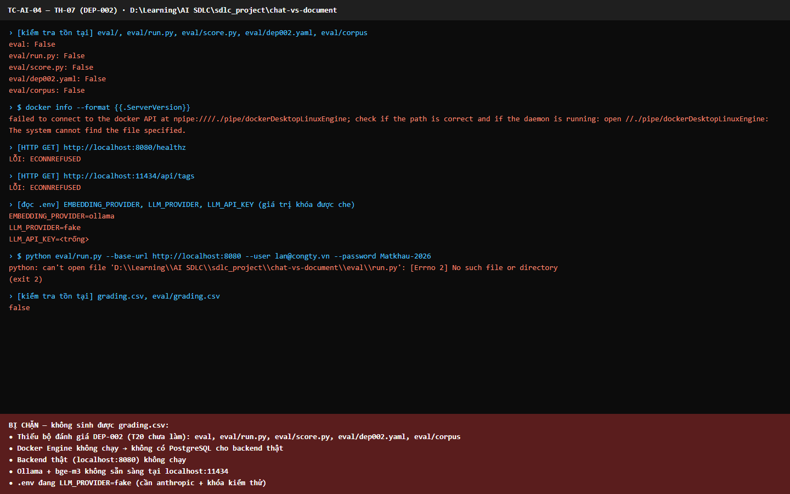
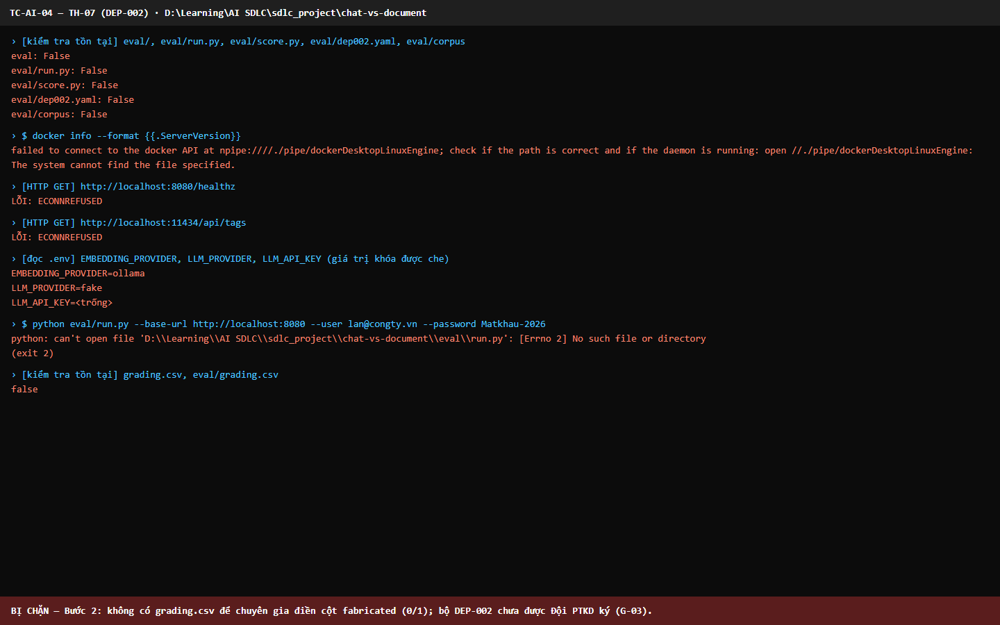
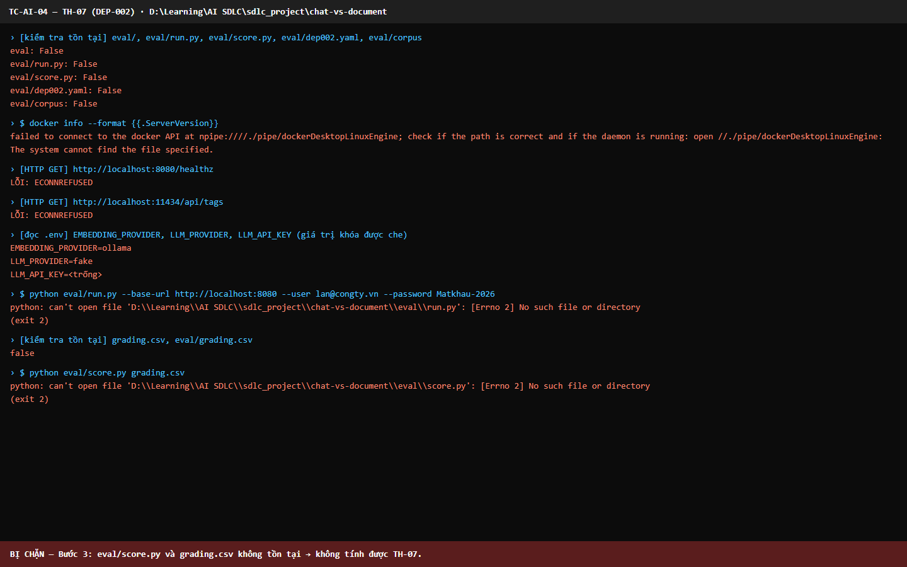
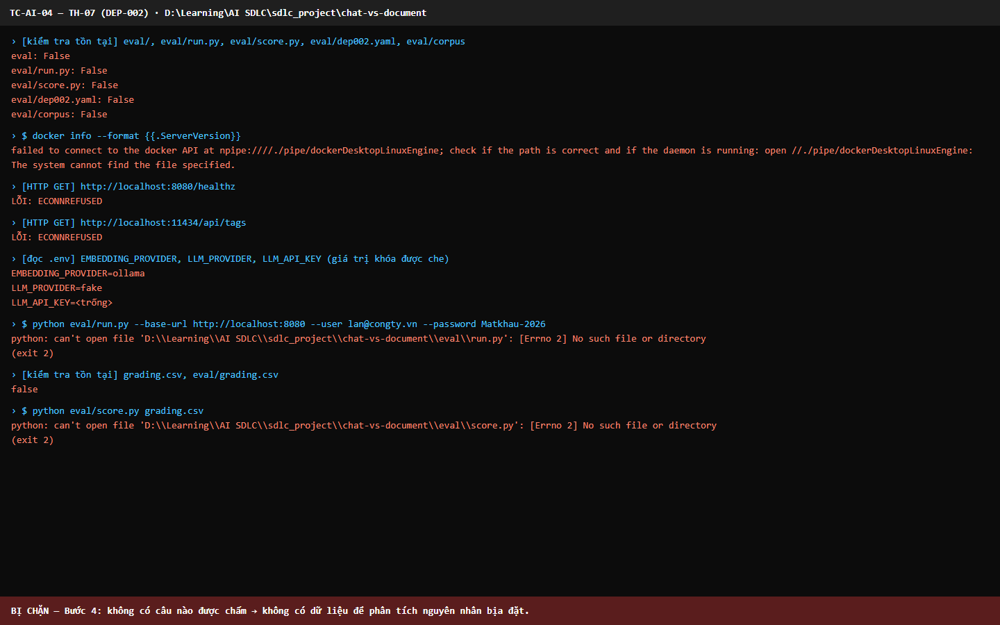

# Báo cáo kiểm thử — TC-AI-04: TH-07: Câu trả lời bịa đặt ≤ 5%

| | |
|---|---|
| **Test case** | [TC-AI-04](../../docs/test/test_cases/TC-AI-04.md) |
| **Kết luận** | ☐ Đạt  ☐ Không đạt  ☑ **Bị chặn** |
| **Ngày giờ chạy** | 2026-11-01 22:17 (UTC+7) |
| **Người chạy** | Claude Code (Playwright tự động: kiểm tra điều kiện và chạy lệnh của mục 4) |
| **Commit** | `e508690` (kèm thay đổi chưa commit: `e2e/`) |
| **Chế độ chạy** | ai (yêu cầu): backend thật + `bge-m3` (Ollama) + `claude-sonnet-5-5`. **Không dựng được**, xem bên dưới |
| **Trình duyệt / công cụ** | Python 3.12 (`eval/run.py`, `eval/score.py`), Docker CLI, HTTP. Một trang dạng terminal trong Chromium hiển thị đầu ra để ghi hình |
| **URL** | http://localhost:8080 (API), http://localhost:11434 (Ollama) |
| **Tài khoản** | `lan@congty.vn` (tài khoản kiểm thử) |
| **Spec** | [e2e/tests/eval/TC-AI-04.spec.ts](../../e2e/tests/eval/TC-AI-04.spec.ts) |
| **Video** | [TC-AI-04.webm](video/TC-AI-04.webm) |

**Cấu hình ghi nhận** (theo yêu cầu cố định phiên bản):
- Phiên bản prompt: *không xác định, chưa chạy*
- `RETRIEVAL_TOP_K=8`, `RETRIEVAL_MIN_SCORE=0.30`
- `LLM_MODEL=claude-sonnet-5-5`, `EMBEDDING_MODEL=bge-m3`
- Số lần chạy: **0/3**

## Cách chạy

Spec thực hiện từng kiểm tra và lệnh dưới đây. Đầu ra in lên một trang dạng terminal để ảnh và video ghi lại đúng nội dung:
- Lệnh có tiền tố `$` (`docker`, `python`) là **tiến trình thật** do spec chạy.
- Dòng `[HTTP GET]` là lời gọi HTTP thật bằng `fetch` của Node.
- Dòng `[kiểm tra tồn tại]` và `[đọc .env]` là thao tác đọc file thật.
- Giá trị `LLM_API_KEY` luôn được che khi hiển thị.

## Kết quả từng bước

### Bước 1 — `python eval/run.py --base-url http://localhost:8080 --user lan@congty.vn --password Matkhau-2026`
- **Mong đợi:** Sinh `grading.csv`
- **Thực tế:**

  | Kiểm tra | Kết quả |
  |---|---|
  | `eval/`, `eval/run.py`, `eval/score.py`, `eval/dep002.yaml`, `eval/corpus` | **Không tồn tại**, vì T20 (bộ câu hỏi DEP-002 và công cụ đánh giá) chưa làm |
  | `docker info` | Lỗi: không kết nối được tới `dockerDesktopLinuxEngine`. Docker Desktop đang tắt nên không có PostgreSQL |
  | `GET http://localhost:8080/healthz` | `ECONNREFUSED`: backend không chạy |
  | `GET http://localhost:11434/api/tags` | `ECONNREFUSED`: Ollama không chạy, chưa xác nhận đã có `bge-m3` |
  | `.env` | `EMBEDDING_PROVIDER=ollama`, **`LLM_PROVIDER=fake`**, **`LLM_API_KEY` trống**. Test case cần `anthropic` và khóa kiểm thử |
  | `python eval/run.py …` | `can't open file '…\eval\run.py': [Errno 2] No such file or directory` (exit 2) |
  | `grading.csv` | Không tồn tại |
- **Trạng thái:** ☑ **Bị chặn**
- 

### Bước 2 — Chuyên gia điền cột `fabricated (0/1)`
- **Mong đợi:** Cột được điền đủ
- **Thực tế:** không thực hiện được vì:
  - Không có `grading.csv` (bước 1 bị chặn).
  - Bộ DEP-002 chưa có và chưa được Đội PTKD ký (G-03).
  - Chưa phân công chuyên gia chấm.
- **Trạng thái:** ☑ **Bị chặn**
- 

### Bước 3 — `python eval/score.py grading.csv`
- **Mong đợi:** TH-07 ≤ 5%
- **Thực tế:** `can't open file '…\eval\score.py': [Errno 2] No such file or directory` (exit 2). Không tính được TH-07.
- **Trạng thái:** ☑ **Bị chặn**
- 

### Bước 4 — Rà từng câu bị chấm bịa
- **Mong đợi:** Có phân tích nguyên nhân (truy hồi thiếu? prompt?)
- **Thực tế:** không có dữ liệu chấm để phân tích, vì bước này phụ thuộc bước 1–3.
- **Trạng thái:** ☑ **Bị chặn**
- 

## Số liệu đo

| Chỉ số | Ngưỡng | Đo được | Đạt? |
|---|---|---|---|
| TH-07: tỷ lệ câu trả lời bịa đặt (trung bình của ≥ 3 lần chạy) | ≤ 5% | — (không chạy được) | ☐ |

## Điều kiện cần để bỏ chặn

1. **T20**: tạo `eval/run.py`, `eval/score.py`, `eval/dep002.yaml` (≥ 50 câu) và `eval/corpus/`; Đội PTKD ký bộ DEP-002 (G-03).
2. Bật Docker Desktop, rồi chạy `./ops/scripts/up.ps1` và `./ops/scripts/api.ps1`.
3. Bật Ollama (`ollama serve`) và tải mô hình (`ollama pull bge-m3`).
4. Trong `.env` (không commit): đặt `LLM_PROVIDER=anthropic` và `LLM_API_KEY=<khóa kiểm thử>`.
5. Tạo tài khoản `lan@congty.vn` trên backend thật (`create-user.ps1`).
6. Phân công chuyên gia chấm cột `fabricated`, rồi chạy lặp ≥ 3 lần.

## Lỗi phát hiện

Không có lỗi ứng dụng. Test case bị chặn vì thiếu điều kiện, không phải vì ứng dụng sai.

## Kết luận

**Bị chặn.** Không thực hiện được bước nào, vì thiếu bộ đánh giá DEP-002 (T20 chưa làm) và môi trường `ai` chưa dựng (Docker, backend, Ollama, LLM thật đều chưa sẵn sàng). Theo [quy tắc chung §7](../../docs/test/test_cases/README.md#7-quy-tắc-chung), test case không được đánh Đạt khi thiếu điều kiện.

## Bằng chứng đính kèm

- [x] Đủ 4 ảnh trong `screenshots/`. Mỗi ảnh có dải đỏ phía dưới ghi lý do bị chặn của bước đó.
- [x] Video trong `video/TC-AI-04.webm`
- [x] `result.json`: có `blockers`, `commands` (đầu ra từng lệnh) và `config`
- [ ] `eval/report.md`, `eval/results.json`, `grading.csv`: **không có**, vì công cụ chưa tồn tại
- Lần chạy trước ở `attempt-1/`: cùng kết quả. Ảnh lần đó dùng nhãn `PS> Test-Path`/`curl` cho các kiểm tra thực ra chạy bằng Node; đã sửa nhãn cho đúng bản chất rồi chạy lại.
