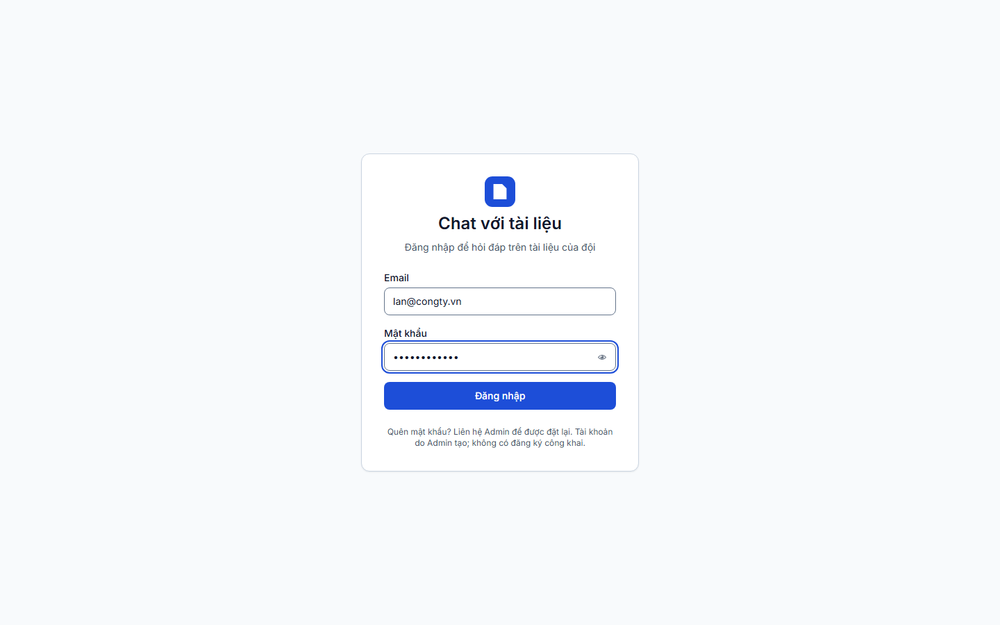
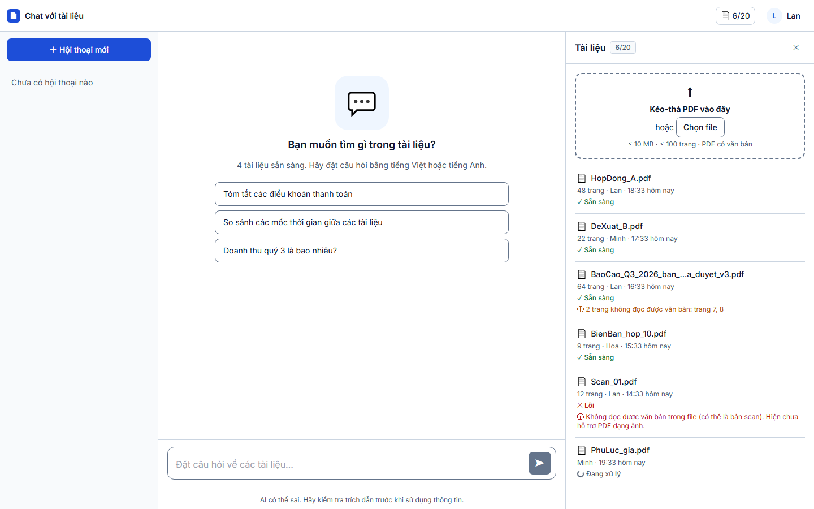

# Báo cáo kiểm thử — TC-AUTH-01: Đăng nhập đúng email và mật khẩu

| | |
|---|---|
| **Test case** | [TC-AUTH-01](../../docs/test/test_cases/TC-AUTH-01.md) |
| **Kết luận** | ☐ Đạt  ☐ Không đạt  ☑ **Bị chặn (một phần)** — bước 1–3 Đạt, bước 4 (F5) không kiểm được ở chế độ API giả |
| **Ngày giờ chạy** | 2026-10-28 19:33 (UTC+7) |
| **Người chạy** | Claude Code (Playwright tự động) |
| **Commit** | `e508690` (kèm các thay đổi chưa commit: thêm `e2e/`) |
| **Chế độ chạy** | mock — `cd web; npm run dev:mock` |
| **Trình duyệt / công cụ** | Chromium (Playwright), viewport 1440×900 |
| **URL** | http://localhost:5173 |
| **Tài khoản** | `lan@congty.vn` (mock) |
| **Video** | [TC-AUTH-01.webm](video/TC-AUTH-01.webm) |

## Kết quả từng bước

### Bước 1 — Mở http://localhost:5173 khi chưa đăng nhập
- **Mong đợi:** được chuyển tới `/login`
- **Thực tế:** chuyển tới `http://localhost:5173/login?next=/c`; thấy tiêu đề "Chat với tài liệu"
- **Trạng thái:** ☑ Đạt
- 

### Bước 2 — Nhập `lan@congty.vn` / `Matkhau-2026`
- **Mong đợi:** hai ô đã điền; mật khẩu hiển thị dạng che
- **Thực tế:** email hiển thị đúng; ô mật khẩu có `type=password`, hiện dạng chấm
- **Trạng thái:** ☑ Đạt
- 

### Bước 3 — Bấm "Đăng nhập"
- **Mong đợi:** trang chat mở trong ≤ 2 giây
- **Thực tế:** mở `http://localhost:5173/c` sau **397 ms**; hiển thị khung chat, "4 tài liệu sẵn sàng", bộ đếm 6/20, danh sách tài liệu và ô nhập
- **Trạng thái:** ☑ Đạt
- 

### Bước 4 — Tải lại trang (F5)
- **Mong đợi:** vẫn ở trang chat, không bị đưa về `/login`
- **Thực tế:** sau F5 bị đưa về `http://localhost:5173/login?next=/c`
- **Trạng thái:** ☑ **Bị chặn** (không đánh Đạt, không đánh Không đạt)
- **Lý do:** API giả giữ trạng thái đăng nhập trong biến module (`web/src/mocks/handlers.ts`, `mockState.user`), nên tải lại trang luôn đặt về chưa đăng nhập. Phiên thật là cookie `sid` HttpOnly do backend cấp nên không bị ảnh hưởng. Cần chạy lại bước này ở chế độ `real`.
- 

## Số liệu đo

| Chỉ số | Ngưỡng | Đo được | Đạt? |
|---|---|---|---|
| Thời gian từ bấm "Đăng nhập" tới khi trang chat hiển thị | ≤ 2.000 ms | 397 ms (API giả, không tính độ trễ mạng / Argon2 thật) | ☑ |

Số đo ở chế độ API giả chỉ chứng minh phía giao diện không chậm; thời gian đăng nhập thực (AC-001.1) cần đo lại ở chế độ `real`.

## Lỗi phát hiện

Không có lỗi ứng dụng.

Hai lỗi nằm ở chính spec trong lần chạy đầu và đã sửa trước lần chạy cuối:
- Regex URL `/\/c(\/|$|\?)/` khớp cả `/login?next=/c` nên bước 3 từng "đạt" khi trang vẫn ở "Đang đăng nhập…" (ảnh cho thấy). Đã neo regex từ đầu chuỗi.
- Bước 4 từng "đạt" vì assertion chạy trước khi ứng dụng kịp chuyển hướng (ảnh chụp lại là trang đăng nhập). Đã chờ giao diện ổn định rồi mới kiểm tra.

## Kết luận

**Bị chặn một phần.** Bước 1–3 (AC-001.1: đăng nhập đúng, vào chat trong ≤ 2 s) Đạt. Bước 4 (giữ phiên sau F5) không kiểm được ở chế độ API giả; cần chạy lại ở chế độ `real` (backend + PostgreSQL) trước khi kết luận Đạt cho toàn bộ test case.

## Bằng chứng đính kèm

- [x] Đủ 4 ảnh trong `screenshots/`
- [x] Video trong `video/TC-AUTH-01.webm`
- [x] `result.json`
- [x] `trace.zip`: không có (test không lỗi); Playwright lưu bản video gốc ở `playwright-output/`
