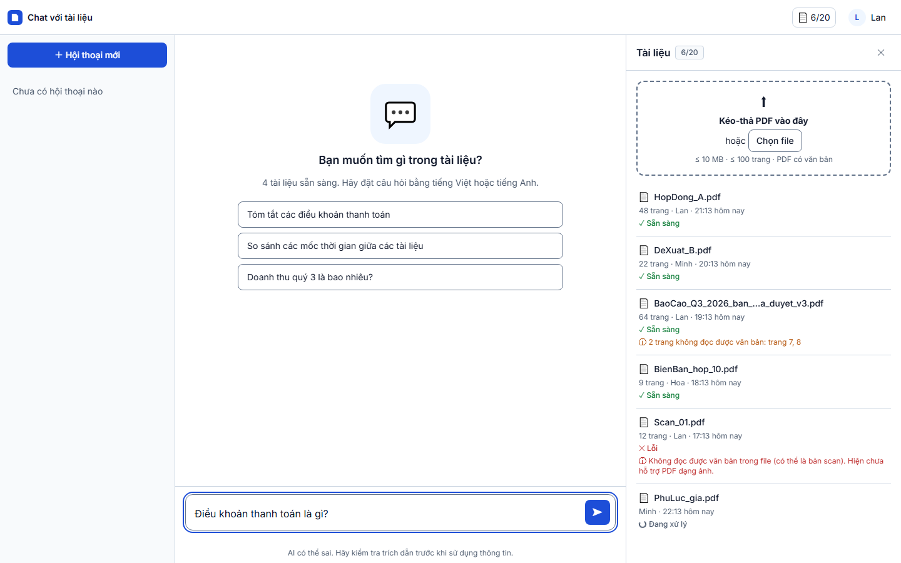
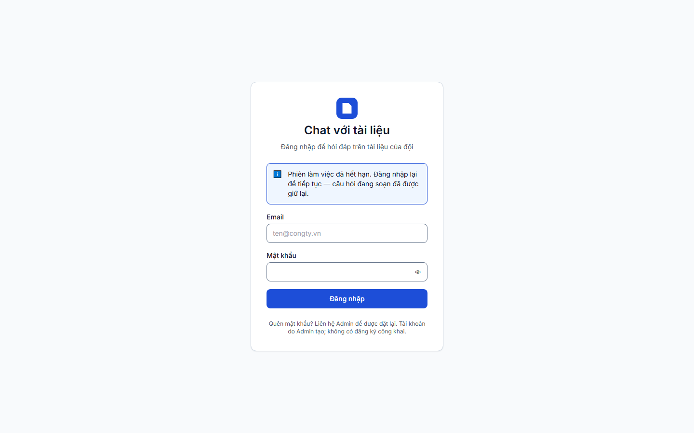
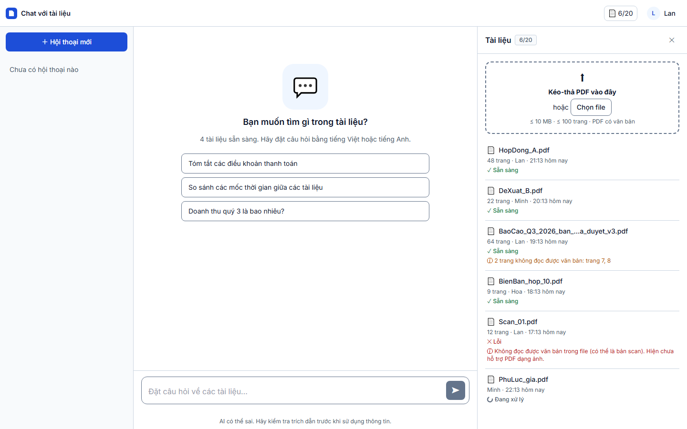

# Báo cáo kiểm thử — TC-AUTH-05: Hết phiên khi đang soạn: giữ nguyên nội dung nháp

| | |
|---|---|
| **Test case** | [TC-AUTH-05](../../../docs/test/test_cases/TC-AUTH-05.md) |
| **Kết luận** | ☐ Đạt  ☑ **Không đạt**  ☐ Bị chặn |
| **Ngày giờ chạy** | 2026-11-01 22:13 (UTC+7) |
| **Người chạy** | Claude Code (Playwright tự động) |
| **Commit** | `e508690` (kèm thay đổi chưa commit: `e2e/`) |
| **Chế độ chạy** | mock — `cd web; npm run dev:mock` (Playwright tự bật) |
| **Trình duyệt / công cụ** | Chromium 156.0.8078.4 (Playwright 1.64.1), viewport 1440×900 |
| **URL** | http://localhost:5173/?mock=answered |
| **Tài khoản** | `lan@congty.vn` (mock) |
| **Spec** | [e2e/tests/auth/TC-AUTH-05.spec.ts](../../../e2e/tests/auth/TC-AUTH-05.spec.ts) |
| **Video** | [TC-AUTH-05.webm](video/TC-AUTH-05.webm) |
| **Mã lỗi** | BUG-001 |

## Cách giả lập hết phiên (khác với test case)

Test case đề xuất dùng `page.route("**/api/**", …)`, nhưng ở chế độ mock cách này không chặn được yêu cầu:
- Ở chế độ mock, API giả do MSW chạy trong Service Worker trả lời, nên yêu cầu không đi qua lớp mạng mà Playwright chặn được.
- Spec đã thử: đặt `page.route` rồi gửi một yêu cầu thăm dò `GET /api/documents`. Kết quả vẫn là **200**, tức `page.route` không có tác dụng.
- Spec gỡ `page.route` và thay `window.fetch` trong trang, để mọi `/api/**` trả `401 {"error":{"code":"SESSION_EXPIRED","message_key":"auth.session_expired"}}`.

Lớp `shared/api` của ứng dụng gọi `fetch` toàn cục, nên ứng dụng nhận đúng phản hồi 401 như khi backend báo hết phiên. Cách giả lập được ghi trong `result.json` (`session_expiry_simulation`).

## Kết quả từng bước

### Bước 1 — Đăng nhập bằng `lan@congty.vn` / `Matkhau-2026` rồi vào trang chat
- **Mong đợi:** Trang chat hiển thị, ô nhập mở khóa
- **Thực tế:** vào `http://localhost:5173/c?mock=answered`, ô nhập mở khóa
- **Trạng thái:** ☑ Đạt
- 

### Bước 2 — Gõ nháp "Điều khoản thanh toán là gì?", **chưa gửi**
- **Mong đợi:** Ô nhập chứa đúng nội dung nháp
- **Thực tế:** ô nhập chứa "Điều khoản thanh toán là gì?". Spec chờ 700 ms để qua thời gian debounce lưu nháp (500 ms).
- **Trạng thái:** ☑ Đạt
- 

### Bước 3 — Giả lập hết phiên (mọi `/api/**` trả `401 SESSION_EXPIRED`), rồi bấm Gửi
- **Mong đợi:** Được chuyển về `/login`
- **Thực tế:**
  - Ứng dụng chuyển tới `http://localhost:5173/login?next=/c?mock=answered&reason=expired`.
  - Thông báo hiển thị khớp nguyên văn SDD 3.5.3 / SCR-01: "Phiên làm việc đã hết hạn. Đăng nhập lại để tiếp tục — câu hỏi đang soạn đã được giữ lại."
  - Ngay lúc này `sessionStorage` chỉ còn `{"mock:scenario":"answered"}`. **Không còn khóa `draft:…` nào**, tức nháp đã bị xóa.
- **Trạng thái:** ☑ Đạt (chỉ xét điều kiện của bước này là chuyển về `/login`)
- 

### Bước 4 — Bỏ chặn, đăng nhập lại `lan@congty.vn`
- **Mong đợi:** Vào lại trang chat và ô nhập vẫn chứa "Điều khoản thanh toán là gì?"
- **Thực tế:**
  - Vào lại `/c`, nhưng **ô nhập trống**.
  - `sessionStorage` không có khóa `draft:*`.
  - `localStorage` không có token hay sid (`[]`).
- **Trạng thái:** ☑ **Không đạt**
- 

## Đối chiếu tiêu chí đạt

| Tiêu chí | Kết quả |
|---|---|
| Chuyển về `/login` khi phiên hết hạn | ☑ Đạt |
| Nội dung nháp còn nguyên sau khi đăng nhập lại | ☒ **Không đạt** |
| Nháp lưu ở `sessionStorage`, không có token trong `localStorage` | Một phần. Không có token trong `localStorage` (đạt). Nháp đã được lưu ở `sessionStorage` khi đang gõ, nhưng bị xóa khi bấm Gửi |
| Thông điệp khớp nguyên văn PRD/SDD | ☑ Đạt. Nhưng nội dung thông báo ("đã được giữ lại") sai với thực tế |
| Đủ bộ báo cáo | ☑ |

## Lỗi phát hiện

| Mã lỗi | Mức độ | Mô tả | Bước |
|---|---|---|---|
| BUG-001 | **Major** (vi phạm AC-001.5, CN-05 "Khôi phục 100% bản nháp") | Mất câu hỏi đang soạn khi phiên hết hạn đúng lúc người dùng bấm Gửi. Màn đăng nhập vẫn báo "câu hỏi đang soạn đã được giữ lại", nên người dùng bị thông tin sai. | 3–4 |

**Nguyên nhân (đọc code):** trong [web/src/features/chat/Composer.vue:50-55](../../../web/src/features/chat/Composer.vue#L50-L55), hàm `send()` làm ba việc theo thứ tự:
1. Đặt `text.value = ''`.
2. Gọi `clearDraft(...)`.
3. Sau đó mới `emit('submit', q)`.

Như vậy câu hỏi bị xóa khỏi ô nhập và khỏi `sessionStorage` **trước khi** biết yêu cầu có thành công hay không. Khi yêu cầu nhận `401 SESSION_EXPIRED`, `session.ts` chỉ kịp `flushDrafts()`, lúc đó nháp đã rỗng. AC-001.5 yêu cầu giữ nháp khi người dùng "thực hiện thao tác **bất kỳ**", nên trường hợp bấm Gửi cũng phải giữ.

**Hướng sửa đề xuất:** chỉ xóa nháp khi server đã nhận câu hỏi (ví dụ khi có sự kiện `meta` hoặc khi tạo hội thoại thành công). Nếu nhận 401/403, trả câu hỏi lại vào nháp trước khi chuyển hướng. Cần thêm unit test cho trường hợp này.

## Kết luận

**Không đạt.** Bước 1–3 đạt; bước 4 không đạt, vì nháp bị mất (BUG-001).

Phần nhỏ hơn của AC-001.5 có thể vẫn đúng: khi phiên hết hạn do một thao tác khác Gửi (ví dụ tải lại danh sách tài liệu), Composer không gọi `clearDraft`, nên nháp có thể được giữ. Lần chạy này **không kiểm** trường hợp đó; cần thêm một biến thể của spec để xác nhận.

## Bằng chứng đính kèm

- [x] Đủ 4 ảnh trong `screenshots/`
- [x] Video trong `video/TC-AUTH-05.webm`
- [x] `result.json` (gồm `session_expiry_simulation` và `storage_after_expiry`)
- [x] `trace.zip`: Playwright trace của lần chạy Không đạt
- Lần chạy trước ở `attempt-1/`: cùng kết quả Không đạt ở bước 4, tức lỗi lặp lại được.
