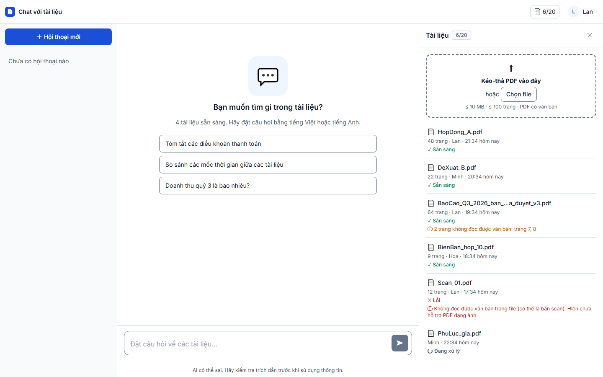
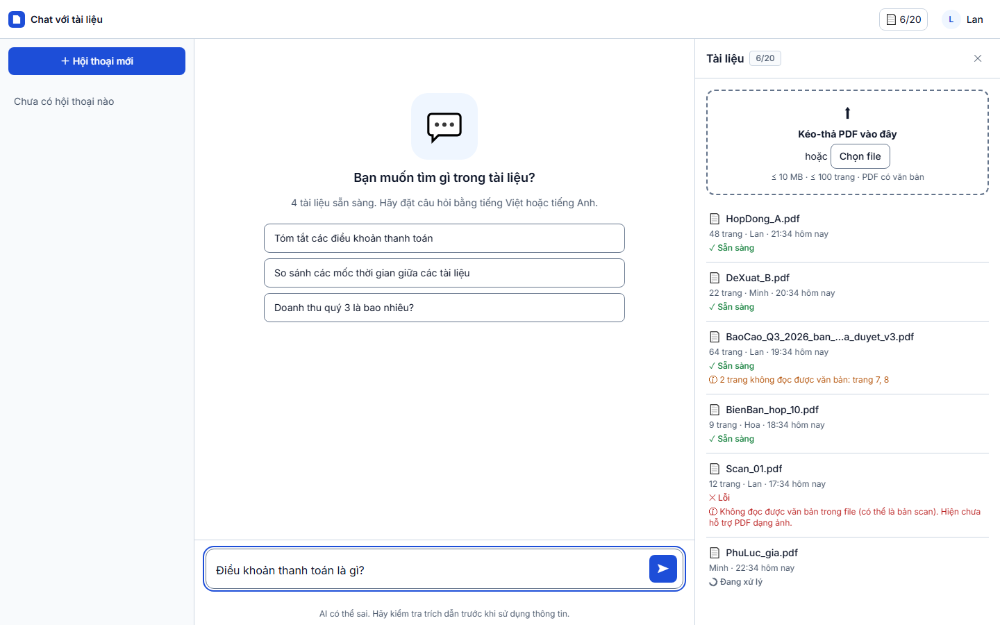
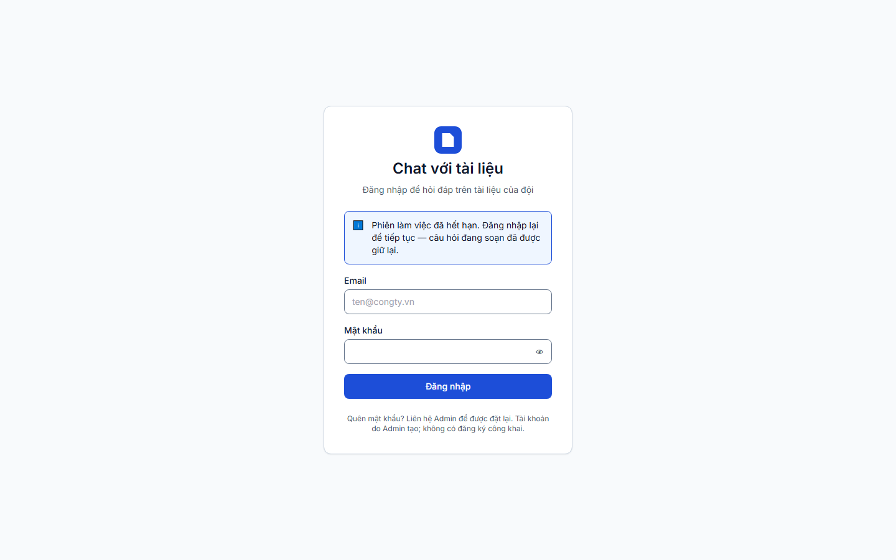
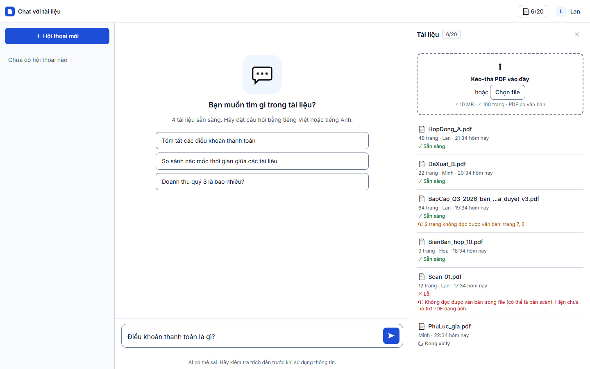

# Báo cáo kiểm thử — TC-AUTH-05 (Round 2, xác nhận sửa BUG-001): Hết phiên khi đang soạn: giữ nguyên nội dung nháp

| | |
|---|---|
| **Test case** | [TC-AUTH-05](../../../docs/test/test_cases/TC-AUTH-05.md) |
| **Round** | 2: xác nhận sửa lỗi [BUG-001](../round-1/report.md#lỗi-phát-hiện) phát hiện ở [Round 1](../round-1/report.md) |
| **Kết luận** | ☑ **Đạt**  ☐ Không đạt  ☐ Bị chặn |
| **Ngày giờ chạy** | 2026-11-01 22:35 (UTC+7) |
| **Người chạy** | Claude Code (Playwright tự động) |
| **Commit** | `e508690` kèm bản sửa BUG-001 chưa commit (xem mục "Thay đổi được kiểm") |
| **Chế độ chạy** | mock — `cd web; npm run dev:mock` (Playwright tự bật) |
| **Trình duyệt / công cụ** | Chromium 156.0.8078.4 (Playwright 1.64.1), viewport 1440×900 |
| **URL** | http://localhost:5173/?mock=answered |
| **Tài khoản** | `lan@congty.vn` (mock) |
| **Spec** | [e2e/tests/auth/TC-AUTH-05.spec.ts](../../../e2e/tests/auth/TC-AUTH-05.spec.ts), giữ nguyên như Round 1 |
| **Lệnh** | `$env:TC_ID="TC-AUTH-05"; $env:REPORT_DIR="test_report/TC-AUTH-05/round-2"; cd e2e; npx playwright test tests/auth/TC-AUTH-05.spec.ts --project=chromium` |
| **Video** | [TC-AUTH-05.webm](video/TC-AUTH-05.webm) |

## Thay đổi được kiểm (bản sửa BUG-001)

| File | Thay đổi |
|---|---|
| [web/src/shared/lib/draft/index.ts](../../../web/src/shared/lib/draft/index.ts) | Thêm `holdDraft` và `releaseDraft`. Khi bấm Gửi, câu hỏi được ghi ngay vào `sessionStorage` và được giữ lại dù ô nhập đã trống. Chỉ `releaseDraft` mới xóa câu hỏi đang giữ; nếu người dùng đã gõ nháp mới thì `releaseDraft` bỏ qua, không xóa nháp đó. |
| [web/src/features/chat/Composer.vue](../../../web/src/features/chat/Composer.vue) | `send()` gọi `holdDraft`, không còn gọi `clearDraft` trước khi gửi yêu cầu. Câu hỏi được phát đi kèm callback `release`. |
| [web/src/features/chat/useAnswerStream.ts](../../../web/src/features/chat/useAnswerStream.ts) | Thêm hook `onHandled`, gọi khi máy chủ đã mở luồng trả lời, hoặc khi yêu cầu bị từ chối vì lý do **khác** `SESSION_EXPIRED`/`UNAUTHENTICATED`. Khi hết phiên thì không gọi, nên nháp được giữ. |
| [web/src/features/chat/ChatPane.vue](../../../web/src/features/chat/ChatPane.vue) | Truyền `release` của Composer vào `ask(..., { onHandled })`. |

**Test hồi quy (Vitest):** toàn bộ 260/260 test đạt; `eslint` và `vue-tsc` không lỗi. Bổ sung 4 test:
- [auth.test.ts](../../../web/src/features/auth/auth.test.ts) "bấm Gửi khi phiên đã hết hạn → đăng nhập lại vẫn còn câu hỏi". Test này đã được chạy thử trên `Composer.vue` cũ và **fail** đúng như mong đợi, tức nó bắt được BUG-001.
- [auth.test.ts](../../../web/src/features/auth/auth.test.ts) "gửi thành công → không còn bản nháp của câu hỏi đã gửi". Test này đảm bảo bản sửa không để lại nháp cũ sau khi gửi thành công.
- [shared-lib.test.ts](../../../web/src/shared/shared-lib.test.ts): 2 test cho `holdDraft` và `releaseDraft`.

## Kết quả từng bước

### Bước 1 — Đăng nhập bằng `lan@congty.vn` / `Matkhau-2026` rồi vào trang chat
- **Mong đợi:** Trang chat hiển thị, ô nhập mở khóa
- **Thực tế:** vào `http://localhost:5173/c?mock=answered`, ô nhập mở khóa
- **Trạng thái:** ☑ Đạt
- 

### Bước 2 — Gõ nháp "Điều khoản thanh toán là gì?", **chưa gửi**
- **Mong đợi:** Ô nhập chứa đúng nội dung nháp
- **Thực tế:** ô nhập chứa "Điều khoản thanh toán là gì?"
- **Trạng thái:** ☑ Đạt
- 

### Bước 3 — Giả lập hết phiên (mọi `/api/**` trả `401 SESSION_EXPIRED`), rồi bấm Gửi
- **Mong đợi:** Được chuyển về `/login`
- **Thực tế:**
  - Ứng dụng chuyển tới `/login?next=/c?mock=answered&reason=expired`.
  - Thông báo khớp nguyên văn: "Phiên làm việc đã hết hạn. Đăng nhập lại để tiếp tục — câu hỏi đang soạn đã được giữ lại."
  - Cách giả lập giống Round 1: `page.route` không chặn được yêu cầu do MSW Service Worker trả lời trước, nên spec thay `window.fetch` trong trang.
- **Trạng thái:** ☑ Đạt
- 

### Bước 4 — Bỏ chặn, đăng nhập lại `lan@congty.vn`
- **Mong đợi:** Vào lại trang chat và ô nhập vẫn chứa "Điều khoản thanh toán là gì?"
- **Thực tế:**
  - Vào lại `/c`, **ô nhập chứa "Điều khoản thanh toán là gì?"**.
  - Nháp nằm trong `sessionStorage` (khóa `draft:<userId>:new`).
  - `localStorage` rỗng: không có token hay sid.
- **Trạng thái:** ☑ **Đạt** (ở Round 1 bước này Không đạt)
- 

## Đối chiếu tiêu chí đạt

| Tiêu chí | Round 1 | Round 2 |
|---|---|---|
| Chuyển về `/login` khi phiên hết hạn | ☑ | ☑ |
| Nội dung nháp còn nguyên sau khi đăng nhập lại | ☒ | ☑ |
| Nháp lưu ở `sessionStorage`, không có token trong `localStorage` | Một phần | ☑ |
| Thông điệp khớp nguyên văn PRD/SDD và đúng với thực tế | Khớp chữ, nhưng sai sự thật | ☑ |
| Đủ bộ báo cáo | ☑ | ☑ |

## Lỗi phát hiện

| Mã lỗi | Mức độ | Trạng thái sau Round 2 |
|---|---|---|
| BUG-001 | Major | **Đã sửa — đã xác nhận** (bước 4 đạt; có test hồi quy) |

Không phát sinh lỗi mới.

## Kết luận

**Đạt.** Đủ 4/4 bước. BUG-001 đã được sửa và xác nhận bằng E2E (Playwright, chế độ mock) cùng test hồi quy Vitest.

**Còn lại cần làm:**
- Chạy thêm trên Edge: test case yêu cầu `--project=msedge`, nhưng cấu hình Playwright chưa có project này.
- Chạy lại ở chế độ `real` (xóa phiên trong CSDL) khi có môi trường backend.

## Bằng chứng đính kèm

- [x] Đủ 4 ảnh trong `screenshots/`
- [x] Video trong `video/TC-AUTH-05.webm`
- [x] `result.json` (`round: 2`, `status: passed`)
- [x] `trace.zip`: không có, vì test đạt. Bản video gốc của Playwright ở `playwright-output/`.
