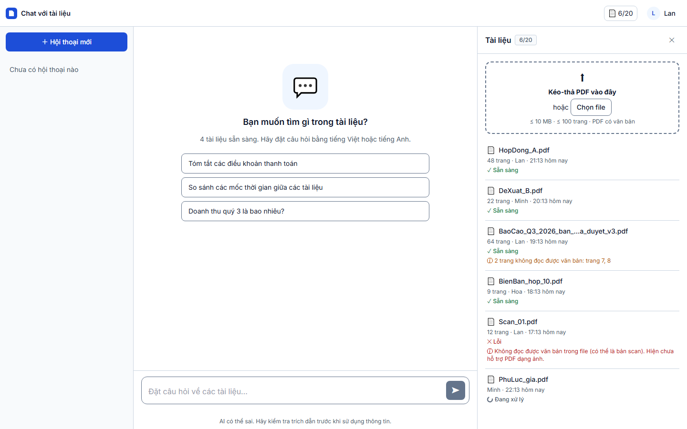
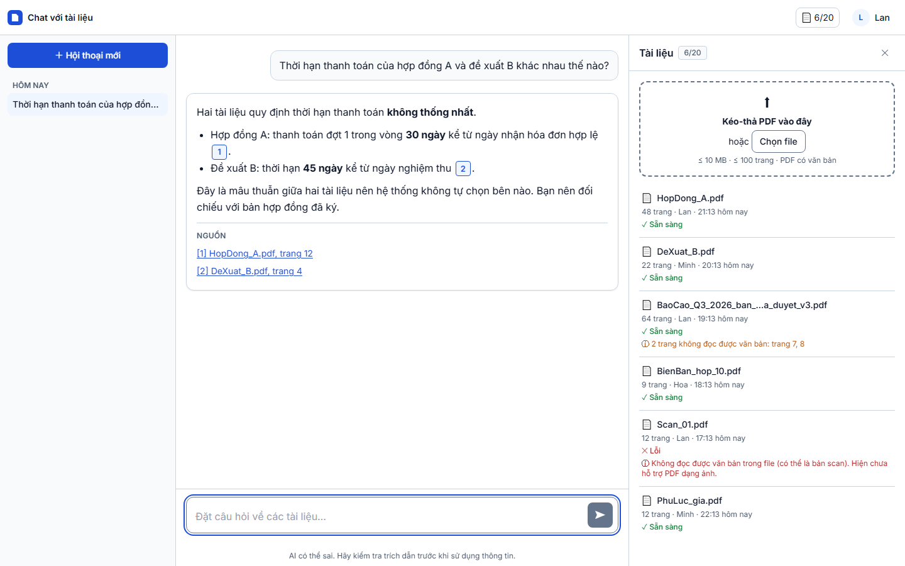
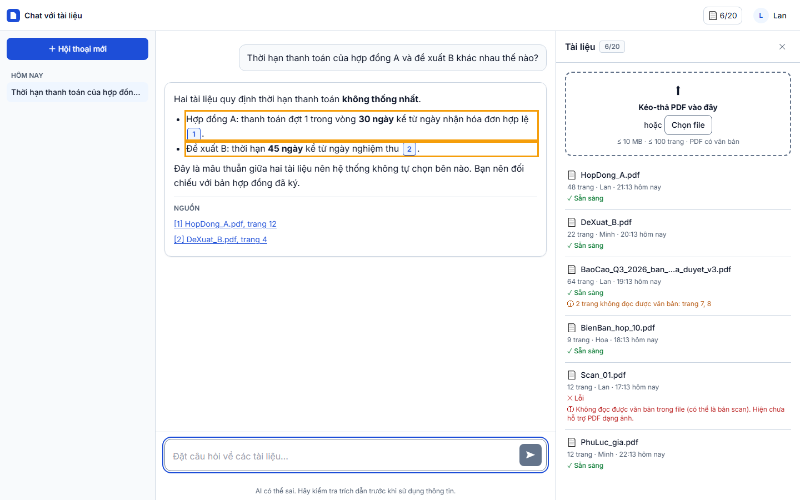
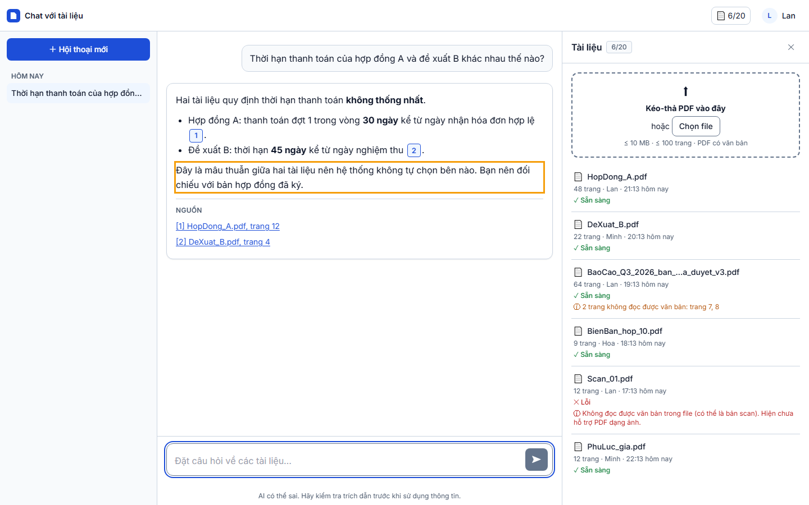

# Báo cáo kiểm thử — TC-CHAT-03: Hai tài liệu mâu thuẫn: nêu cả hai, không tự chọn bên

| | |
|---|---|
| **Test case** | [TC-CHAT-03](../../docs/test/test_cases/TC-CHAT-03.md) |
| **Kết luận** | ☑ **Đạt**  ☐ Không đạt  ☐ Bị chặn |
| **Ngày giờ chạy** | 2026-11-01 22:13 (UTC+7) |
| **Người chạy** | Claude Code (Playwright tự động) |
| **Commit** | `e508690` (kèm thay đổi chưa commit: `e2e/`) |
| **Chế độ chạy** | mock — `cd web; npm run dev:mock` (Playwright tự bật) |
| **Trình duyệt / công cụ** | Chromium 156.0.8078.4 (Playwright 1.64.1), viewport 1440×900 |
| **URL** | http://localhost:5173/?mock=answered |
| **Tài khoản** | `lan@congty.vn` (mock) |
| **Spec** | [e2e/tests/chat/TC-CHAT-03.spec.ts](../../e2e/tests/chat/TC-CHAT-03.spec.ts) |
| **Video** | [TC-CHAT-03.webm](video/TC-CHAT-03.webm) |

## Kết quả từng bước

### Bước 1 — Đăng nhập bằng `lan@congty.vn` / `Matkhau-2026`
- **Mong đợi:** Workspace hiển thị
- **Thực tế:** vào `http://localhost:5173/c?mock=answered`; ô nhập câu hỏi mở khóa, bảng Tài liệu 6/20
- **Trạng thái:** ☑ Đạt
- 

### Bước 2 — Gõ "Thời hạn thanh toán của hợp đồng A và đề xuất B khác nhau thế nào?" rồi bấm Gửi
- **Mong đợi:** Câu trả lời hiển thị
- **Thực tế:** câu trả lời hiển thị dần và kết thúc ở trạng thái `answered`; mở đầu "Hai tài liệu quy định thời hạn thanh toán **không thống nhất**."
- **Trạng thái:** ☑ Đạt
- 

### Bước 3 — Đọc nội dung
- **Mong đợi:** Nêu "30 ngày" của Hợp đồng A kèm `[1]` và "45 ngày" của Đề xuất B kèm `[2]`
- **Thực tế:**
  - "Hợp đồng A: thanh toán đợt 1 trong vòng **30 ngày** kể từ ngày nhận hóa đơn hợp lệ `[1]`." Chip có nhãn trợ năng "Trích dẫn 1: HopDong_A.pdf, trang 12".
  - "Đề xuất B: thời hạn **45 ngày** kể từ ngày nghiệm thu `[2]`." Chip có nhãn "Trích dẫn 2: DeXuat_B.pdf, trang 4".
  - Dòng 30 ngày không có chip `[2]`, dòng 45 ngày không có chip `[1]`.
  - Mục NGUỒN có đúng 2 dòng: `[1] HopDong_A.pdf, trang 12` và `[2] DeXuat_B.pdf, trang 4`.
- **Trạng thái:** ☑ Đạt
- 

### Bước 4 — Tìm câu kết luận
- **Mong đợi:** Có câu nói rõ đây là mâu thuẫn giữa hai tài liệu; **không** tự chọn bên nào
- **Thực tế:**
  - Câu kết luận: "Đây là mâu thuẫn giữa hai tài liệu nên hệ thống không tự chọn bên nào. Bạn nên đối chiếu với bản hợp đồng đã ký."
  - Câu này khớp nguyên văn câu trả lời mẫu ở prototype SDD ([SCR-03](../../docs/design/html_design/SCR-03_workspace-chat.html)).
  - Spec cũng quét toàn bộ câu trả lời để tìm các câu khẳng định một bên là đúng (ví dụ "Hợp đồng A đúng", "nên áp dụng 30 ngày"): không tìm thấy câu nào.
- **Trạng thái:** ☑ Đạt
- 

## Lỗi phát hiện

Không có.

## Kết luận

**Đạt.** Đủ 4/4 bước. Hai giá trị đều có trích dẫn riêng, câu trả lời nêu rõ mâu thuẫn và không chọn bên nào.

**Giới hạn:** ở chế độ mock, nội dung câu trả lời là dữ liệu mẫu cố định (`web/src/mocks/data.ts`), nên lần chạy này chỉ kiểm cách giao diện hiển thị câu trả lời. Hành vi của LLM thật (AC-021.3) cần kiểm lại ở chế độ `ai` bằng cặp tài liệu mâu thuẫn trong corpus DEP-002 (mục 7 của test case).

## Bằng chứng đính kèm

- [x] Đủ 4 ảnh trong `screenshots/`. Viền cam là phần cần kiểm, do spec tô vào để dễ nhìn.
- [x] Video trong `video/TC-CHAT-03.webm`
- [x] `result.json`
- [x] `trace.zip`: không có, vì test không lỗi. Bản video gốc của Playwright ở `playwright-output/`.
- Lần chạy trước ở `attempt-1/`: kết quả cũng Đạt, nhưng ảnh tô viền nhầm cả danh sách nguồn và đoạn mở đầu. Đã sửa cách tô viền rồi chạy lại.
