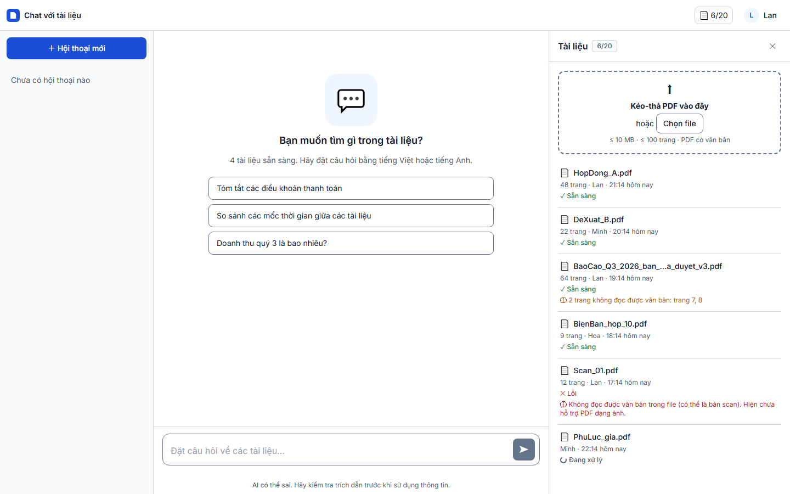
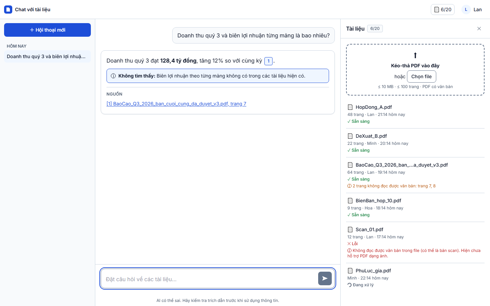
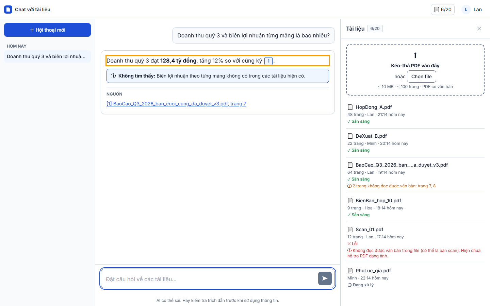
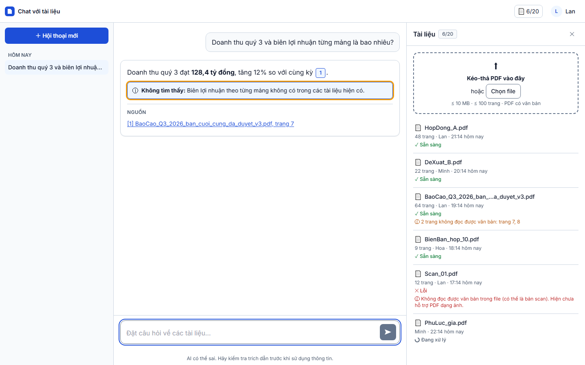
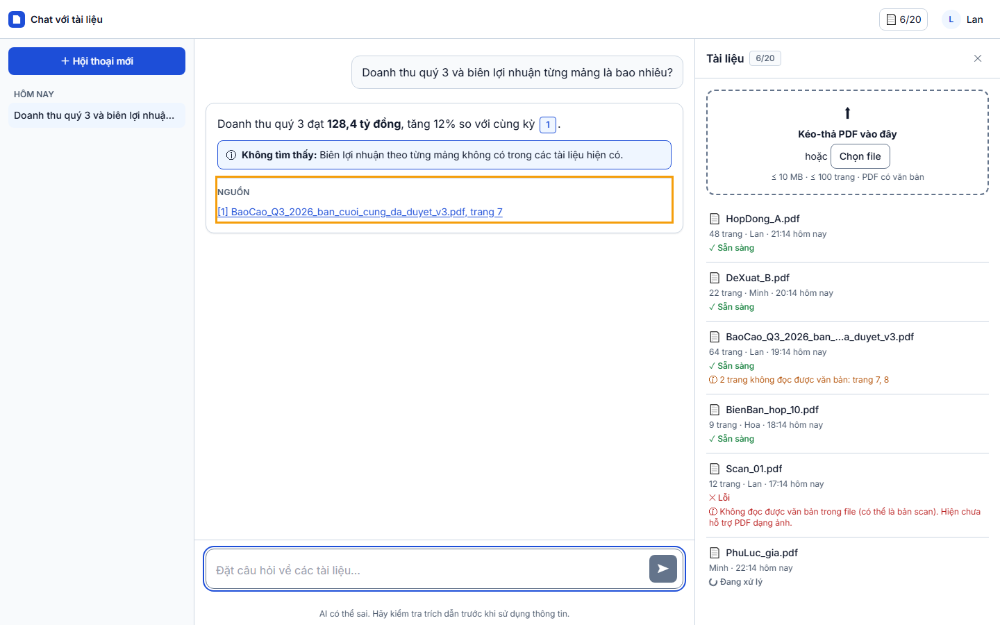

# Báo cáo kiểm thử — TC-CHAT-05: Trả lời một phần: nêu phần tìm thấy và phần không tìm thấy

| | |
|---|---|
| **Test case** | [TC-CHAT-05](../../docs/test/test_cases/TC-CHAT-05.md) |
| **Kết luận** | ☑ **Đạt**  ☐ Không đạt  ☐ Bị chặn |
| **Ngày giờ chạy** | 2026-11-01 22:14 (UTC+7) |
| **Người chạy** | Claude Code (Playwright tự động) |
| **Commit** | `e508690` (kèm thay đổi chưa commit: `e2e/`) |
| **Chế độ chạy** | mock — `cd web; npm run dev:mock` (Playwright tự bật) |
| **Trình duyệt / công cụ** | Chromium 156.0.8078.4 (Playwright 1.64.1), viewport 1440×900 |
| **URL** | http://localhost:5173/?mock=partial |
| **Tài khoản** | `lan@congty.vn` (mock) |
| **Spec** | [e2e/tests/chat/TC-CHAT-05.spec.ts](../../e2e/tests/chat/TC-CHAT-05.spec.ts) |
| **Video** | [TC-CHAT-05.webm](video/TC-CHAT-05.webm) |

## Kết quả từng bước

### Bước 1 — Đăng nhập bằng `lan@congty.vn` / `Matkhau-2026`
- **Mong đợi:** Workspace hiển thị
- **Thực tế:** vào `http://localhost:5173/c?mock=partial`; ô nhập mở khóa
- **Trạng thái:** ☑ Đạt
- 

### Bước 2 — Gõ "Doanh thu quý 3 và biên lợi nhuận từng mảng là bao nhiêu?" rồi gửi
- **Mong đợi:** Câu trả lời hiển thị
- **Thực tế:** câu trả lời hiển thị dần và kết thúc ở trạng thái `partial`
- **Trạng thái:** ☑ Đạt
- 

### Bước 3 — Đọc nội dung
- **Mong đợi:** Nêu "128,4 tỷ đồng, tăng 12% so với cùng kỳ" kèm `[1]`
- **Thực tế:** "Doanh thu quý 3 đạt **128,4 tỷ đồng**, tăng 12% so với cùng kỳ `[1]`." Chip `[1]` có nhãn "Trích dẫn 1: BaoCao_Q3_2026_ban_cuoi_cung_da_duyet_v3.pdf, trang 7".
- **Trạng thái:** ☑ Đạt
- 

### Bước 4 — Đọc phần còn lại
- **Mong đợi:** Nêu "Biên lợi nhuận theo từng mảng không có trong các tài liệu hiện có."
- **Thực tế:** khối thông tin hiển thị "**Không tìm thấy:** Biên lợi nhuận theo từng mảng không có trong các tài liệu hiện có." Spec so sánh nguyên chuỗi (`toBe`), không chỉ tìm từ khóa, và kết quả khớp.
- **Trạng thái:** ☑ Đạt
- 

### Bước 5 — Kiểm tra danh sách nguồn
- **Mong đợi:** Chỉ có nguồn của phần tìm thấy (`[1]`)
- **Thực tế:** mục NGUỒN có đúng 1 dòng là `[1] BaoCao_Q3_2026_ban_cuoi_cung_da_duyet_v3.pdf, trang 7`. Không có chip `[2]` trở lên.
- **Trạng thái:** ☑ Đạt
- 

## Lỗi phát hiện

Không có.

## Kết luận

**Đạt.** Đủ 5/5 bước. Câu trả lời có phần tìm thấy kèm trích dẫn, phần không tìm thấy hiển thị nguyên văn, và danh sách nguồn chỉ gồm nguồn của phần tìm thấy.

**Giới hạn:** ở chế độ mock, nội dung câu trả lời là dữ liệu mẫu, nên lần chạy này chỉ kiểm cách giao diện hiển thị câu trả lời `partial`. Việc LLM thật phân loại `partial` đúng hay không thuộc nhóm TC-AI-*.

## Bằng chứng đính kèm

- [x] Đủ 5 ảnh trong `screenshots/`. Viền cam là phần cần kiểm.
- [x] Video trong `video/TC-CHAT-05.webm`
- [x] `result.json`
- [x] `trace.zip`: không có, vì test không lỗi.
- Lần chạy trước ở `attempt-1/`: cũng Đạt. Chạy lại để toàn bộ 5 test case dùng cùng một phiên bản helper.
